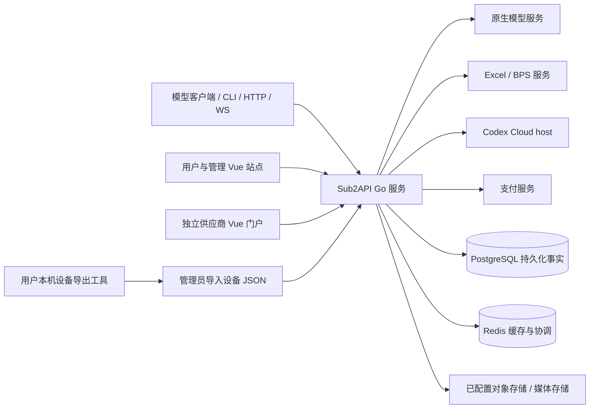
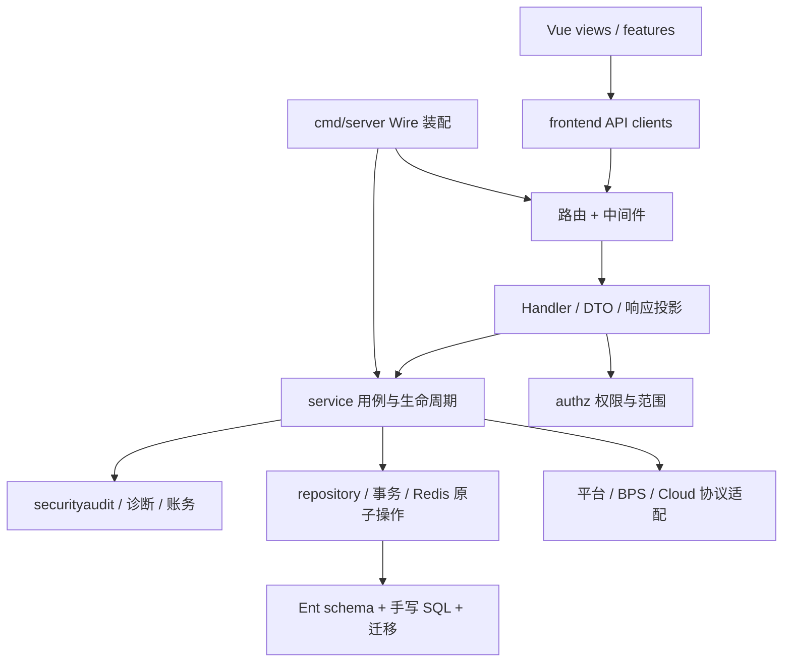
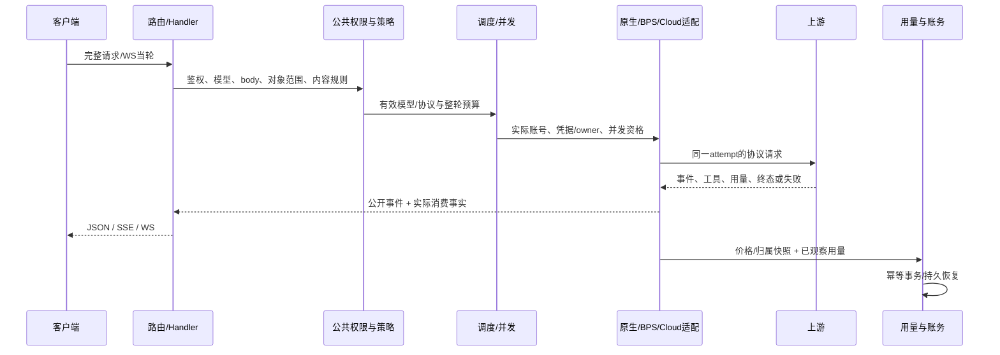
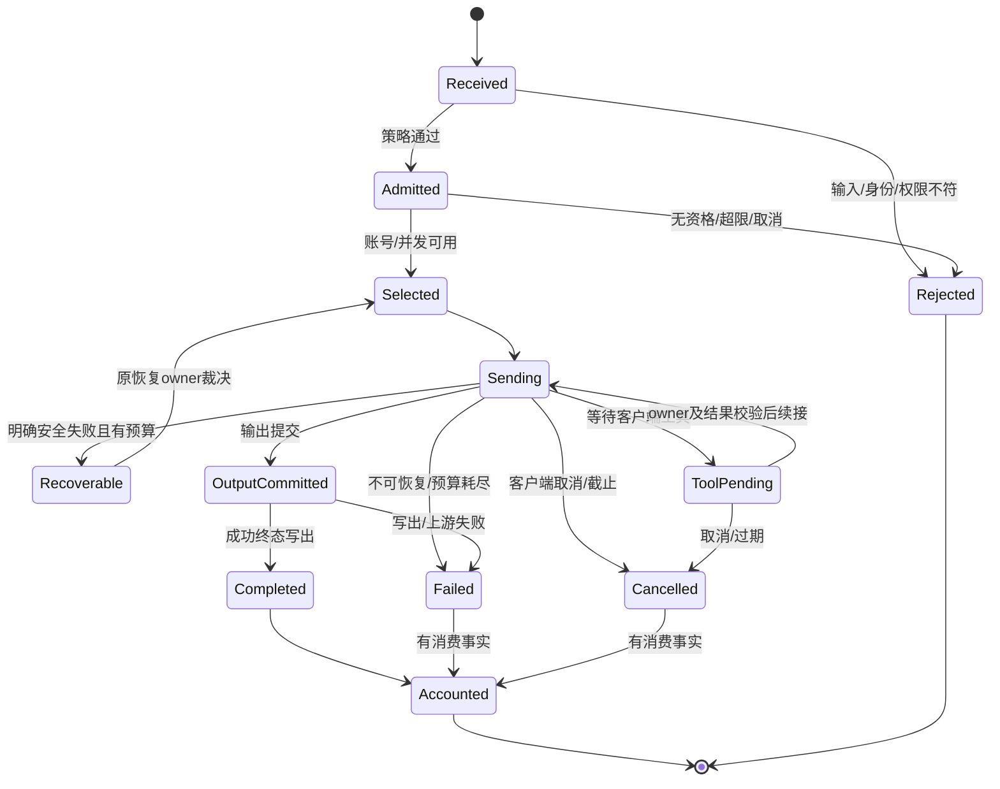
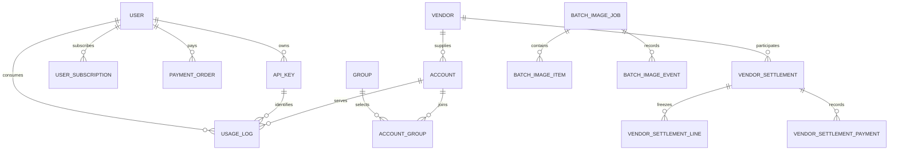

# Sub2API 定制工程：需求、架构、设计与实施基线

> 核查日期：2026-10-25（Asia/Shanghai）。适用：KDAN、TapModels、Tokensavy。本说明书是定制功能的统一工程入口：已开发功能按当前代码补齐需求和设计，后续开发先沿本文形成可评审的变更说明。它不是生产验收证明，也不自动授权新的功能开发。

## 阅读导航

1. [范围、证据与术语](#scope)
2. [需求与功能目录](#requirements)
3. [系统架构与代码结构](#architecture)
4. [核心技术设计与状态流程](#design)
5. [数据、接口与配置契约](#contracts)
6. [非功能需求与安全设计](#quality)
7. [验证与验收设计](#verification)
8. [部署、升级、运维与回滚](#operations)
9. [实施规划与待决策事项](#planning)
10. [删除、替代和兼容边界](#retired)
11. [来源、覆盖和文档维护](#traceability)

## 1. 范围、证据与术语

### 1.1 产品目标

为用户提供统一的模型访问、Key 管理、用量与支付能力；为运营者提供上游账号授权、模型与分组、调度、风控、诊断和账务能力；为一级/二级供应商提供独立资源运营与双边结算；在同一套 Go/Vue 实现中保留三个品牌的展示、渠道及部署差异。

工程目标是让每一项需求能够回答：为什么需要、谁使用、正常和失败时怎样表现、规则由哪个模块负责、数据如何流转、怎样证明正确、上线如何观察和回退。目录、接口名称或旧方案存在，均不能单独证明能力已经实现。

### 1.2 源码与范围基线

| 输入 | 最终核查的已提交版本 |
|---|---|
| 官方父基线 | `37067e8e340e9440d173a92b4faa05e8ce58368f`，Wei-Shaw/sub2api |
| main / KDAN | `ce58a16ee67305575a704cef304b9c2b1959cb75` |
| TapModels | `de4344b91b29fb864f215aaa9688361b59540730` |
| tokensavy | `39c2245c619ece67c2bdc622d62aea951c80d3cf` |

这些 SHA 标识文档核查输入，不冒充文档自身的最终提交。交付记录另外绑定最终树和远端 SHA。普通需求保持已经核对的官方基线；本次不附带上游同步、依赖升级或生产操作。其他工作树中尚未提交的实现不计入“当前已实现”。

**证据等级：** 源码核对、历史本地测试、历史真实客户端/上游探测、当前版本生产验收分别记录。本文的“现行”表示已找到实现和调用依据；本轮只执行文档、引用、清单及树等价检查。原历史测试报告不能被改写为本轮通过记录。

### 1.3 对需求样例的处理

用户提供的《Sub2API 账号身份与遥测统一管理需求》用于确定应有的需求文档深度与业务表达方式。其“自动随机初始化、双平台事件接收、归属、补发”与当前已明确修改过的产品范围存在差异；本文在 [R04](#req-identity) 中逐项说明。样例中的目标不直接覆盖已确认的退役决定，也不被写成已开发能力。

### 1.4 文档与工程分工

- 本文：需求、设计、架构、模块责任、非功能要求、验收和后续规划的统一基线。
- [累计 Release Note](CUSTOMIZATION_RELEASE_NOTES.md)：交付给使用者的累计变化与升级摘要。
- [交付规范](CHANGE_DELIVERY.md)：品牌归属、验证复用、单一定制提交、精确 lease 和本地收尾的现行规则。
- 操作手册、协议资源矩阵、Cloud 能力矩阵、法律文本和来源材料是有明确用途的附录；不再分别维护多版“最终需求”“初版方案”“后续实施方案”。
- 历史过程通过 Git、已有来源归档和本次恢复 bundle 追溯；已应用迁移、许可证、作者署名、来源冻结材料不因文档归并而删除。

### 1.5 核心术语与身份隔离

| 对象 | 业务含义 | 不能混同的对象 |
|---|---|---|
| 用户 | 登录主体、个人余额/订阅与模型 Key 的所有者 | 上游账号、供应商合同 |
| 管理员 | 由固定角色和实时策略限定的管理主体 | 拥有所有数据的无条件管理员 |
| 管理访问密钥 | 机器访问管理 API 的受限凭据 | 用户模型 API Key、超管 JWT 会话 |
| 上游账号 | 授权、配额、调度及出站身份的资源 | 下游用户或 Key |
| grant / 凭据 | 某账号的原生授权或独立 Excel 授权 | 可在任意账号间通用的 Token |
| 分组 | 平台、模型权限、价格/倍率和可选资源的业务边界 | 模型能力保证 |
| 请求 / turn | 一次客户端请求或 WS 业务轮次及其共享预算 | 网络连接、单次上游发送 |
| attempt | 某账号、模式、出口上的实际发送尝试 | 可独立重置截止时间的请求 |
| owner | 响应、线程、工具、附件的实际归属及版本约束 | 最后成功账号或最后一次路由 |
| 用量事实 | 上游已观察到的消耗与可信完成/中断事实 | 客户端看到的文字、成功 HTTP 状态 |
| 结算根 | 一轮多段执行共用的去重与账务身份 | 每个 HTTP/SSE 片段各扣一次款 |
| 遥测事件 | 账号活动投递数据；当前部分指标是合成值 | 客户请求成功、真实硬件测量或账务证据 |

## 2. 需求与功能目录

### 2.1 分类规则

下面的“新增、修改、调整、删除”描述相对官方基线及本地已替代实现的语义，不代表本轮修改了业务代码。逐文件 A/M/D、行数、blob/mode 与需求归属在 [功能文件清单](customization/engineering-files.tsv) 中保留；文件层新增不等于新业务需求，删除生成文件不等于业务能力退役。

| ID | 需求域 | 定制变化 | 当前状态 / 责任边界 |
|---|---|---|---|
| R01 | 用户、角色、会话及授权 | 新增/修改 | 固定角色、策略及创建人范围生效 |
| R02 | 模型 Key 与管理访问密钥 | 修改/新增 | 两类凭据分离，导入导出及并发受控 |
| R03 | 上游账号、授权和备份 | 修改/新增 | 原生授权、独立 Excel、供应商与导出归属 |
| R04 | 账号身份、设备与遥测 | 新增/调整/删除 | 当前 Claude 导入式遥测；无双平台通用采集/补发 |
| R05 | 模型目录、权限与复合路由 | 修改/调整 | 目录发现、白名单、路由与定价分工 |
| R06 | 统一调度、并发与配额 | 修改/调整/删除 | 统一资格和业务层，旧算法选择退出 |
| R07 | 原生多协议网关 | 修改 | HTTP/SSE/WS 与平台语义保留 |
| R08 | 恢复、连续性与终态 | 修改/调整 | 整轮预算、owner、防重放及真实用量 |
| R09 | Excel/BPS | 新增/调整 | 独立授权、工具图片、桥接与安全原生回退 |
| R10 | Codex Cloud | 新增/重构 | 复用原生授权、owner actor、单次解析与账务 |
| R11 | 图片、视频与语音 | 修改/新增 | 同步、异步、批量及媒体归属与计费 |
| R12 | 计费、支付、资金转账 | 修改/调整/删除 | 事务、幂等、冻结与历史账务保护 |
| R13 | 两级供应商平台 | 新增/调整 | 两级资源范围、双边合同、独立结算 |
| R14 | 提示词、安全审计与风控 | 修改/新增 | 内容范围、同步/异步裁决和隐私边界 |
| R15 | 诊断、健康与 SLA | 修改/调整/删除 | 原生计费探测；不恢复自动质量运营 |
| R16 | 用量、统计、导出与观测 | 修改/新增 | 权限投影、原始时间指标、真实计费状态 |
| R17 | 客户端、站点、多语与品牌 | 修改/新增 | 四语言、配置下载、三品牌差异 |
| R18 | 插件扩展 | 保留/修改 | 原有插件 API、包格式与安全边界 |
| R19 | 数据、配置与基础设施 | 修改/新增 | PostgreSQL、Redis、迁移、装配与缓存 |
| R20 | 构建、交付、发布与来源 | 修改/调整 | 同基线单提交、人工发布、来源可追溯 |

### R01 用户、角色、会话与授权

**目标与使用者。** 超管可授权运营工作，普通管理员只能在被授予的模块、动作、字段和用户范围内操作；普通用户及供应商不会因共用接口而获得管理权限。

**当前需求。**

1. 运营角色为 `super_admin/admin/user`；供应商使用独立的 `vendor_level1/vendor_level2`。策略目录由后端 `authz` 统一维护，界面展示不构成授权。
2. 普通管理员只创建及管理自己创建的普通用户。`users.created_by` 是持久归属；缺少可信历史归属由超管管理，不能猜测、由客户端覆盖或靠审计保留期限决定。
3. 策略变更校验依赖关系和版本，保存、审计及敏感操作检查保持一致；非委派能力只由超管会话执行。普通管理员不能越权读取受保护超管对象。
4. 会话撤销、refresh family、MFA、Passkey、一次性 pending OAuth、最后超管保护由后端实施。某个策略编辑不要求 TOTP，不等于取消全站敏感操作的二次验证。

**过程与失败。** 认证主体 → 取得最新角色/策略 → 校验对象范围 → 字段投影或事务内重新校验 → 执行与审计。范围不符拒绝；策略版本冲突要求重新读取；流式或批量操作不能只检查第一条。

**代码与验收。** [策略目录](../backend/internal/authz/policy.go)、[用户范围](../backend/internal/authz/user_scope.go)、[策略服务](../backend/internal/service/admin_role_policy.go)、[路由](../backend/internal/server/routes/admin.go)。验收覆盖五类角色、未知归属、跨管理员访问、策略撤销、批量/导出和最后超管；单纯隐藏菜单不能通过验收。

### R02 模型 Key 与受限管理访问密钥

**目标。** 模型访问凭据可安全迁移与运营，自动化管理权限可精确限制。

- 模型 Key 归用户，执行状态、期限、IP、模型/分组、额度、窗口和并发限制；不能因为余额豁免而跳过 Key 或平台额度。
- 超管可协作管理其他超管的个人 Key，但后端实时确认所属角色。跨超管换组仍核对 Key 所属用户资格；删除用户只删除该用户 Key。
- `sub2api-keys` v1 导入导出最多 1000 条，按目标用户允许的平台及组名匹配；保留受支持状态与用量，不迁移源用户/数据库 ID，不覆盖他人 Key。
- 官方受限管理员密钥适配本地角色：超管 JWT 创建、轮换、撤销或删除；存储哈希，完整密钥只在创建/轮换时展示。资源规则内同时匹配动作、分组、平台和账号类型，支持期限/IP。
- 机器密钥不能自管或替代超管会话；旧全权管理 Key 不再新建，保留有明确调用依据的轮换/删除路径。

**设计。** 用户 Key 服务与管理密钥服务独立；路由、服务及事务内权限共同防止检查后越权。等待队列复用已有并发机制，取消和超时释放占用。

**证据/验收。** [模型 Key](../backend/internal/service/api_key_service.go)、[管理 Key](../backend/internal/service/custom_admin_keys.go)、[事务校验](../backend/internal/repository/custom_admin_key_transaction.go)、[操作手册](admin-api-keys.md)。验收检查导入冲突、越权导出、撤销即时生效、IP/到期、并发退出及只展示一次的秘密。

### R03 上游账号、授权、资料与备份

**目标。** 同一账号的身份、授权、调度和供给归属可追踪；导入备份不会混用凭据或偷换资源。

- Claude 支持完整 OAuth、浏览器 OAuth token 和手工 Setup Token。长期 Setup Token 不要求不存在的 profile 权限，不伪造期限、邮箱或套餐。
- 已验证邮箱/套餐来自授权主体；授权兑换身份不一致应拒绝。账号新建空名称可用可信邮箱前缀，已有名称及重新授权不被自动改写。
- 原生凭据与 Excel grant 独立加密和刷新；Cloud 当前复用原生 Codex 授权。凭据代际、CAS、错误分类与调度资格由已有服务维护。
- 完整账号备份 `sub2api-data` v2 在同一快照保留账号、原生/BPS 授权、协议和调度状态，目标站重新加密、事务恢复。代理按文件引用，分组按平台与完整名称匹配；缺组/重名拒绝，未知版本拒绝。
- 账号备份不包含完整数据库账本、临时运行状态或任意历史审计。归档资源仍保留历史用量与结算，不能通过导入、刷新或授权绕过只读限制。

**设计/代码。** [账号服务](../backend/internal/service/admin_account.go)、[凭据保存](../backend/internal/service/account_credentials_persistence.go)、[供应商凭据](../backend/internal/service/vendor_account_credentials.go)、[账号实体](../backend/ent/schema/account.go)。

**验收。** 授权取消与失败、凭据轮换竞态、Setup Token 无 profile、新旧备份、代理与组匹配、供应商归属、归档资源写入均需覆盖；登录成功不代表模型/工具协议验收成功。

### R04 账号身份、真实设备资料与遥测

**业务目标。** 推理和账号活动使用有归属的身份事实，设备来源、账号身份、会话和投递结果互相区分。

**最终范围。** 当前仅 Anthropic OAuth/Setup Token 账号进入导入式遥测；普通 API Key 和 Codex 不进入这套事件生成/发送链。Codex 本身的出站身份仍由原生机制处理。新账号状态为 `waiting_import`，不是自动生成随机身份后 ready。

**功能需求。**

1. 超管导入 version 2 真实设备包，入口 `POST /api/v1/admin/accounts/:id/telemetry/import`，最大 1 MiB；严格拒绝未知字段、凭据、账号、会话和任意事件。
2. 设备包由独立 Go 工具在 Windows/Linux/macOS 本机读取官方安装资料。工具可按其手册安装/初始化官方 CLI；这些行为发生在用户运行工具的设备，不发生在网关服务器。
3. `accounts.extra.account_telemetry` 仅保留设备包、owner、稳定 session、revision 和导入时间。身份变更保留设备并重新绑定；凭据快照和 revision CAS 阻止旧任务覆盖新导入。
4. 推理指纹读取有效导入设备事实；无设备包时沿用原生网关指纹，不伪造遥测。设备包可以被不同账号复用，账号和会话绑定独立。
5. 发送总闸默认关闭。开启后启动、导入、重新绑定及实际 dispatch 激活十分钟窗口；初始化和首批事件后按 60–86400 秒的配置发送，默认 600 秒；GrowthBook 首次及六小时周期单独计时。
6. 发送时使用所属账号当下有效 access token、代理及 TLS；复核资格、owner 和 revision。不换号、不因发送失败处罚账号，也不形成客户计费。
7. 无活动停止；关闭保留资料和时钟；重新开启不补停用期间积压。硬件事实仍校验/存储但不发送 CPU/内存/磁盘/MAC/DMI 字段。process 是既有规则生成的合成指标，周期 success 不是客户请求成功证明。
8. 旧客户端遥测采集、OTLP、样本库、服务器 bootstrap、手动生成及旧 profile 回退已退出运行。兼容空响应入口不等于接收、归属、存储或成功投递。

**状态与失败。** waiting_import → 校验/导入 → ready → 绑定变更后的新 revision。发送活动由 Redis leader、账号锁和时钟约束；init 4xx 结束本轮，既有冷却后可重新激活；普通发送失败进入后续周期，不提供通用持久化事件补发队列。

| 样例目标 | 当前证据与结论 | 后续处理 |
|---|---|---|
| 自动随机生成三平台账号环境 | 当前明确采用真实设备导入；服务器生成已退役 | 不作为待修复缺陷恢复 |
| Claude/Codex 全覆盖 | 账号遥测生成/发送仅 Claude；Codex 原生请求身份单独存在 | 扩平台需独立需求和协议证据 |
| 客户端事件接收、归属及补发 | 原采集和补发式目标不在当前实现中 | 若重新提出，应先设计事件合同、隐私、幂等和留存 |
| 稳定身份、账号隔离 | 导入设备 + owner/revision/session + 发送前复核 | 保留并验收 |
| 历史档案版本可查询 | 当前 revision 为并发绑定标识，不等于完整档案审计/事件溯源库 | 不宣传拥有完整历史查询 |

**代码/验收。** [账号状态](../backend/internal/service/account_telemetry.go)、[导入](../backend/internal/service/account_telemetry_import.go)、[生成](../backend/internal/service/account_telemetry_generator.go)、[worker](../backend/internal/service/account_telemetry_worker.go)、[设备工具](../backend/cmd/telemetry-export/)、[设备导出手册](ACCOUNT_TELEMETRY_DEVICE_EXPORT.md)。覆盖三平台包校验、多账号、换身份、revision 竞争、开关/时钟、无包不发送及退役路径。真实上游接收和风控效果需独立证据。

### R05 模型目录、权限、价格与复合路由

**目标。** 用户能够发现适用模型，但只能调用实际获准且存在可调度资源的模型。

- 分组白名单在鉴权后、复合路由改写前针对客户端模型名校验；账号限制、模型映射、平台能力继续在实际选择时检查。目录出现不表示所有账号均可调用。
- 官方 Codex 远程目录字段和顺序保持；BPS/Cloud 只投影已知的实际能力。experimental_supported_tools 按 Key 可用账号及路由/映射取交集，未知/撤回/凭据作用域不符时不沿用声明；Cloud 的保守目录与局部已验证映射可能不同，详见 R10，不能从目录反向推断所有请求形态均被拒绝。
- 复合分组以已登记路由决定模型到目标平台；媒体查询缺少模型时仍由对应处理器执行任务归属检查。不存在的跨平台能力应明确拒绝。
- 模型广场展示分组目录与报价，价格、成本、倍率和最终计费用途分开；发现失败状态不能伪造成空成功或永久能力结论。
- 删除独立目录治理和重复名单；冻结账号目录等历史方案以当前配置/调用链为准，不另保留一套过期“模型定价统一”设计。

**代码/验收。** [白名单中间件](../backend/internal/server/middleware/group_model_allowlist.go)、[复合路由](../backend/internal/service/composite_route_resolver.go)、[模型广场](../backend/internal/service/model_plaza_service.go)、[分组目录](../backend/internal/service/group_codex_models_manifest.go)。验收同一模型的展示/调用权限、映射前后名称、Cloud/BPS 能力覆盖、ETag、价格来源与目录失效。

### R06 调度、配额、并发与有限恢复

**目标。** 在可用且有权限的账号中按业务偏好、容量和健康选择，保留已建立会话的归属，不用算法设置掩盖容量或授权错误。

- 统一候选资格：账号/供应商状态、归档、组/模型权限、协议授权、窗口配额、并发及故障范围共同决定能否发送。实际发送前重验，缓存命中不免检。
- 优先级、订阅偏好、成本层与健康层是不同业务维度。OpenAI 同业务层内成本按已知价格划带；未知成本不冒充零价。相关健康样本按模型/模式与 cohort 隔离，缺少证据保持中性。
- 有限并发按实际限制和 LoadFactor 估计；无限账号仅在同层借用有限容量估计，不能按无穷大吞噬调度。配额保护和 Fable 窗口独立保留。
- 亲和不是权限：粘性命中仍需资格和容量；明确 pin 是请求内硬约束。模型故障、代理故障、账号授权故障、Key 限制、客户端错误和实例压力分别归因。
- 跨实例半开使用 Redis epoch/fenced lease；拿不到共享保护不私自扩大探测。失去 lease 需停止相关发送/WS。
- 单轮共用截止时间、发送尝试和模式排除；刷新凭据、附件准备、换号及原生回退不能各自启动无限预算。
- 旧算法选择、手工权重调参和专用 YAML 已退役；保留业务控制和现有恢复参数，不恢复第二套调度器。

**代码/验收。** [调度器](../backend/internal/service/openai_account_scheduler.go)、[业务层](../backend/internal/service/scheduler_business_layers.go)、[配额保护](../backend/internal/service/scheduler_quota_guard.go)、[恢复探测](../backend/internal/service/scheduler_recovery.go)、[整轮恢复](../backend/internal/service/gateway_turn_recovery.go)。覆盖候选失效、层级排序、大池批次、无限容量、亲和失效、lease 丢失、429/503 和总预算耗尽；本地回放不等于生产容量标定。

### R07 原生 HTTP、SSE、WebSocket 与平台协议

**目标。** 复用现有网关入口和平台语义，将公共安全/账务规则共享到不同传输，而不把不同上游协议机械合并。

- OpenAI Responses/Chat、Anthropic Messages、Gemini 和其他现有平台按路由及账号实际能力处理；HTTP JSON、SSE 与客户端 WS 是输出/传输形式，不等于相同上游连接方式。
- 客户端 WS 开关只证明入口允许 WS。必须分别识别原生 upstream WS、HTTP/SSE bridge、Excel/BPS 和 Cloud RPC，不能把桥接指标解释为原生 WS 性能。
- 入站读取、BOM、JSON 唯一键、解压与资源上限保持明确失败；请求体超限 413、空闲读取超时 408、客户端放弃 499、格式错误 400 分别归类。
- SSE CR/LF/CRLF、多行 data、EOF、完整帧尾和取消由共用解析/终态机制处理。流已经返回 200 后，语义失败仍需记录失败状态及已观察用量。
- 参数转换按模型、平台、账号类型与协议执行；不把 OAuth 的删字段规则套到所有 API Key 透传。thinking、搜索历史、图片和工具控制字段按已支持合同处理。

**新增现行合同。** 原生字段优先于兼容别名；可选严格兼容检查已知有损转换；WS 支持同流 FIFO 与跨流并行，具体错误、取消、资源和同连接跨流续链见 [完整契约](#responses-compat)。

**代码/验收。** [注册入口](../backend/internal/server/routes/gateway.go)、[通用转发](../backend/internal/service/gateway_forward.go)、[OpenAI 转发](../backend/internal/service/openai_gateway_forward.go)、[SSE 包](../backend/internal/pkg/sse/)。验收完整客户端序列化报文、分片、非流式、取消、读/写/Flush 失败、压缩边界和不支持形态。

### R08 会话连续性、终态与有界重放

**目标。** 失败可恢复时继续业务，不重复执行已提交内容、工具或账务；不可恢复时保留明确错误及真实消费。

1. 网络连接、上游 thread、公开 response、工具 call、附件及用户会话分别建模。响应和工具引用需要 owner 匹配，不能只用字符串 ID 找记录。
2. 无已提交输出、无已观察用量、无未知工具副作用且预算允许时，才按错误类型进入现有恢复路径。断连/取消不自动变成换号依据。
3. 跨账号/协议的推理密文没有通用解密能力。明确推理前拒绝后，现有两级恢复分别去掉不可读 reasoning/回放密文及处理不可读 compaction；同号、有界，不重新推理已执行段。
4. 本网关 Cloud compaction 信封可展开为可读摘要；这不同于解密上游私有密文。完整可读历史可新建会话，未配对工具结果不能凭空修复。
5. 成功终态真正写出并 Flush 后，与其同时到来的取消不能反向改写成功；实际 Write/Flush 错误保留。流内失败和失败前用量不能因返回 error 而丢账。
6. 上下文超限在适用流式 Responses 路径中使用 `response.failed/context_length_exceeded`，HTTP 状态可能为 200，Ops 仍记录真实上游/语义错误。
7. 已知原生 response owner 是续接约束，不是普通粘性偏好；账号不可用时保留归属到既有 TTL，返回 `previous_response_not_found`，不携带旧锚点换号，也不将续接拒绝包装为依赖故障而消耗准备重试预算。连接本地响应还须核对真实上游 response ID 与连接写入代际；持久化响应不受最新连接锚点限制，不能用本轮 store 字段改写上一响应的作用域。
8. 原续接连接失效且没有可验证的完整历史时，WS 返回 `400 / error / previous_response_not_found / param=previous_response_id`，允许客户端在同连接补发完整历史；HTTP 保留结构化错误。网关自身将全量 HTTP 请求优化为增量后，仅在明确 missing-parent、未交付语义输出、无消费且预算允许时，用保存的完整请求同账号新连接恢复一次；一般断线、未知执行、部分用量与工具副作用保护不放宽。

Codex HTTP 出站压缩在每次发送前使用独立单 goroutine zstd 编码器同步完成，不另设全局压缩槽位；复用既有请求调度，保留压缩前后取消检查、语义正文和 wire 重放。level 3 使用 Go 编码库的相近级别映射，不声明与 Rust/libzstd 字节或性能相同。

**代码/验收。** [密文恢复](../backend/internal/service/openai_encrypted_history_recovery.go)、[终态失败](../backend/internal/service/openai_stream_terminal_failure.go)、[整轮恢复](../backend/internal/service/gateway_turn_recovery.go)。至少覆盖首轮/第二轮、工具回传、跨传输、完成/取消竞态、过期 previous ID、归属冲突、输出后失败和一次结算。

### R09 Excel/BPS 授权、工具、图片与桥接

**目标。** 在既有网关、权限、调度和账务内提供批准的 Excel/BPS 路径，保持与原生授权独立。

- 独立 Excel grant 加密、刷新、版本 CAS 和账号归属；原生 OAuth 不被覆盖。新安装全局 BPS 与图片默认启用、图片默认 native；已保存值优先。
- 支持 HTTP/SSE、适用 compact/Chat/Messages 兼容和客户端 Responses WS 桥接；功能函数、custom、namespace、dynamic 目录及成对历史保持调用身份。
- BPS wire 仍只支持 tool_choice auto/none。请求本身完整声明纯客户端工具、required/具名 function/custom/allowed_tools 选择可验证且原生 normalizer 不会改写时，在 BPS 上传/生成前复用同账号 native 授权，保留原选择与工具参数；不改为 auto、不修改持久 BPS 开关。托管/混合目录、BPS 专有继承/动态目录、缺失或畸形声明、会被原生降级的 namespace 选择、Excel-only/probe/取消/无 native 权限仍拒绝并标明 param=tool_choice；原生能力由原生上游验证。
- BPS 已完成响应在终态发送前预存短期快照、成功交付后提交；HTTP JSON/SSE 与客户端 WS 重连/跨实例可按精确 response ID 恢复完整 input、已确认 output 及省略的 tools，再清除锚点。同 Key、用户、分组、选中账号及稳定凭据身份必须吻合；显式新 tools（包括空数组）覆盖旧目录，不继承旧 instructions。历史压缩使用真实 compact window + 未压缩尾部 + 本轮输出，不重复旧输入。恢复正文继续经过现有大小、图片、工具、密文和调度重放检查，并传给同账号原生回退/账号切换；不重复生成前一轮或执行历史工具。
- 复用 `gateway.excel_bps_state_redis_enabled`（默认 true；省略配置即开启，显式 false 保留）与现有 Redis BPS StateStore：正文最多保留两小时，固定创建时间不随读取续期，单条解压后最多 64 MiB 且受 WS 请求限制约束，存储单条 16.5 MiB/共享总量 32 MiB、1024 条 LRU；大于 4 KiB 的快照按收益压缩。仅小 pending 标记参与最多一秒的提交等待；失败/取消/未完成及终态写失败不能成为新锚点。缓存故障返回可重试 503；快照缺失、过期、淘汰或归属不符继续 `400 / previous_response_not_found / param=previous_response_id`，客户端需补发完整历史，旧部署从未保存的响应无法追溯恢复。`conversation/prompt` 仍不推测展开。WS 本地缺失续接错误不再记为 provider/upstream_http；真实上游同码仍保留上游归因。
- 工具参数封装、目录继承、发现结果、成对 call/output、结构化答案与最多两轮纠错共用现有适配层。 已验证完整原始 call→result 的历史可用于已完成操作去重，不因旧工具退出当前目录或新 schema 收紧而失效；output-first、仅缓存结果、重复/未完成或不可验证历史不新增证明。当前新输出仍须通过当前目录及 schema，未知工具纠正只替换一个未下发调用，停止条件通过同源固定原因记录。未知工具和副作用不凭模型猜测补执行。 CMD 资格拒绝记录固定原因、脱敏目标及目录指纹；仅精确已知 cmd:string 函数且原完整参数可验证时，允许原两轮额度内改为同目标普通 FUNCTION，命令字节和其余参数不变，未知目标不转入新重生成。
- 图片按账号、Key、会话、凭据代际/工作区隔离，阶段超时与首输出预算分开；可复用的是附件 ID，不是跨账号图片权限。
- 生成前的明确附件归属错误只允许在完整受管原图及安全事实满足时同号重传一次；未知归属、已有输出/用量或压缩后副作用不盲重发。 普通内联工具截图与 reasoning 密文计数不单独阻断该重试，两者原样保留；至少有一个可重传受管文件，远程/非受管文件、不透明 compaction 与未知执行保护仍生效。
- 403/cyber/模型拒绝/429/暂时性 5xx 分别处理。BPS 模型冷却不污染原生配额；本地客户端 4xx 不作为账号健康失败。上游授权终态拒绝对外按现有服务错误映射，不将上游 Token 错误冒充下游 Key 鉴权失败。
- 可安全恢复时先其他 BPS 机会，再保留同号原生机会；原生失败不反跳 BPS。所有阶段共享实际预算与用量；上下文超限按 R08 输出。

**来源与范围。** 只保留明确批准的 BPS 核心、Excel、工具图片及恢复；自动登录 Worker、Mihomo、票据/Cookie 和自动质量运营仍退役。

**代码/验收。** [BPS 适配包](../backend/internal/service/basispoints/)、[网关恢复](../backend/internal/service/openai_excel_bps_recovery.go)、[目录投影](../backend/internal/service/openai_excel_bps_models_manifest.go)、[资源矩阵](GATEWAY_PROTOCOL_LIMITS.md)。覆盖授权轮换、双路径、两轮纠错、附件复用/失效、429/403/5xx、流内失败、WS 取消与原生回退的单次计费。

### R10 Codex Cloud 与统一解析器

**目标。** 在账号级选择 Cloud，复用原生 Codex 授权和公共权限/账务，通过现有 Cloud RPC 承载可表达的 Responses 语义。

**产品范围。** Cloud 默认关闭，开启后账号级优先于 BPS；保留原生/BPS 配置和凭据。已删除独立 Cloud 授权前置、能力验证准入、模型验证名单和人工未决消费阻断；手工测试不作为启用条件。

**解析与架构。**

1. 保存公共入口改写前输入；公共策略处理后，每进程语义解码一次，以现有 `cloudProtocolRequest` 承载有效执行计划。路由、账务和 owner 使用只读投影。
2. L0 校验 JSON/唯一键及资源，数字用 UseNumber；L1 进行可共享的内容和 legacy 规范化；L2 私有能力矩阵裁决字段；L3 映射 thread/start、thread/inject_items、turn/start 和工具 RPC；actor 负责执行与生命周期。
3. 非执行提示按矩阵忽略并留痕；已知工具、输出和密文字段不能错放后当普通提示丢弃。跨实例传原始有效 JSON 字节和 owner，接收实例独立解码及校验，不接受序列化的“可信计划”。
4. 工具续接继承执行设置；新用户轮省略字段仍可能继承线程值，outputSchema 按轮处理。这是明确的状态语义差异，不宣传完全等同无状态 Responses。
5. 自定义 grammar 是描述提示，上游不强制语法；client tool_search 可在已验证条件下映射，server 执行模式仍不支持。目录保持 `supports_search_tool=false` 的保守声明，不再使用旧设计中“一律拒绝 tool_search”的结论。
6. 移除独立工具总数 256 和历史条目 8192 限制；RPC、结果、保留内存、队列及同时待回复调用上限继续有效。传输事件使用 128 MiB 总预算的 FIFO，包含每条节点开销；不再用 256 条 channel 限制长历史注入的回显。RPC 应答与事件消费解耦，全部事件仍由 actor 按 thread/turn 归属判断，不丢弃应答前的本轮事件或按 auto-compact 标记猜测过滤。
7. 失败的非平凡适配决策随 Ops `kind=cloud_adaptation` 导出；成功写有界 WARN，最多 64 条/16 KiB，并注明省略数。只含路径、动作及矩阵 ID，不记录正文、密文、参数或凭据。 返回 response.failed 且 Go error 为 nil 也按失败记录；安全失败阶段/枚举通过 cloud_failure 诊断事件保留，排除健康尝试归因，导出支持真实 SSE 错误帧及已知 Codex 错误 variant，不混合不同终态的事实。

**调度与会话数量。** Cloud 请求复用原生用户/账号并发、排队、分组与映射前模型权限，不按本地 actor、Redis live、用户/账号会话、待结算或账务预留数量再次准入。删除旧容量拒绝及完成会话压力回收路径；完成会话按既有 TTL 正常归档，等待工具的 owner 不因数量被淘汰。维护任务分批读取不限制待处理记录总数；账务事实仍等幂等 ACK 或既有持久归档，不因积压丢弃。新记录不再创建旧用户/账号容量索引，旧记录正常终态仍清理自身 membership，升级不执行生产清空或迁移。

**原生恢复与时间预算。** 用户/账号并发、排队、余额在途预留、账单资格、模型白名单及映射仍走共享 handler/scheduler。Cloud 不附加同账号重试次数；明确的上游暂态 429 复用原生 OAuth 重试窗口、截止时间和退避，真实额度拒绝不伪造暂态依据。绑定工具 owner、已输出或执行不明仍禁止普通换号重放。拨号、RPC读写、活动响应停滞和工具等待读取原生 WS 配置；首输出及整轮目标预算共用原生实现。授权、wham/usage、拨号和 initialize 受当前请求取消/期限约束，持久 RPC 生命周期单独由 actor 持有；初始化请求结束不能关闭已交出工具的连接。

**父子会话。** 完整历史中的调用/结果对若来自另一个已标识的客户端会话，作为 fork 历史创建新 Cloud 会话，不回传父会话仍等待的工具 RPC。仅复用原生稳定会话头生成可选哈希；不使用 prompt_cache_key/client_metadata 作为身份。显式 previous_response_id 继续按原归属校验续接；未配对的跨会话增量结果拒绝。缺少哈希的旧记录保持原行为，不清空授权、开关或会话；哈希随现有 Redis 记录/命令传递，无 SQL 迁移。

**密文恢复。** 精确识别自动压缩的 `Error running remote compact task: ` 单层错误上下文后读取结构化提供方错误；不搜索任意正文或递归解析嵌套提示。contextCompaction 只有 completed 才标记成功，started 后明确被密文校验拒绝不等于发生过成功压缩。恢复仍要求已证明推理前拒绝、无输出/用量/工具副作用，共享原两次预算、账号、deadline 和结算根。`thread/inject_items` 的 JSON-RPC 参数拒绝（`-32602` gRPC INVALID_ARGUMENT、`-32600` invalid request）与上游丢弃线程同样视为推理前历史拒绝，走同一组约减，耗尽后返回 400 `cloud_history_rejected`；其他方法的同码拒绝不是历史证据。提供方拒绝原因只以脱敏、限长形式进入 WARN 日志（附被点名条目的类型/字段名），不返回客户端、不入会话记录或诊断导出。

**连续性与账务。** owner lease、公开 response/call 绑定及取消 tombstone 防止跨实例抢执行。完整历史可注入并以显式空 input 启动 turn；不伪造 user 消息。工具结果可夹带新 user/developer/system 内容，先确认注入再回工具。所有 pending 结果齐备、托管工具完成、上游中断确认且用量可信时，才允许同账号、同结算根更换工具目录/线程。

工具回传先区分完整历史与真实活动执行。无 previous_response_id 的完整 call/output 对在 owner 完成、关闭或已不存在时属于可迁移历史，不因 call_cloud_ 前缀或末项是工具结果固定旧协议，也不强制增加一条用户消息；只在最终选中 Cloud 后复用已完成同轮的幂等结果。显式 previous 仍需原归属，未配对结果不能伪造调用，真正存活的工具 RPC 仍回原 owner。原生→Cloud、BPS→Cloud、Cloud→原生、Cloud→BPS 共用此边界和原调度规则。

已确认中断或失败的消费可按可信下界结算并标记 `lower_bound`；未知事实不能记为零消费。公开 usage 的采样投影不等于整轮账单，两者分别说明。Cloud 摘要压缩是模型生成的可读摘要信封，不等于原生服务端压缩，也不保证无损。

**协议切换与 WS 历史。** 公共入口只检查 Cloud 引用归属，目标未选中前不执行 Cloud 内容能力校验。具名、无 call_id 的外部工具上下文共用文本变体规范化，保留正文、图文顺序与各目标的图片规则。Cloud SSE→WS 使用已有完整输出采集器，真实 previous＋delta 继续原 RPC 续接，独立累计可核验的迁移历史及客户端工具目录。按来源协议的已确认续接语义继承省略的 tools，原生仅保留既有工具结果续接的目录，不把普通新轮的省略改成旧工具复活；显式空目录清除；Lite 声明载体保持自身规则，失败轮不更新目录。账号配置显式切换协议时复用原生 account-refresh 和完整请求重建；无论 store 值都不把外协议 previous 传给目标。迁移前检查原引用及最终拼接历史中的活动 owner，目标重新绑定请求上下文与原有权限/账务；不完整历史、活跃工具和跨身份不透明资源仍受原保护，不新增自动协议 fallback。

**明确限制。** `store:true`、强制 tool_choice、非默认 service_tier、不可映射输出格式、远程图片/file_id、detail:low 等仍按矩阵拒绝。图片 original 在用户/历史输入与当前动态工具回复上支持范围不同；不能把一种输入的支持推广到所有入口。完整表见 [Cloud 能力与实现附录](cloud-parser/implementation-20261025.md)。

**证据/验收。** [能力矩阵](../backend/internal/service/openai_cloud_capabilities.go)、[协议计划](../backend/internal/service/openai_cloud_protocol.go)、[Cloud 结算](../backend/internal/service/openai_cloud_billing.go)、[矩阵契约测试](../backend/internal/service/openai_cloud_capabilities_test.go)。验收覆盖 JSON/SSE/WS 的跨轮组合、namespace/custom、工具发现、精确数字、取消、跨实例 owner、未知消费及单根结算。历史真实上游探测与本轮文档检查分列。

### R11 同步/异步图片、批量任务、视频和语音

分组`image_count_billing`默认false，仅允许生图的OpenAI/composite组可开启，专用图片端点/图片模型结果按实际响应张数结算；普通混合工具请求不因开关改变token计费。开启后响应无法确定张数按1兜底，关闭时保留旧fallback。渠道按次/尺寸/上下文价继续保留所需token输入；批次v2独立资金凭证不被替代。

**目标。** 媒体请求在能力、资源、所属用户/Key/账号和账务上保持一致，异步查询不能绕过创建时边界。

- 同步图片使用平台对应入口；异步任务按已配置对象存储和后台能力处理，提交、查询、结果与失败状态明确。批量任务有独立 item/job/event 与账务生命周期。
- 批量生图 v2 将预留、捕获、释放的账号/Key/批次和金额冻结；捕获与释放互斥，不能花费其他批次冻结余额。货币按八位规范一次量化，零价仍零资金。
- 旧高精度金额只有确切已提交操作指纹可只读认定重试；无法确认返回 `BATCH_IMAGE_MONEY_REVIEW_REQUIRED`，不猜测余额池、不补扣、不自动退款。
- Grok 语音用户并发、音色所有权、媒体内容出口和任务归属校验继续保留。视频/Seedance 等仅在已注册平台及协议能力内承载，不以统一 URL 宣称任意模型支持。
- URL/下载、multipart、解码图片与附件缓存分别有限额。资源最大值是本地保护，真实上游能否接受必须另外验证。

**代码/资料。** [批量资金](../backend/internal/service/batch_image_billing_hold.go)、[批量恢复](../backend/internal/service/batch_image_billing_recovery.go)、[任务实体](../backend/ent/schema/batch_image_job.go)、[网关注册](../backend/internal/server/routes/gateway.go)、[异步 API](ASYNC_IMAGE_TASKS.md)、[批量 API](BATCH_IMAGE_MVP.md)。验收交叉用户访问、提交重试、取消与完成竞争、冻结归属、S3 失败、下载出口和历史金额边界。

### R12 用量计费、支付、退款与管理员转账

**目标。** 实际消费、余额、Key/平台额度及流水能够对账，错误和恢复不造成重复扣款或无声漏账。

- `UsageBillingCommand` 冻结请求归属、价格、消费和 BalanceExempt；持久事件/回执处理至少一次执行下的一次入账。消费后定价、重试和恢复不能重新猜测当时角色或价格。
- 超管个人余额豁免不豁免 Key、窗口和平台额度。供应商采购价与用户售价分开；成本/倍率、缓存读/写分桶不能重复计量。
- 普通管理员获余额调整权限后，可对所属用户原子转账或扣回未消费余额；双方余额、关联流水和审计同事务。用户初始余额来自管理员转出，不能通过 edit/set 旁路造资金。
- 支付回调核实商户、订单和交易身份，并幂等履约；退款保留预留/租约和人工裁决边界，支付方结果未知不能立刻释放成可重复退款。
- 本人充值记录只使用当前 JWT 身份，先过滤再分页；实际备注与历史账本分开投影，不能泄露内部管理信息。累计充值不是现金实付净额。
- 钱包兑换、邀请/返利/提现及优惠码已退出产品执行链；历史账务、审计及必要读取仍保留，不能由代码下线推断数据已删除。

**代码/验收。** [计费命令](../backend/internal/service/usage_billing.go)、[计费事务](../backend/internal/repository/usage_billing_repo.go)、[管理员转账](../backend/internal/service/admin_balance_transfer.go)、[支付](../backend/internal/service/payment_service.go)、[支付配置](PAYMENT_CN.md)。覆盖重复回调、网络未知、崩溃后恢复、并发转账/退款、超管豁免、失败前消费、八位金额及历史只读数据。

### R13 两级供应商平台、资源与双边结算

**目标。** 平台采购一级供给，一级管理二级供给；每一条合同边独立运营和结算，资源与账务不能跨树串用。

- 独立门户复用登录、MFA/Passkey、后端鉴权与业务服务。一级和二级各有范围；一级对直属下级可读聚合不等于越级写权限。
- 自有账号、代理、授权导入/导出、分组供给、暂停和归档由供应商范围限制。归档只读，历史用量/合同/账单保留。自动代理分配无可用出口时不能静默直连。
- 原生与 BPS 并行授权仍为同账号的两份授权，供应商不能获得超管授权权限或删除他人凭据。
- 平台→一级、一级→二级各自冻结合同、用量、价格和付款信息，独立去重、确认、作废、调整、付款登记及冲正。
- 新账采购消耗使用倍率前模型成本：消费 USD × 采购价 CNY/USD ÷ 付款换算价 CNY/USDT，得到 USDT。历史账按原快照，不用新公式重算。
- 全站 RPM/TPM/实时并发仅发布允许的汇总；列表/详情仍限资源范围。异常账号自动禁调度和供应商手工暂停分别显示，门户不能借开关绕过后端故障状态。
- 门户独立镜像不直接连接 PostgreSQL/Redis，访问同一后端 API；同机/分机升级及版本关联见操作附录。

**代码/验收。** [供应商路由](../backend/internal/server/routes/vendor.go)、[结算合同](../backend/internal/service/vendor_settlement_contract.go)、[结算范围](../backend/internal/service/vendor_settlement_scope.go)、[前端模块](../frontend/src/features/vendor/)、[门户部署](vendor-console/PORTAL-ROUTING.md)。覆盖两层视角、非直属访问、只读聚合、归档、双方账单、换算精度、重复付款和撤销。

### R14 提示词、安全审计、风控和出站安全

**目标。** 在既有请求生命周期里执行明确的内容规则，保护敏感资料，失败语义可解释。

- 提示词审计由 `internal/securityaudit` 统一协调旧风控和 PromptEngine；模式为 off、async、blocking。异步有界复制入队是尽力处理，不保证逐条成功；blocking 并行求值后按既有优先级裁决。
- 旧风控明确阻断优先；提示词审计 block 为 403，服务不可用或非法响应为 503；不能把 unavailable 当作安全通过。内容读取遵守独立敏感权限。
- 规则保存和总闸分开；“保存并启用”先保存后开启，普通保存不隐式启用。keyword_only 不要求远程凭据，语义审核需真实配置。
- Claude 提示词支持受支持 JSON/JSONL blocks、变量、overlay/wrapper 与预设；未知变量拒绝，zero 不注入，已保存自定义内容不随升级自动改写。
- thinking 签名在真实凭据与租户范围内使用；跨号/未知归属有明文降为 text，无明文则按既有规则移除，不能假造签名。
- 可信客户端 IP、响应头、URL/图片下载出口、代理与 TLS、日志脱敏保持现有边界；不把公网 URL 语法通过等同于安全可访问。

**代码/验收。** [协调器](../backend/internal/securityaudit/coordinator.go)、[配置](../backend/internal/securityaudit/prompt_config.go)、[安全出站](../backend/internal/securityaudit/prompt_outbound_security.go)、[审计 API](../backend/internal/securityaudit/prompt_handler.go)。验收各模式、双规则冲突、异步满队列/停机、凭据加密、SSRF、正文权限及脱敏；审计异常与原网关规则不能相互掩盖。

### R15 降智检测、账号健康与 SLA

**目标。** 提供可解释的诊断信号及故障归因，不创建与原生调度、计费平行的运营体系。

- 诊断保留单账号/多模型、可计费 Key、模板、指纹刷新、定时/取消及记录。请求走原生网关，指定账号不可用不换号代测。
- ModelTrace 是统计信号，不证明上游真实身份，也不承诺一定识别降智。模板不是打票或票据恢复入口。
- SLA 区分客户端请求错误、业务限制、取消、平台、账号/模型/代理故障；不能把全部 4xx 算账号失败。软删除/归档资源的历史统计保留其口径。
- Fable 独立阈值、5h/7d 窗口和套餐额度各自更新；不能清短窗口时连带清周窗口。额度保护默认及账号覆盖以现有设置为准。

**代码/验收。** [诊断入口](../backend/internal/handler/admin/codex_diagnostic_handler.go)、[探测](../backend/internal/service/codex_diagnostic_probe.go)、[健康分](../backend/internal/service/ops_health_score.go)、[SLA](../backend/internal/service/ops_sla.go)。验证计费、固定账号、取消、分类边界及缺样本，不把诊断结论当保证。

### R16 用量、时间指标、导出与可观测性

**目标。** 同一事实在列表、详情、统计和导出中有一致含义，并按角色最小化暴露。

- 普通用户不返回上游 account_id；受限管理员按字段权限省略账号资料。分页、统计和导出使用同一对象范围；被隐藏账号不显示为已删除。
- 首字显示原始 `first_token_ms`；首事件、首内容、首正文、总耗时分开。0ms 有效，缺失不借其他指标补值；历史记录不回填。
- 平均 TPS = output_tokens × 1000 / 原始 duration_ms，不扣首字等待；不能用统一链路耗时替代该分母。
- 缓存占比使用互斥输入分桶；真实上报的缓存创建 TTL 及增量余量进入合适分桶，不能依据请求 TTL 猜消费或重复相加。
- 导出固定水位、有界批次，并执行权限和隐私投影；Cloud lower_bound 为已结算的可信下界，未知消费不伪造为零。
- 诊断记录请求/attempt/协议/owner 及脱敏原因，保留原始上游错误和网关映射差异；不保存凭据、任意工具正文或密文来替代结构化日志。
- 错误详情的“导出完整信息”覆盖当前选中错误弹窗：保留详情全部已存字段与原始事件字符串，并通过当前请求专属接口补齐底部上游尝试的完整授权响应；派生的根因、诊断分区、调度决策和展开响应单独放在 display。关联尝试按页取全，分页失败、数量变化/缺项或重复 ID 时拒绝生成不完整文件；独立上游错误仅导出自身。不查询无关请求，不恢复未采集、已脱敏、截断或清理的内容；凭据脱敏与字段权限保持。

**代码/验收。** [用量导出](../backend/internal/service/usage_export.go)、[字段权限](../backend/internal/authz/fields.go)、[时间展示](../frontend/src/utils/latencyHealth.ts)、[用量实体](../backend/ent/schema/usage_log.go)。覆盖权限切换、稳定水位、缺失值、零值、部分账务和终态用量合并。

### R17 客户端、站点、四语言与品牌

**目标。** 用户得到与其 Key/模型能力相符的使用说明，运营与供应商界面共享组件和语义，各品牌保留独立标识。

- Key 页面提供受支持客户端配置、目录/推理设置和下载工具；官方桌面应用是否允许自定义 API 需按实际客户端契约说明，不能泛称全兼容。
- Claude/Codex 会话修复、图片技能和安装工具按品牌交付，保留校验和使用文档。工具不是网关替用户执行本机修复的后台服务。
- English、简体、台湾繁体、日本語共用键结构；繁体由既有生成器产生，语言按需加载、合并同一加载请求，最后一次选择生效，失败保留当前语言。
- 站名、域名、Logo、法律主体、默认配置、安装包及下载地址属于品牌覆盖；运行时已保存设置优先。共享逻辑不能硬编码其他品牌策略。
- 供应商和主站的账号状态、错误提示、费用/配额、移动端焦点和弹层遵守同一授权与显示语义。

**代码/验收。** [路由](../frontend/src/router/index.ts)、[品牌](../frontend/src/config/brand.ts)、[客户端配置](../frontend/src/components/keys/UseKeyModal.vue)、[在线手册](../frontend/src/content/docs/)、[繁体生成](../tools/zh-tw/)。验收四语言键、异步语言竞态、链接/下载包、权限菜单、窄屏、键盘与品牌差异；同语言唯一版本，翻译不算重复需求方案。

### R18 插件扩展

**目标。** 在现有插件管理和 API 合同内扩展能力，保持插件配置、包和权限可审查。

- 复用既有 `plugin_manager` 与 `pluginapi/v1`，插件协议、包格式、UI bridge 和安全要求以同组开发手册为准。
- 插件能力不得绕过网关鉴权、对象范围、出站安全或账务；包加载成功不等于功能/安全验收成功。
- 本轮不新增 SDK 版本或插件执行框架。历史计划中的可选扩展不能当成已安装插件。

**代码/验收。** [管理器](../backend/internal/service/plugin_manager.go)、[插件 API](../backend/pkg/pluginapi/README.md)、[包格式](../backend/pkg/pluginapi/docs/package-format.md)、[安全](../backend/pkg/pluginapi/docs/security.md)。验收协议兼容、无效包、配置秘密、进程生命周期和权限拒绝。

### R19 数据、配置与基础设施

**目标。** 持久化事实、缓存与运行协调职责明确，多实例/恢复情况下不混淆事实来源。

- PostgreSQL 保存用户、授权、账务、供应商和必要审计；Ent schema 与手写 SQL/repository 共存，不能只看 Ent 推断全部表。
- Redis 承担配额/并发协调、缓存、会话 owner/命令和短期活动；不同键有不同一致性与失效语义，缓存不存在不等于业务事实为零。
- 迁移按完整文件名及现有迁移器执行，历史重复数字前缀不能手工重排或改写；旧表/字段可能只为账务和升级保留。
- 配置来自 YAML/环境、数据库设置、账号覆盖和运行时事实；每项由自己的读取逻辑决定优先级，不能规定一个与代码不符的全局覆盖顺序。
- Wire 负责装配，后台任务有启动和关闭归属；请求 context、独立有界后台 context 与 shutdown 不可混用。

**代码/验收。** [装配](../backend/cmd/server/wire.go)、[配置](../backend/internal/config/config.go)、[实体](../backend/ent/schema/)、[迁移说明](../backend/migrations/README.md)、[repository](../backend/internal/repository/)。验收新装/升级、幂等、默认缺值、多实例失效、进程重启和数据库不可用；本轮文档整理不执行迁移。

### R20 构建、发布、来源与工程交付

**目标。** 可重复建立候选、验证、回退与三品牌分发，避免混入并行任务或从旧历史恢复已退役功能。

- 三品牌最终历史均为同一已核对官方 SHA + 一笔完整定制提交，main 先审核共享行为，品牌按三方文件树整合。
- 代码发布限 `holeenlu/sub2api` 三个完整目标 ref；精确旧 SHA lease、外部恢复备份、预期树校验和实时远端核对是已有交付条件。
- 所有 GitHub Workflow 仅人工 workflow_dispatch；提交/推送不自动发版、打标签、发布镜像、部署或迁移。
- 发布固定使用人工运行选定的提交，分支后续推进或重写不阻止本轮构建、发布及 latest 提升；从该提交读取完整累计说明，主站/门户版本、源码及镜像摘要需要可核对。正式标签、Release 和附件不因文档归并改写。
- 官方全量基线与四个选择性来源分工明确，许可、NOTICE、署名和既有源冻结保留。参考某来源不表示整仓已审查或取得额外授权。

**资料/验收。** [交付规范](CHANGE_DELIVERY.md)、[人工发布及更新](../deploy/AUTOMATIC_RELEASE.md)、[来源说明](SOURCE_ADAPTATIONS.md)。核对实际 refs/trees、品牌覆盖、所有 workflow 触发、文档版本及恢复备份；文档变更不重复全应用构建。

## 3. 系统架构与代码结构

### 3.1 系统上下文

**信任边界。** 浏览器/CLI/外部回调均是不可信输入；JWT、模型 Key、管理 Key、供应商身份和上游凭据分别认证。支付回调需支付协议校验，不能因无 JWT 就视为无鉴权。独立门户和设备工具不直接访问业务数据库。

### 3.2 运行容器与部署视图

| 单元 | 责任 | 状态/依赖 | 扩展与失败边界 |
|---|---|---|---|
| Go 应用实例 | API、协议适配、服务及后台工作 | PostgreSQL、Redis、出站网络 | 多实例共享协调；本地缓存/连接/actor 属于进程 |
| 主站前端 | 用户/管理界面及文档 | API、公开设置 | 可嵌入 Go；构建资产不替代权限判断 |
| 供应商门户 | 供应商及相关超管视图 | 后端 API、站点设置 | 独立镜像/域名；版本应与后端契约匹配 |
| PostgreSQL | 用户、资源、合同、账务和审计 | 现有迁移器 | 事务/唯一性保证；副本/恢复策略由部署确定 |
| Redis | 并发、限流、缓存、租约、队列及会话协调 | 持久化/高可用由部署配置 | 不同调用路径各有失败策略，不能统一宣称 fail-open |
| 对象存储/媒体出口 | 异步媒体结果及受控下载 | 显式配置的存储与权限 | 不能把外部 URL 直接当作可信内容 |
| 设备导出程序 | 读取导出设备事实 | 本机官方 CLI/安装资料 | 用户运行的本机工具，不是服务器 worker |

同机 Compose、独立门户、Docker 和本机开发见相应操作手册。本文不将某个历史本机拓扑视为生产部署事实。

### 3.3 逻辑分层及依赖

这是现有代码责任视图，不是已完成“严格洁净架构”改造的声明。service 中仍有较大的聚合服务和平台差异；新的设计优先在已有 owner 内收口规则，有明确无法承载的理由才新增层。

### 3.4 代码导航与修改影响

| 目录/入口 | 当前责任 | 修改时主要联动 |
|---|---|---|
| [backend/cmd/server/main.go](../backend/cmd/server/main.go) | 启动、初始设置、版本与运行模式 | 配置、生命周期、迁移、嵌入前端 |
| [backend/cmd/server/wire.go](../backend/cmd/server/wire.go) | 服务装配、资源和 shutdown | provider 集合、生成装配、后台任务 |
| [backend/internal/server](../backend/internal/server/) | Router、路由注册、中间件 | 认证、限流、body、错误与管理授权覆盖 |
| [backend/internal/handler](../backend/internal/handler/) | HTTP/WS 输入输出与调用编排 | DTO、API 前端、流式写出、范围检查 |
| [backend/internal/authz](../backend/internal/authz/) | 固定角色、权限目录、字段/对象范围 | 用户、管理 Key、供应商、导出/批量 |
| [backend/internal/service](../backend/internal/service/) | 领域用例、调度、协议、账务和后台生命周期 | 对应 repository、handler、跨轮不变量 |
| [backend/internal/service/basispoints](../backend/internal/service/basispoints/) | BPS 编解码、工具、附件、共享状态 | Excel grant、恢复、输出模型和实际用量 |
| [backend/internal/securityaudit](../backend/internal/securityaudit/) | 提示词审计配置、协调、入队和结果 | 内容提取、秘密、正文权限、停机 |
| [backend/internal/repository](../backend/internal/repository/) | PostgreSQL/Redis 持久化及原子边界 | SQL、事务、幂等、CAS、cache/outbox |
| [backend/ent/schema](../backend/ent/schema/) | Ent 实体声明 | 生成代码、迁移、repository、数据合同 |
| [backend/migrations](../backend/migrations/) | 历史增量与约束演进 | 升级顺序、历史账务与部署回退 |
| [backend/internal/pkg](../backend/internal/pkg/) | SSE/协议/HTTP 等共享低层语义 | 所有调用点；只共享等价行为 |
| [frontend/src/views](../frontend/src/views/) | 页面、状态展示及交互 | API DTO、角色投影、导航和语言 |
| [frontend/src/features/vendor](../frontend/src/features/vendor/) | 供应商独立功能模块 | 两级范围、账号/代理、合同与结算 |
| [frontend/src/api](../frontend/src/api/) | API 封装及错误处理 | 后端路由、DTO、认证和并发请求 |
| [frontend/src/stores](../frontend/src/stores/) | 会话、配置及页面共享状态 | 撤销、刷新、缓存和语言切换 |
| [frontend/src/components](../frontend/src/components/) | 可复用界面组件 | 主站/门户、多语、可访问性 |
| [frontend/src/i18n](../frontend/src/i18n/) | 语言键和加载 | 繁体生成、并发语言选择和回退 |
| [frontend/src/content/docs](../frontend/src/content/docs/) | 运行时加载的用户手册 | 四语内容、导航、定价/能力说明 |
| [backend/pkg/pluginapi](../backend/pkg/pluginapi/) | 插件协议与开发合同 | 插件管理器、包格式、UI bridge |
| [deploy](../deploy/) / [scripts/release](../scripts/release/) | 安装、构建、发布/更新 | 品牌渠道、版本、镜像/附件、人工触发 |
| [tools/change_delivery.py](../tools/change_delivery.py) | 已有审查、验证回执及交付锁 | 实际输入、工具链、并行任务和资源收尾 |

新增和实际修改代码的语言级规则、包内与前端feature组织、审查和工具覆盖见[详细编码规范](architecture-rebuild/CODING_STANDARDS.md)。当前系统结构仍以本节为准，目标重构职责以其架构文档为准。

### 3.5 关键设计决策

| ADR | 已采用决定 | 理由与代价 | 状态 |
|---|---|---|---|
| A01 | 一个官方基线、三个品牌最终树 | 共享能力可复核；品牌覆盖需按树整合，不能普通合并旧历史 | 现行 |
| A02 | 权限由后端统一 owner 处理 | 避免页面/脚本各有规则；导出/流式仍需执行时校验 | 现行 |
| A03 | 原生、BPS、Cloud 共享公共网关但保留各自协议编译 | 相同鉴权/预算/账务复用；不同上游语义不能机械相同 | 现行 |
| A04 | 请求/turn 统一预算，输出/用量/副作用决定恢复 | 避免嵌套无限重试；有时必须明确失败而不能透明续聊 | 现行 |
| A05 | Cloud 每进程一次语义解析，能力矩阵作为唯一策略数据 | 降低多处解析分叉；跨实例仍独立验证，不传可信计划 | 现行 |
| A06 | 账务事实与响应状态分离、持久幂等 | 失败前也可能消费；未知事实增加恢复/归档复杂度 | 现行 |
| A07 | 遥测只接受真实设备包、默认关闭 | 不再服务端伪造安装或采集任意客户端事件；范围比样例小 | 现行 |
| A08 | 供应商边独立合同和冻结账单 | 保留历史价格与责任；不能以当前配置重算旧账 | 现行 |
| A09 | 历史迁移/授权来源保留，退役代码清理 | 升级与来源可追溯；历史表存在不代表功能仍开放 | 现行 |
| A10 | 证据分级、按实际变化验证 | 避免本地替身冒充真实验收；本轮文档不重跑业务全量 | 现行 |

未来若要改变这些决定，先描述受影响需求、现状证据、替代方案、数据/权限/重放变化和退出路径；本文不为尚未选择的方案创建新开关或双实现。

## 4. 核心技术设计与状态流程

### 4.1 公共推理调用链

**边界约束。** 必须分别保留客户端请求模型、实际上游模型、协议模式、账号/Key/供应商归属、公开响应及 attempt 标识。模型名恢复只能操作协议字段，不能对正文/工具参数做全局字符串替换。请求结束时释放连接、并发与租约；消费记录的持久恢复不依赖客户端继续连接。

### 4.2 可见输出、用量与副作用三条独立事实

| 事实 | 作用 | 不能推导的结论 |
|---|---|---|
| 已向下游提交可见内容 | 防止换号重放产生第二份答案 | 没有可见内容不代表上游未执行 |
| 已观测用量/可信中断 | 真实消费及恢复限制 | 未收到最终 usage 不代表零消费 |
| 工具已执行/未决副作用 | 工具结果续接与重试边界 | call ID 存在不代表工具尚未执行 |
| 成功终态 Flush | 响应完成裁决 | HTTP 200 或缓冲区写入不等于成功写达 |
| 上游明确拒绝 | 可分类失败/部分推理前恢复 | 任意 5xx/断网不等于可安全重放 |

新适配必须沿用这些事实的原归属，不能加一个布尔“成功”抹平它们。

### 4.3 抽象请求状态机

下图是工程分析模型，便于覆盖测试；不是新增的数据库 enum。

失败/取消可能无消费、具有消费或消费未知，应分别记录。图中的 Accounted 表示进入相应事实处理，不能理解为未知用量已经扣款。

### 4.4 调度算法与容量设计

1. **资格阶段：** 以请求平台/组/模型、授权模式、供应商范围及活动状态过滤；加入当前配额、归档、并发、模型/代理冷却和硬 pin。
2. **业务排序：** 遵守实际优先级、订阅偏好和健康层。OpenAI 请求需要成本偏好时在同层冻结成本带，价格为未知时单独处理；当前实现以约 10% 范围划带，零价也不与正价混同。
3. **容量与健康：** 同层/模式/cohort 比较负载和 TTFT，缺少样本不自造劣化。中位数相对延迟因子有上下界，不让单次离群值支配全池。无限账号使用同层有限估计而非无限权重。
4. **尝试与反馈：** 共享 turn 预算、目标摘要、已排除模式和实际发送计数；重试不重置成本/容量层的基础事实。不同平台保留原生排序差异，不能从 OpenAI 算法推导其他平台完全相同。
5. **恢复试探：** 模型/代理半开 lease 具有 fencing/epoch；成功和失败按实际范围反馈。依赖状态不可读时遵守该路径保护策略，不私自改走无保护通道。

**性能边界。** 大池按现有批次读取负载，既有进程状态有界。吞吐/TTFT/缓存命中收益不能由代码结构推断；生产标定另见质量与验收章节。

### 4.5 Responses 字段兼容与客户端 WS 多流

以下合同核对期间已发布的 Responses / WS 实现，复用原入口、调度、权限与账务。

#### 请求字段

- reasoning.effort、text.format、tools / tool_choice 优先于 reasoning_effort、response_format、functions / function_call。别名仅填充缺失的原生值；显式原生 null/无效形态保留给原验证链处理。messages 转换保留 previous_response_id，原生 input 优先；原生 max_output_tokens 不被 messages 的 max_tokens 覆盖。
- JSON 兼容转换使用 json.Number；大整数、JSON Schema 中的 const / enum 等值不经过 float64。输出 schema 的 Codex 受限转换只作用于原生 Codex 账号；标准 Responses 中转保留 uniqueItems、minProperties 等约束。reasoning.effort 的 minimal→none 同样只在原生 Codex 账号的 HTTP 非透传路径执行，标准中转原样转发 minimal。
- 默认保留现有兼容行为与安全检查。原生 Codex、标准中转、BPS、Cloud 的实际协议能力不同；保留字段并不保证每个上游支持该字段。

#### 可选严格模式

请求头 X-Codex2API-Strict-Compatibility: true，或环境变量 CODEX_STRICT_RESPONSES_COMPAT=true（YAML gateway.strict_responses_compatibility）。默认 false；全局已开启时请求头 false 不会关闭它。

按实际选中的原生 Codex 账号，在有损转换前检查已知不支持的参数、存储要求、推理强度及模式、工具与输出 schema。发生改写或丢弃时，HTTP 返回 400，error.code=unsupported_feature，error.details.fields 列出字段路径。WS 返回同结构的 error 事件并携带 status:400；命名流局部结束。标准中转、Cloud、BPS 走自身适配规则，不受此原生模式约束；BPS 回退到原生时重新适用原生检查。

检测复用实际 normalizer，不是通用 JSON Schema 验证器，也不是模型能力授权。无权限、无有效账号和无计费准入时，仍执行现有拒绝。

#### 多流和取消

已有 GET /v1/responses（及原路由别名）升级后只有一个物理读泵，所有写入串行协调。stream_id 为 1–256 个 ASCII 字母、数字、下划线、连字符或点；省略时使用缺省流。重复的 type / stream_id / event_id、非法信封和损坏 JSON 关闭连接，避免解析歧义。

- 同一命名流及缺省流各自 FIFO；不同流可并行。同流下一 create 在上一轮终态写出及既有收尾边界后执行。
- 每连接最多 16 个活动轮次、32 个命名流；每流最多 16 个等待 create，全连接最多 64 个等待 create。超额返回 stream_limit_exceeded / stream_queue_full（429）。命名流数按该连接使用过的名称计，避免无限创建名称。
- 待处理及活动请求的合计字节（含跨流重建）受现有 client_read_limit_bytes 约束。控制帧最大 16 KiB，并受独立有限队列约束；取消不会被本流排队 create 阻塞。计费与用户/账号并发额度没有因多流放宽。 已收齐帧等待活动名额时不再计入上传/轮间读取超时；连接取消仍可终止等待。
- 每流拥有独立 Gin 上下文、时钟、追踪、重试状态、输出历史和连接池亲和性。各流仍使用现有 ctx_pool、passthrough 或 HTTP bridge。客户端 stream_id 不转发到单流上游协议。
- response.cancel / response.interrupt 只作用于指定流当前轮次；显式 response_id 必须归属该活动轮。未完成/未知执行不自动重放，已观测用量沿用原单次结算。
- 命名流请求错误不关闭其他健康流。缺省流保留原关闭语义；Key / 用户 / 分组鉴权失效、物理断开或连接租约失效仍终止整连接。每个新命名流及后续轮重新校验授权。
- response.append / response.steer 返回 400 unsupported_feature；没有实现生成中改向。

#### 同连接跨流续链

可从同一客户端连接内另一流已完成交付的 store:false 响应继续。必须保持 Key、分组、选中账号和完整凭据代际一致；不能借用另一流的活动连接或不透明轮次状态。网关以完整输入与已确认输出（含允许的推理密文、工具调用及结果）在目标流重建，并移除只在原上游连接有效的 previous_response_id。

历史只有在完成终态写出成功后提交；失败、取消、部分输出、未知输出项和写出失败均不能形成跨流恢复依据。每连接最多缓存 256 个响应，历史总字节不超过 client_read_limit_bytes；输出收集每活动流不超过该预算的 1/16。超限的响应仍正常输出，但不承诺可跨流重放。缓存淘汰、断线或重启后，按原持久化续链校验处理；store:false 的客户端应提供完整历史重新开始。无跨连接共享缓存、无新存储表。

#### 模型能力

experimental_supported_tools 只接受有界字符串数组，随原模型快照保存。目录按当前 Key 可用账号、分组模型路由及映射取交集；未知能力按不支持处理。实时探测撤回声明时清除旧能力，凭据/提供方身份作用域失配时不沿用旧快照；同 OAuth 身份正常 token 刷新不误当成新身份。最终目录重新计算 ETag，Cloud 的既有能力上限仍生效。

升级后旧快照没有能力作用域时保守不宣称支持；通过原账号模型同步操作重新探测，再刷新客户端目录即可，无数据库迁移。

#### 旧实现清理

- 整连接 stream_id 变更拒绝由多流分发替代，旧拒绝测试改为真实 handler 并发、独立用量与跨流历史测试；保留虚拟流内部 stream_id 归属防串线检查。
- functions / function_call 的重复转换从 Codex transform 移除，统一使用原生字段优先的别名处理；原消息入口与直接 Responses 入口复用同一规则。
- 保留既有下游取消/断连、账号调度、重试预算和账务收尾：它们仍被每个虚拟流及直接 service 调用使用，不是待删除的旧单流网关。没有保留第二套公开 WS 入口或旧单流功能开关。

源码：[多路分发](../backend/internal/service/openai_ws_multiplex.go)、[严格模式](../backend/internal/service/openai_responses_strict.go)、[WS 写协调](../backend/internal/handler/openai_gateway_ws_writer.go)。既有实现阶段完成的本地/race/替身验证见原交付回执，本轮未重跑；真实收费上游、生产长时耐久仍不能由这些记录证明。

### 4.6 Cloud 编译与 owner 执行

**同进程/跨实例。** 本地 owner 进入进程内收件箱；远端 owner 通过受大小和身份校验的 Redis 命令。状态字节不能被 Lua JSON 往返重编码后改变大整数或正文；取消、lease、版本和归属在 owner 一侧再次核对。

**工具目录变化。** 活动工具结果必须成对且齐备，不能把不完整结果偷偷当新用户轮；只有确认中断且已消费可结算时，才按当前实现换线程、注入完整历史并在同根累计用量。迟到文本/推理保留，但旧工具不能再次公开执行。

**设置继承。** 继承后对已解码结构重新编译；不 marshal 再 decode 客户端 body。工具目录摘要和非工具有效设置摘要服务不同判断，不能用两个摘要创建两套解析器。

**适配决策。** drop/map/reject/default-only 与 protocol-fact/observed/policy 分开。前者说明处理动作，后者说明证据性质；本地策略拒绝不是上游能力上限。详细矩阵留在唯一测试绑定附录。

### 4.7 BPS 附件及工具设计

- native 图片先验证、去重、上传，再开始生成阶段；单次上传/阶段超时与首输出计时分离。relay URL 经过受控出口与归属校验。
- 附件缓存键覆盖账号/Key/会话/凭据/工作区，缓存 ID 失效仅删除对应范围。持有原图和完整执行事实是自动重传的前提。
- 工具目录与回放状态都有字节预算及持久条目上限；工具搜索产出的声明需完整验证，不能因名称出现在模型输出里就授权执行。
- 两轮纠错保留第一次反馈与实际用量，参数比较维护 JSON 数字语义。预处理、压缩、生成和纠错共享预算及最终账务事实。
- BPS grant 和原生凭据的错误分类分开；一个模式不可用不代表整个账号授权失效。已提交输出或未知执行状态不切模式重放。

### 4.8 事务、账务与幂等设计

| 场景 | 事务/冻结边界 | 恢复与拒绝规则 |
|---|---|---|
| 模型用量入账 | request/结算身份、价格、所有者、豁免和额度 | 同一事实最多一次应用；定价未知进入持久等待 |
| 管理员转账 | 双方余额、两侧流水、审计 | 任一步失败回滚；不能仅一侧成功 |
| 批量生图 | batch+用户+Key+金额的独立持有凭证 | held→captured 或 held→released，不能同时成功 |
| 支付履约 | 订单/交易身份、状态及余额/订阅变更 | 回调可重复，履约不能重复 |
| 退款 | 预留/租约、支付方结果、财务更新 | 不确定结果保留待确认，不立即重复执行 |
| 供应商结算 | 合同边、用量区间、价格/汇率及付款快照 | 确认/调整/冲正留证，历史不按新价格重算 |
| Cloud 多段执行 | 同账号/owner、结算根及可信用量累计 | confirmed lower_bound 可结算；unknown 留事实/归档 |

金额使用现有 NUMERIC(20,8) 规范及应用量化，不另加任意舍入/容差来掩盖对账错误。Redis 预留和 SQL 持久结果必须按对应服务恢复，不能把缓存有值直接当成数据库已经入账。

### 4.9 Claude 指令、签名和额度保护补充

- 蒸馏检查读取 system/instructions/developer 与本轮用户文本；语义审核、拒答记忆仍只读取其规定的用户内容，工具结果和 assistant thinking 不因此扩大采集范围。
- 完整提示词预设区分 billing、identity_cli、reporting、agent_official、内部边界、env_official 和 caller_system；边界标记不发送，已有自定义 blocks 及仍被存量模板引用的变量保留。未知变量拒绝，zero 为空数组。
- 真实出站前处理 thinking/redacted_thinking 的凭据归属，observer 收集签名。已有 GatewayCache 存摘要，不存原始签名/Token/提示词；当前签名 TTL 30 天、最多 100000 条，thread pin 24 小时、最多 10000 条。更换租户/账号/模型不继承 thread pin，缓存不可读不能臆测归属。
- Anthropic thread beta pin 按同号同模型的前一 message ID 合并 flags，账号显式头覆盖和 beta 删除策略保持最终优先级。WS interrupt/cancel 由当前传输 owner 执行；控制消息确认不冒充真实 Cloud 上游中断完成。
- `scheduling_quota_defaults.json` 是额度默认值与校验范围的单一静态来源。套餐双窗口总开关默认 false；默认/Pro 的 5h/7d 为 85/80，Max 为 95/95；临界带 5 个百分点，大冷输入 100000 token，guard_large_cold=true，可信样本最长 300 秒。显式应用建议值后仍需保存；账号覆盖、Fable 和原生自动用卡边界不变。

代码：[共享状态缓存](../backend/internal/repository/gateway_cache_claude_state.go)、[额度默认值](../backend/internal/service/scheduling_quota_defaults.json)、[设备身份投影](../backend/internal/service/account_telemetry_profile.go)。这些源码事实不承诺等同来源 VM 的性能、调度或风控结果。

### 4.10 生命周期、缓存与一致性

| 生命周期 | 归属 | 收尾原则 |
|---|---|---|
| HTTP/WS 请求 | handler + 原网关生命周期 | 取消、截止、写失败释放请求资源，保留已观察事实 |
| Cloud actor | 会话 owner/lease | 释放/关闭与账务事实分别处理；过期引用返回明确错误 |
| BPS 缓存 | 账号/Key/会话/凭据作用域 | 代际变化失效，有界容量/TTL，不跨账号搬迁 |
| 调度快照 | repository + scheduler outbox/cache | 更新资格后传播；实际发送仍重验 |
| 遥测 worker | Redis leader + 账号锁/时钟 | 停用取消活动，保留设备及必要时钟，不补积压 |
| 审计 worker | 有界队列、配置快照及 shutdown | 请求副本和后台 context 有界，失败与丢弃可观测 |
| 账务恢复 worker | 持久事件与幂等回执 | 不因请求退出丢事实，不拿重试代替权限/归属 |

## 5. 数据、接口与配置契约

### 5.1 概念数据模型

这是业务关系图，不声称所有关系都有数据库外键；完整字段及约束以 Ent schema、手写 repository SQL 和迁移为准。供应商父子关系、合同边和用户创建人是不同关系，不能用一个 owner_id 替代。

### 5.2 数据字典与事实来源

| 数据域 | 主实体/存储 | 关键字段或事实 | 保留与删除边界 |
|---|---|---|---|
| 登录/授权 | users、auth identities、pending session、security secrets | role、created_by、撤销/版本、加密秘密 | 敏感字段不返回普通列表；历史会话按实际策略清理 |
| 模型 Key | api_keys | 所属用户、组、额度、窗口、状态、期限/IP | 导出要求权限；不导入别人的数据库身份 |
| 账号 | accounts、account_groups、proxy | 平台/类型、凭据、extra、供应商、调度状态 | 归档保持历史；当前运行投影过滤旧私密字段 |
| BPS | Excel grant 及共享缓存 | 账号、授权版本、密文、owner | 原生/Excel 不混用；旧版本任务 CAS 失败退出 |
| Cloud | 原生授权 + 会话/结算记录 | owner、协议版本、pending、usage/结算根 | TTL 释放运行状态不删除未知账务事实 |
| 遥测 | accounts.extra.account_telemetry + Redis | v2 device、revision、owner、session、时钟 | 无完整客户端事件库；废弃历史字段可能仍在 DB |
| 用量/账务 | usage_logs、usage_billing_events/回执 | 模型、token 分桶、价格、billing_status、BalanceExempt | 不重算历史账、不把 unknown 补为零 |
| 批量资金 | batch_image_money_holds | batch/Key/user、hold_amount、held/captured/released | 状态互斥，旧高精度仅确切回执兼容 |
| 支付 | payment_order/provider/audit | 商户、交易、履约、退款状态 | 查询与财务动作权限分开 |
| 供应商 | vendor/group/settlement/line/payment/allocation | 合同边、价格、汇率、冻结用量、付款/冲正 | 历史快照不可由当前配置无痕改写 |
| 风控与提示词审计 | 专用配置、事件/载荷与运行快照 | config_version、模式、节点、内容权限 | 正文留存按已配置策略；不默认永久保存 |
| 观测 | Ops、渠道监控、日志/快照 | 错误来源、阶段时间、请求/attempt 关联 | 不将推理正文/Token/私密 URL 当日志字段 |

### 5.3 主要迁移链及兼容解释

| 迁移 | 当前工程意义 |
|---|---|
| 265–269 | BPS 历史退役、附带扩展清理与 Fable 保护；后续明确恢复的 BPS 由新路径承载 |
| 270、289 | 固定角色与用户创建人归属；未知历史归属不猜测 |
| 272、278、279 | 独立 Excel/BPS 授权、供应商授权模式及用量模式 |
| 273–277、280、285、287 | 供应商、双边结算、统一调度、资源额度及创建人/换算快照 |
| 281 | 持久账务事件及 usage billing_status |
| 282、283 | 已退役的客户端遥测历史迁移；存在不表示采集仍有效 |
| 284、290 | SIWC 历史创建与后续删除；原生/BPS 及合法账务保留 |
| 286、288 | 延迟阶段与缓存创建 TTL；旧记录不补造值 |
| 291–295 | Cloud 历史绑定、随后撤销能力准入/独立授权前置和人工阻断 |
| 296 | Cloud 不可消费/未知结算事实归档；不新增人工审核产品流程 |
| 297 | 批量生图独立持有凭证和金额合同 |

这些说明不是手动执行顺序。生产升级使用现有迁移器的完整文件名/校验逻辑，不能挑选重跑、改写已执行 SQL 或只按数字前缀排序。回退程序并不会撤销数据迁移。

### 5.4 API 分层与代表性契约

完整静态注册来源见 [路由注册清单](customization/engineering-routes.tsv)。该清单记录源文件、行号、注册接收者和局部 path；分组、中间件与动态平台分派必须结合对应路由函数阅读，不将静态提取冒充运行态 OpenAPI。

| API 家族 | 示例/入口 | 鉴权与主要合同 |
|---|---|---|
| 认证与个人资料 | `/api/v1/auth/*`、`/api/v1/user/profile` | 区分公开认证和 JWT；MFA/pending/撤销各有状态 |
| 模型 Key | `/api/v1/keys`，GET export / POST import | 当前用户及已确认超管协作范围 |
| 本人资金 | `GET /api/v1/user/balance-history` | JWT 主体，不接受任意 user_id 扩大范围 |
| 用户用量 | `/api/v1/usage`、export、dashboard/* | 对象/字段范围在查询与导出共同生效 |
| 管理员 | `/api/v1/admin/*` | 模块/动作/字段权限及资源范围，敏感操作另校验 |
| 受限管理 Key | `/api/v1/admin/settings/admin-api-keys` | 超管 JWT 管理、step-up；机器 Key 不自管 |
| 遥测设备导入 | `POST /api/v1/admin/accounts/:id/telemetry/import` | 超管、账号资格、v2 严格 JSON、1 MiB |
| 提示词审计 | `/api/v1/admin/prompt-audit/config/runtime/events` | 配置版本、内容权限、节点 probe/事件删除合同 |
| 供应商 | `/api/v1/vendor/accounts/proxies/usage/payables/settlements` | JWT + vendor Scope，树范围、只读/写入分开 |
| 供应商管理 | `/api/v1/admin/vendors/*` | 超管管理视角，不借接口绕过归档保护 |
| 支付 | `/api/v1/payment/orders`、public、webhook | 用户/JWT、resume token 或支付签名，按入口区分 |
| 推理 | `/v1/responses`、`/v1/chat/completions`、`/v1/messages` | 模型 Key、组/模型权限、并发/预算和实际平台 |
| 媒体 | `/v1/images/*`、images/batches 及平台媒体入口 | 任务与媒体归属、对象存储/出口及消费 |
| 模型与能力 | models/Codex models、model plaza | 模型发现、缓存/ETag、权限与能力投影 |

接口明细和操作样例以各 API 手册及实际 handler DTO 为准。敏感字段、枚举和局部 path 不从旧需求表手工猜测；本轮未新增 API、配置项或运行入口。

### 5.5 错误合同

| 情况 | 外部语义 | 记录/恢复要求 |
|---|---|---|
| 身份或权限不符 | 对应认证/授权拒绝 | 不尝试上游，不把别人数据放入错误 |
| 输入 JSON/格式非法 | 400 与协议对应错误体 | 字段路径可见，敏感值不可见 |
| 请求体或受限命令过大 | 413 | 标明实际阶段；不换账号规避 |
| body 空闲超时 | 408 request_timeout | 读到数据续期，和总业务截止区分 |
| 客户端放弃 | 499/取消事实，视传输能否写出 | 释放资源，已观察消费另处理 |
| 模型/账号/Key 配额 | 现有 429/业务限制及 Retry-After | 根据故障范围冷却，不污染无关账号 |
| 上游已输出后失败 | SSE/WS 失败终态或关闭 | 不盲目重放，保留 usage 与原始错误归因 |
| 上下文超限 | 适用流式 Responses 为 response.failed | Ops 仍保存真实语义/上游状态 |
| previous ID 不可用 | previous_response_not_found 或对应 owner 错误 | 客户端可按合同补完整历史，不猜旧工具结果 |
| Cloud 未知消费 | 内部未决事实/归档 | 不是零价成功，不恢复人工准入门槛 |
| 批量旧金额不明 | BATCH_IMAGE_MONEY_REVIEW_REQUIRED | 停止不确定财务写入，不自动补扣/退款 |

### 5.6 配置、默认值与资源预算

| 配置/常量 | 当前事实 | 设计含义 |
|---|---|---|
| Cloud 账号开关 | 默认关闭，复用原生授权，账号级优先 BPS | 不删除其他授权和选择 |
| BPS 全局/图片 | 新装默认开，native 图片；保存值优先 | 新默认不是升级重置 |
| 遥测发送 | 默认 false | 导入 ready 不等于开始投递 |
| 遥测间隔 | 60–86400 秒，缺值默认 600 | 热更新不补历史、不重置时钟 |
| 可信代理 | server.trusted_proxies / SERVER_TRUSTED_PROXIES | 显式空值与未设置区分；不默认信任所有代理 |
| body 读取 | server.read_body_timeout 默认 300 秒，0 关闭 | 空闲续期语义，不是完整推理总耗时 |
| SSE/非流式读体 | 默认 128/128 MiB | 由实际经过的更小层限制最终接纳 |
| Responses 严格兼容 | gateway.strict_responses_compatibility 默认 false；请求头 true 可开启 | 只检查实际原生 Codex 的已知有损转换，不能关闭安全校验 |
| 客户端 WS | 128 MiB；首消息 120 秒、轮间闲置 900 秒 | 活跃执行另受业务截止/资源约束 |
| BPS 附件 | 单次 120 秒、阶段 180 秒、请求并行 4 | 上传阶段与首输出阶段分开 |
| BPS 附件缓存 | 60 分钟、最多 512 项 | 强作用域，只缓存附件 ID |
| BPS 目录窗口 | 最大 922000 token，自动压缩 830000 | 更小模型/显式较低阈值优先，不是全部模型保证 |
| Cloud | RPC/跨实例命令 64 MiB、结果 16 MiB、actor 保留 128 MiB | 本地保护，不代表真实 host 接受能力 |
| Cloud 生命周期 | 完成闲置 30 分钟，状态索引 2 小时 | 不因状态 TTL 删除未决财务事实 |
| SSE 下游心跳 | gateway.stream_keepalive_interval 默认 10 秒，0 关闭 | 原生、BPS HTTP、Cloud 使用该键；WS 桥事件另有合同 |

完整编码/解码/缓存/图片像素/队列矩阵见 [协议资源附录](GATEWAY_PROTOCOL_LIMITS.md)。MiB、token、图片数量、像素、并发和时间不可互换。原图 Base64 后还要计 JSON/RPC 开销，不能把 64 MiB RPC 宣传为 64 MiB 图片。

## 6. 非功能需求与安全设计

### 6.1 可验收的质量属性

| ID | 属性 | 当前必须维持的标准 | 未确定或须实测的部分 |
|---|---|---|---|
| N01 | 授权与隔离 | 无跨用户/供应商/账号/Key/会话越权；执行时重验 | 新第三方客户端需提供真实请求与身份样本 |
| N02 | 账务一致性 | 同一幂等事实最多一次应用；失败消费和 unknown 不丢失 | 生产崩溃恢复/数据库故障验证需独立环境 |
| N03 | 恢复正确性 | 输出、usage、工具副作用任一不安全即不盲重放 | 特定上游错误可恢复性需证据而非关键词猜测 |
| N04 | 资源有界 | 请求、帧、队列、目录、结果、缓存、活动期限受现有上限 | 并发内存与容量需基于部署实测 |
| N05 | 可观察性 | 错误来源、阶段、attempt、用量和结算状态可区分 | 成功 Cloud 决策全量持久化仍未实现 |
| N06 | 隐私与秘密 | 凭据加密/最小回传；日志不泄露正文、Token、密文 | 留存天数及合规要求由实际配置/业务决定 |
| N07 | 性能 | 新变化在等价语义下有相称基准，不能以更少校验换快 | 不虚构全站 SLA、P95、QPS 或命中率目标 |
| N08 | 兼容与迁移 | 已保存设置、历史账单、合法来源和已应用 SQL 可追溯 | 重大协议/数据变更需排空/灰度计划 |
| N09 | 可维护性 | 一个规则 owner；删除替代实现与失效文档 | 不因目录有大文件就自动启动全仓重构 |
| N10 | 用户体验 | 角色范围、四语言、错误提示与窄屏使用一致 | 浏览器/辅助技术矩阵随界面改动确定 |

### 6.2 主要威胁与防护落点

| 威胁/误用 | 防护责任 | 验收方法 |
|---|---|---|
| 猜 ID、跨管理员/供应商访问 | authz、范围查询、事务重验 | 相同 API 换主体/对象，检查列表、详情、导出与批量 |
| 伪造转发 IP | trusted proxies + 现有客户端 IP 逻辑 | 非可信代理送 X-Forwarded-For 不扩大权限 |
| SSRF/图片回填绕路 | 安全 URL/出站、代理/下载 owner | 内网、重定向、DNS/代理与响应类型边界 |
| Token/密钥泄露 | 加密保存、DTO 投影、日志清洗 | canary 秘密不出现在响应、导出、错误与日志 |
| 工具注入/串号/重放 | 声明目录、call/owner、参数摘要、pending | 未声明、跨号、重复/篡改结果必须拒绝 |
| 支付伪造/重复退款 | 签名、商户/交易身份、幂等与租约 | 重复回调、相同请求不同金额、结果未知 |
| 资源耗尽 | body/帧/解压/图片/队列/缓存与取消 | 边界前后、慢读、取消和并发组合 |
| 日志与遥测越界 | 最小化、账号/revision、受控事件 | 任意客户端事件不可进入已删除采集链 |
| 过期 worker 覆盖 | CAS、epoch/fenced lease、版本 | 暂停旧 worker 后修改/撤销，再恢复旧任务 |

安全边界以实际生产代码为准；文档重构不能把“待研究的防护”描述成已上线，也不能删掉现有保护来统一界面。

## 7. 验证与验收设计

### 7.1 验证层级

| 层级 | 证明什么 | 不证明什么 |
|---|---|---|
| E0 文档/源码审查 | 需求与实现落点、分支、边界和引用对应 | 运行结果、性能或生产正确性 |
| E1 函数/服务回归 | 明确输入、状态和输出下的行为 | 真实 Redis/SQL、网络、上游支持 |
| E2 真实本地基础设施 | 事务、迁移、CAS、lease、持久恢复 | 真实供应商能力或线上配置 |
| E3 客户端→本地网关→替身 | 真实客户端报文、入口/跨轮与输出 | 真实上游接受、计费或生产扣款 |
| E4 真实上游探测 | 指定版本/账号/模型及形态的实际接受 | 所有模型、所有租户和生产数据库链 |
| E5 指定生产版本验收 | 部署版本/配置/账号与端到端观测 | 未来版本或未经测量的容量承诺 |

本轮交付证据属于 E0。附录中历史 E1–E4 记录保留其当时输入和局限，不累计重叠用例，也不宣称重跑。

### 7.2 需求验收追踪矩阵

| 需求 | 正向场景 | 独立失败风险 | 检查落点 |
|---|---|---|---|
| R01 | 各角色合法权限与本人/所属对象 | 越权、策略撤销、未知归属、最后超管 | authz、管理路由与用户范围回归 |
| R02 | Key 创建、轮换、导出再导入 | 跨人覆盖、撤销、期限/IP、并发退出 | Key service、scoped key repository/路由 |
| R03 | 三种 Claude 授权、原生/Excel 并存、备份恢复 | profile 缺权、身份冲突、CAS、归档/错误分组 | 账号、供应商和导入导出回归 |
| R04 | 三平台设备导入、稳定绑定、活动发送 | 无包、旧版本、换身份竞态、关闭/窗口过期 | telemetry import/worker/generator 测试 |
| R05 | 模型发现、白名单、复合分派及目录覆盖 | 隐藏模型、映射越权、缓存与能力误报 | 模型/分组/目录/复合路由测试 |
| R06 | 优先级、容量、亲和和有限探测 | 无限账号、大池、状态漂移、lease 丢失 | scheduler 相关回归/既有回放 |
| R07 | JSON/SSE/WS 正常请求与终态 | 多行/截断/BOM/慢读/解压/写失败 | pkg/sse、handler、平台转发测试 |
| R08 | 第二轮、工具回传、跨传输恢复 | 输出后重试、未知副作用、过期 owner、重复扣费 | recovery、terminal、usage 测试 |
| R09 | grant、工具、图片、BPS→原生 | 429/403/5xx、附件归属、纠错累计、取消 | basispoints 与 excel_bps 组合回归 |
| R10 | 单次解析、client search、跨 owner 续接 | 结构歧义、目录变更、未知消费、取消/迟到事件 | Cloud 矩阵/协议/会话/账务/入口回归 |
| R11 | 异步/批量任务、媒体查询、正常捕获 | 同资金双持有、捕获/释放竞态、任务越权 | batch image、媒体与财务回归 |
| R12 | 转账、支付履约、退款和真实用量 | 重复回调、崩溃、pending pricing、豁免越界 | billing/payment/repository 事务测试 |
| R13 | 平台/一级/二级各自资源与结算 | 越级写、归档、价格变更、重复付款 | vendor scope、settlement、门户组件 |
| R14 | off/async/blocking 与合法内容 | 不可用、非法审核响应、满队列、SSRF | securityaudit/coordinator/worker 测试 |
| R15 | 指定账号计费诊断与正确健康分类 | 换号代测、取消、误罚、缺样本 | diagnostic、ops_sla/health 回归 |
| R16 | 原始首字/TPS、固定水位和合法导出 | 缺值变零、账户泄露、并发翻页、下界账务 | usage export、fields、latencyHealth 测试 |
| R17 | 四语言、配置下载、品牌与窄屏 | 语言竞态、旧链接、秘密、越权菜单 | 前端组件/i18n/客户端包检查 |
| R18 | 合法插件包/协议与生命周期 | 版本不符、无效包、秘密/权限与停机 | pluginapi/manager 相应检查 |
| R19 | 新装及支持版本升级、重启恢复 | 已应用 SQL 改写、缺配置、缓存/DB 不一致 | migrations、repository、config 检查 |
| R20 | 预期树、三品牌、人工发布与回退 | 远端漂移、混入他人改动、自动发版 | 已有交付与发布工具/人工核对 |

### 7.3 典型验收用例格式

每个新增/变化的独立风险至少说明：需求 ID、触发条件、身份与数据前提、输入形态、执行步骤、正常输出、拒绝/失败输出、持久化副作用、允许/禁止的重试及证据等级。

**例：R10 工具目录变化。** 给定同账号 Cloud 会话有两条客户端工具待结果；只交一条并改变目录时，不得提前新建线程或重复公开旧工具。两条齐备且无未完成托管工具、上游中断确认和用量可信时，允许同根新段；前后段用量合并一次结算。owner 不符、用量未知和取消分别构造独立失败用例。

**例：R12 管理员转账。** 给定管理员 A 只有其创建用户 U 的余额调整权限；转入失败应双方余额与审计均回滚；同一幂等输入重复不再扣 A。替换 U 为其他管理员用户应在财务写入前拒绝。不能只用前端按钮不可见证明权限有效。

### 7.4 本轮文档验收

- 所有原已提交 Markdown 文档都有去向：当前工程正文/附录、有效操作手册、运行时用户/法律文本、许可证/来源证据，或已并入而删除的旧方案。
- 当前正文不存在把旧计划、历史中间实现或样例目标写成现行能力的表述；未实施项集中在规划章节。
- 需求 ID 能定位到源代码、数据/接口、失败边界与验收风险；逐文件清单绑定实际基线与 blob/mode。
- 内部链接与显式锚点有效；Cloud 测试绑定矩阵与当前 Go 矩阵一致；法律/在线手册等运行时 Markdown 的特殊用途有登记。
- 本轮业务代码、测试、数据库迁移和运行配置 blob/mode 保持不变；仅文档及必要文档跟踪/引用元数据变化。不得以此宣称所有业务测试已经通过。

## 8. 部署、升级、运维与回滚

### 8.1 开发与构建前提

当前后端 `backend/go.mod` 声明 Go 1.27.3。前端 Vue/TypeScript/Vite 和 pnpm 的实际版本以 package.json、锁文件及 Docker 构建文件为准；旧 README 的 Go 1.21 或泛化 Node 18 最低要求不能覆盖实际构建要求。使用已有 SDK/共享缓存，不为文档检查复制依赖或运行全量构建。

常见入口：`backend/cmd/server`、`frontend/package.json` 中的 dev/typecheck/test:run/build/build:vendor，以及现有部署手册。执行任何命令前确认工作目录、环境与影响；示例命令不是生产授权。

### 8.2 发布和升级准备

1. 固定分支、镜像摘要、版本及完整累计说明，确认主站/门户/API 配套。
2. 检查数据库备份、已执行完整迁移文件及回滚限制；确认密钥、已保存设置、供应商合同、BPS/Cloud 选择和设备包。
3. 有 Cloud 活跃工具会话或内部协议版本变化时，让会话按既有方案排空；旧 owner/摘要不能强制按新协议续接。
4. 批量资金协议升级前按实际批准的排空方案停止旧财务写入；未结束旧批次不能与不同金额协议的写入方混跑。
5. 既有合法设置优先，不因新默认开启遥测、重置 Cloud/BPS、扩大模型权限或重算旧账。
6. 由用户明确授权后运行人工发布/部署/迁移；提交推送自身不执行这些动作。

### 8.3 运行观察与故障定位

| 症状 | 首先区分 | 建议读取的已有证据 |
|---|---|---|
| 首字慢 | 排队/准备/附件/上游/首内容；真实传输 | 分阶段延迟、attempt、实际 mode、容量/代理 |
| 无可用账号 | 权限、配额、归档、模型冷却、并发、协议授权 | 调度轨迹与实际候选资格，不靠列表总数 |
| 工具/历史续接失败 | 缺调用、owner、目录变化、过期、密文域 | 脱敏字段路径、call/response 关联、矩阵决策 |
| BPS 图片失败 | 上传/压缩/生成、缓存归属、429/5xx | 附件分类与作用域、阶段预算、实际 output/usage |
| Cloud 失败或账务未知 | RPC 拒绝/断连/中断事实/usage 可信性 | owner/版本、阶段诊断、结算事实及归档 |
| 财务对不上 | 交易/请求/批次/合同边、精度、重复/未知 | 幂等回执、持有凭证、冻结价格和账本 |
| 遥测未发送 | 设备 ready、总闸、资格、活动窗口/间隔 | 绑定 revision、leader/锁、LastBatch/eval |
| 门户 404/版本差 | 主站/门户入口、反向代理与 API 版本 | 独立门户操作手册及实际镜像/路由 |

先按调用链划分，再定位根因。客户端启用 WS、HTTP 200、授权成功和缓存命中都不能单独解释完整链路结果。

### 8.4 回滚与数据恢复

- 代码/镜像回滚使用明确旧版本或本次恢复 bundle；不能把旧完整定制历史 merge 回新官方父链。
- 数据回滚另行核实迁移效果和备份；程序回退不自动恢复删除的 SIWC 数据、不撤销资金写入，也不改变已确认供应商账。
- 配置回滚需要知道旧值及影响范围；回退不能自动开启已关闭功能或恢复退役接口。
- 未知支付/Cloud/批量财务结果优先保留证据并按原恢复流程处理，不通过直接改余额、清 Redis 或删记录制造“恢复”。

## 9. 实施规划与待决策事项

用户明确的重构品牌目标见[项目身份与品牌配置规范](architecture-rebuild/BRANDING.md)：项目统一sub2api，部署标识参数化，网站品牌/API展示链接由设置提供，清理无关广告/赞助。该目标尚未实施，当前行为与迁移期发布政策仍按本工程基线及交付规范核对。

全新架构重构的开发前合同、分工与验收详见[重构开发资料包](architecture-rebuild/README.md)。该资料包描述尚未实施的目标设计，本工程基线继续说明当前已实现行为；不以设计稿代替运行验收。

### 9.1 本轮交付与开发前材料

本轮是工程资料重构：按当前已提交代码建立范围、需求、架构、数据/接口、状态流程、质量属性、验收和来源索引；已完成需求补齐设计，已替代方案从现行文档退出。工程文档写完不等于新增业务能力已经开发。

未来某需求进入代码开发前，在同一需求组补齐下表中与变化有关的内容；沿用现有项目流程，不新增测试平台、准入开关或审批系统。

| 材料 | 应回答的问题 | 完成形式 |
|---|---|---|
| 需求与范围 | 谁、为何、输入/输出、排除什么、影响哪些品牌 | 对应 Rxx 的现行文字及明确增删 |
| 现状与差距 | 当前完整调用链是什么、已覆盖哪些、缺口证据是什么 | 代码/样本/实际错误引用 |
| 方案与取舍 | 现有 owner 能否承载、为何需新增、替代方案代价 | 小型 ADR，与权限/恢复/数据边界绑定 |
| 技术合同 | API/字段/默认/状态/并发/幂等/失败怎样变化 | 同组接口、数据和状态表 |
| 迁移与清理 | 新旧共存理由、兼容调用方、退出条件、数据处置 | 显式保留/删除/需独立授权事项 |
| 验收与观察 | 哪些独立风险、何种证据等级、怎样回滚 | 风险用例与已有命令/观测位置 |
| 实施顺序 | 哪些前置依赖、能否分批、每批的可交付结果 | 不虚构工期的依赖计划 |

### 9.2 后续工作清单的状态

以下来自现有已记录限制或本轮代码/文档差异。它们是工程待办边界，不是自动批准的功能扩展，也不将有意退役的能力写成必须恢复的“缺陷”。

| 项目 | 现状/原因 | 开发前需要补齐 | 状态 |
|---|---|---|---|
| Cloud service_tier | 非默认档位尚无完整执行/计费映射 | 真实 RPC/价格/用量证据与账务方案 | 未实施 |
| Cloud 成功适配决策持久化 | 当前只有成功 WARN，失败可导出 | 价值、隐私、容量/留存、既有存储 owner | 未实施 |
| Cloud grammar 强制与 reasoning.context | grammar 是提示；无对应逐轮 context 控制 | 上游能力证据、兼容和错误合同 | 明确限制 |
| 第三级历史恢复 | 当前只有两级；扩大可能丢语义或重放副作用 | 真实失败样本、输出/usage/副作用证明 | 文档候选，未实施 |
| Cloud 额外 L1 规范化 | 孤立输出与输出 schema 关键字仍是候选 | 确定语义、完整客户端样本、原生对照 | 未实施 |
| 通用双平台遥测 | 当前只 Claude 真实设备导入式生成/发送 | 新需求确认、事件/归属/隐私/幂等/留存及实际协议 | 样例差距，不恢复已退役链 |
| 生产容量与延迟目标 | 本地资源上限不等于线上容量 | 部署规格、流量形状、基准及可接受 SLO | 待实际环境定标 |
| 历史数据清理 | 退役表/JSON/磁盘资料可能仍存在 | 实际读取方、备份、数据处置授权与迁移 | 独立范围 |
| 文档中的历史验收材料 | 输入版本和执行环境不同 | 仅对实际受影响变化补验，不重复旧全量 | 持续维护 |

### 9.3 推荐实施顺序与依赖

1. **需求冻结。** 明确本次改变的 Rxx、现实问题和验收结果，不把所有规划项捆绑成一个必须全做的大重构。
2. **合同先行。** 先确定权限/数据/协议/账务不变量，再决定是否修改字段、状态、接口或迁移。
3. **核心 owner。** 在现有规则归属处实现最小完整行为；同次删除被替代代码、文案、测试和配置。
4. **跨层闭环。** 完成入口→执行→输出→账务及必要 UI/导出/多语联动；涉及协议必须覆盖第二轮和取消/失败。
5. **证据与交付。** 冻结候选后补受影响检查，更新对应文档和累计说明，按现有三品牌规则交付。
6. **独立上线验收。** 在授权部署后以准确版本、配置和账号验证；验收未执行时明确标记，不补造成功结论。

工期、负责人和生产 SLO 需要项目真实资源与范围，本文不填入虚构估算。实施顺序是依赖关系，不是新增自动开发或上线授权。

## 10. 删除、替代和兼容边界

| 已删除/替代能力 | 当前有效替代或保留 | 历史数据/兼容边界 |
|---|---|---|
| SIWC 独立授权/网关/调度/界面 | 原生、BPS 及独立实现的 Cloud | 290 删除旧私有授权；历史用量模式可能保留 |
| Cloud 独立授权前置与验证准入 | 复用原生 Codex 授权，账号级开关 | 旧迁移仍记录演进，不恢复授权测试门槛 |
| Cloud 人工未决消费审核/阻断 | 内部事实保存、自动恢复/归档 | unknown 不当零消费，历史账务保留 |
| 钱包兑换、邀请、返利/提现 | 在线支付、管理员原子转账、历史读取 | 旧账表/模型可能仍为审计或历史读取服务 |
| 优惠码 | 正常邮箱/OAuth 注册与支付 | 旧链接/字段不能再赠额，旧数据不擅自删除 |
| 旧客户端遥测/OTLP/样本库 | Claude 导入 v2 真实设备 + 有界活动发送 | 282/283 保留；空响应不是投递成功 |
| 服务器 CLI bootstrap/手工遥测生成 | 独立本机导出工具 | 服务端旧目录清理需另核实与授权 |
| 票据、Cookie 绑定、自动登录 Worker | 原生授权、现有账号刷新和指定诊断 | 不通过同步或文档重新引入 |
| Mihomo 托管代理、额外自动质量运营 | 原生代理、调度、诊断/健康机制 | 不新建平行运营体系 |
| 独立目录治理、旧调度算法选择 | 原生目录/白名单与统一调度 | 明确设置缺省和迁移，不留永久旧算法开关 |
| 独立费用预测器 | 官方同窗口估算及真实 usage | 历史观测字段可能仅留数据库，不恢复运行读取 |
| HTTP 流式 WS 加速旧转换 | 当前明确的原生 WS / HTTP bridge 路径 | 不由客户端 WS 标志推断上游方式 |
| 多处 Cloud 请求解析和旧封闭字段名单 | 每进程一次计划与能力矩阵 | 跨实例按原始有效字节独立校验 |
| 多套日期版“最终需求”和中间计划 | 本说明书及单用途现行附录 | 历史正文进入 Git/恢复 bundle；来源/作者原件保留 |

**兼容保留的判据。** 必须有实际客户端或持久化读取方、明确范围和退出条件；“可能以后用到”不足以保留执行分支。源码中仍有历史类型、SQL 或字符串，不应仅凭命中就断言退役失败；必须查实际注册与调用。反之，无同名字符串也不能证明改名后的功能已经撤销。

本轮不更改应用代码、测试或迁移，因此不宣称修复本表之外的新业务缺陷或清除了生产历史数据。

## 11. 来源、覆盖和文档维护

### 11.1 可追溯附录

本轮 main 输入含 329 份已提交 Markdown，TapModels 341 份、tokensavy 344 份；共 1014 份分支文档快照、357 个不同路径；对非文档差异建立 2522 个路径项的主需求归属，并提取 722 条静态路由注册。静态计数不是独立功能数，也不宣称逐条执行了运行验收。

- [逐功能代码清单](customization/engineering-files.tsv)：核查输入相对官方的非文档路径，主需求域、类型、A/M/D、增删行和两侧 blob/mode；共享文件主归属用于导航，不否认跨功能依赖。
- [品牌逐路径覆盖](customization/engineering-brand-overrides.tsv)：两个品牌相对同批 main 的 548 个差异项，分别保留实际 blob/mode、文档/证据与运行覆盖归属。
- [全量文档审查清单](customization/documentation-audit.tsv)：本轮开始的每份已提交 Markdown、原 blob、用途、最终去向及核查方式。
- [静态路由注册清单](customization/engineering-routes.tsv)：路由文件中的注册事实；完整 URL 与 middleware 仍需结合分组函数。
- [来源与适配说明](SOURCE_ADAPTATIONS.md)：官方/选择性来源、许可、已采用及边界；与历史源冻结资料分工。
- [已有逐树来源](customization/provenance.json) 及 source-commits/冻结档案：保留原作者和历史核查关系，不冒充实时运行清单。

### 11.2 文档唯一性与资料归档

当前功能只在对应 Rxx、设计章节及有明确用途的附录维护有效合同；不再按日期复制完整需求/方案。用户手册翻译、法律文本、SDK 开发资料及源码归属说明各有独立受众和运行用途，保留同一现行版本，不将它们误当重复设计删除。

引用被删除旧方案的链接转向其当前功能锚点；程序错误提示、源码注释、既有测试或发布说明直接引用的固定路径，按实际需要保留短导航或单一附录。稳定路径不是继续保存旧需求的理由。

历史来源 patch、作者/提交清单、许可证/NOTICE、已发布说明及已应用 SQL 保留原字节。它们用于来源、升级或历史证明，不在本文有效需求旁再建立一份“旧版本仍有效”的说明。

### 11.3 变更维护方式

功能新增、修改、调整或删除时，更新对应需求、技术合同、失败/恢复边界、数据与配置、验收、升级以及累计说明。设计未实现时清楚标记；开发完成后用真实代码与验证证据替换计划状态。一个需求可以有多个独立风险用例，但不为相同规则在后端、前端、脚本和多份文档中分别建定义。

**完成口径。** 文档完整性指覆盖已确认范围并能追踪当前代码及待决策缺口，不代表所有未来软件工程工作都已经执行。发布、生产部署、迁移、真实上游和线上验收分别报告；源码事实与历史测量均注明适用范围。
