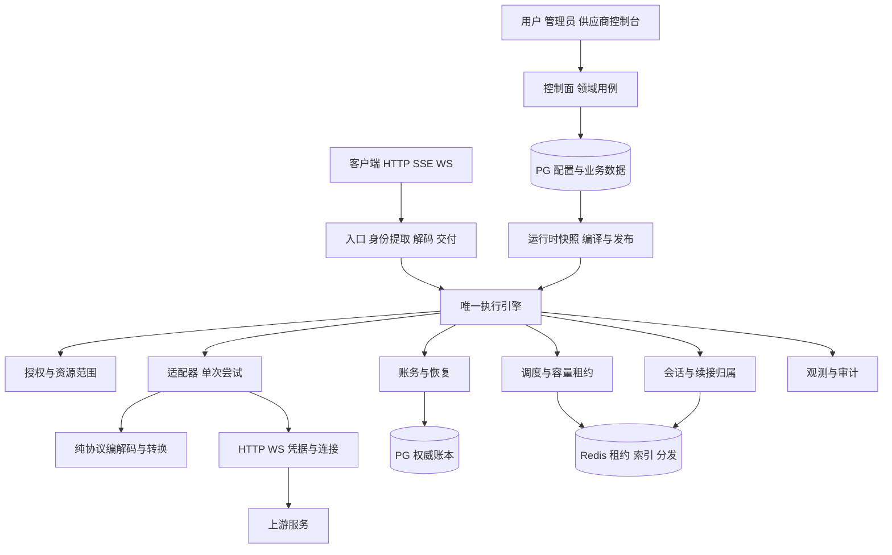

# Sub2API 系统架构重构方案

日期：2026-10-25。状态：开发设计基线，业务代码尚未按本方案替换。目标技术项目统一为sub2api；各运营品牌使用部署配置和网站设置，当前三分支作为交付过渡。

目标是让一次业务请求只有一个执行控制者、一份明确的授权范围、一条可追溯的结算链。保留 Go、Vue、PostgreSQL、Redis 和有效客户端协议，把散布在 handler、service、transport 中的控制逻辑重组为有依赖约束的模块化单体。目录、接口和状态机均为目标设计，不表示已经落地。

## 1. 三个项目值得学什么

| 项目 | 值得采用的结构 | 落到 Sub2API | 不直接采用的部分 |
| --- | --- | --- | --- |
| Codex Proxy RS | 无 HTTP/DB/Provider 依赖的内核；请求与尝试分离；不可变快照；原始报文与旁路事实分离 | 一个引擎拥有重试、取消、输出提交、调度调用和结算编排；适配器只执行一次授权尝试 | 不换 Rust，不复制单副本和内存待结算假设，不增加第二套插件体系 |
| vm2api | 管理与执行分离；调度范围与计费分组分离；亲和与执行容量分离；异步交接重新校验权限 | 明确资源范围、价格方案和租约；强续接归属与普通亲和分开 | 不引入 VM、guest、Node 控制面、额外 kernel、SQLite 文件镜像；不将其单控制面当作我们的多实例模型 |
| New API | 独立协议转换器；转换步骤/质量/诊断明确；预留、结算和退款生命周期 | 纯协议模块；模型身份分工；独立账务用例 | 不复制大型可变 RelayInfo，不照搬多步骤账务提交和钱包退款语义，不泛化数据库支持 |
| 当前 Sub2API | PostgreSQL 幂等结算与恢复；多实例会话归属；调度及发出前资格复核；供应商与安全边界 | 保留不变量，重建职责和调用方向，迁移已有正确算法与事务 | 不保留长期双核心，不再用不断增加的 context key、账号布尔字段和平台特判承载新需求 |

借鉴边界，不整仓拼装。不能因为其他项目目录清晰，就把我们已有的账本、授权和多实例保证换弱。

## 2. 当前问题的根源

**控制权分散。** `OpenAIGatewayHandler` 同时解析、准入、选号、占用并发、转发、切换和提交使用记录；`OpenAIGatewayService.Forward` 再选择 Cloud/BPS/原生和部分回退；深层传输继续局部恢复。当前已有共享整轮预算，并非完全各自为政，但错误分类和恢复动作仍跨层影响。

**状态边界模糊。** `OpenAITurnBudget` 不只装预算，还装 BPS 恢复、账号指针、目标计数、模式排除、健康和调度恢复器。关键状态通过 `gin.Context`、`context.Value` 传递，缺少明确的写入者和时序。问题不是 context 这个工具，而是它代替了业务对象。

**实体承担太多职责。** Group 同时组织准入、资源、模型、价格和订阅；Account 同时承载资源身份、凭据、供应商、能力和运行状态。管理界面可以聚合它们，执行核心不应拿整份可变实体自行解释。

**协议维度混在平台维度里。** OpenAI 可能表示客户端协议、上游平台、OAuth 身份或一个 service。客户端 WS 也不等于上游原生 WS：ctx_pool、http_bridge、BPS、Cloud 有不同的传输与恢复语义。

**业务可靠性等级混用。** 使用记录、健康、审计和扣费不能用一条泛化事件队列代替。当前 UsageRecordWorkerPool 首次通过 Run 同步执行，失败再恢复；不能从类名认定账务只是异步日志。

**前端放大同一问题。** 大型 Settings、账号和分组表单持有大量跨领域条件。仅拆文件不能消除复杂度，需要后端先提供有归属的配置和能力契约。

## 3. 目标架构与依赖方向

先保持模块化单体和现有部署形态。控制面、数据面、恢复任务是模块与生命周期边界，第一阶段不拆微服务。



图是调用/数据流，不是 import 图。具体存储、Provider 实现核心定义的窄端口，由 composition root 注入。核心不依赖 Gin、Ent、Redis 客户端或具体 Provider。

```text
backend/cmd/server/             装配及启动关闭顺序
backend/internal/
  gateway/
    model/                     小型值对象、身份、状态和结果事实
    execution/                 操作与尝试状态机、恢复控制
    routing/                   资格、排序、亲和、失败归因
    session/                   续接归属、租约和恢复规则
    protocol/                  原始报文及纯转换
  access/                      身份、角色、授权范围和撤销校验
  catalog/                     模型、能力、映射、配置编译
  billing/                     资金来源、额度、价格快照、账本用例
  control/                     管理与供应商用例
  ingress/                     Gin HTTP、SSE、WS 边界
  providers/                   上游具体适配
  storage/                     PostgreSQL/Redis 端口实现
  host/                        worker、连接池、插件进程生命周期
  observability/               日志、指标、追踪、只读投影
```

不是先建空目录或给每个类型套 interface。边界规则：

- model 不反向引用 execution，也不成为所有 DTO 的新堆积处。
- execution 消费窄端口，不认识 Provider 名单或具体 repository，不接收 Gin Context。
- protocol 不访问网络、配置、token、调度或数据库。
- providers 执行已授权的一次准备/发送/接收，不能直接扣费或重新挑账号。
- storage 实现领域端口；账务、配置领域决定事务边界。
- control 与 ingress 使用同一业务校验；供应商入口不能复制一份规则。
- 保留现有 Wire 装配能力。构造函数不隐式启动 goroutine，host 显式管理 Start、Drain、Stop。

优先扩展既有 `.golangci.yml` depguard 约束迁入模块，只有无法表达的包图不变量才补最小检查，不新建验证平台。

后端包内组织及语言写法见[详细编码规范](CODING_STANDARDS.md)；前端完整目录、14领域、共享与跨域装配、状态/API及切片迁移以[前端重构架构](FRONTEND_ARCHITECTURE.md)为唯一详细设计。本文继续定义顶层职责和依赖，避免两份结构规范相互漂移。

## 4. 业务身份与资源模型

| 概念 | 生命周期 | 约束 |
| --- | --- | --- |
| Session | 多次客户端交互 | 绑定用户、Key、有效范围和上游身份，不仅是可猜测 session id |
| Operation | 一次客户端业务提交 | 不等于 HTTP/WS 连接，每轮独立准入与取消 |
| Provider Turn | 一次上游生成生命周期 | 工具回传可能继续同一 turn，不能假设一个 HTTP 请求就是一个新 turn |
| Attempt | 一次明确生成发送 | 固定资源、授权 grant、传输与发送内容；跨账号/模式是显式新 attempt |
| Billing Root | 可跨断线恢复的结算单元 | 与 session、operation、attempt 分别关联，不直接复用连接 id |
| Delivery | 入口输出交付 | 记录客户端是否已收到不可撤回的业务输出，不等于上游已产生字节 |

迁移保留当前 `(request_id, api_key_id)` 等有效幂等键。若新增 root/attempt 持久化关系，必须明确旧键映射，避免历史请求重新扣费；数据迁移单独处理。

### 4.1 拆开六个维度

客户端协议（Responses/Messages 等）、上游平台、授权方式（OAuth/API Key/Excel 等）、执行模式（Native/BPS/Cloud）、传输（HTTP/SSE/WS/桥接/JSON RPC）、操作能力（生成/图片/视频/批次/语音）分别表达。

候选资格由明确能力和策略共同决定。unknown 与 unsupported 不同；上游模型目录未列出不自动代表拒绝，管理员的既有模型权限继续生效。

不用万能 Provider 接口强迫所有操作共享文本流生命周期。文本、异步任务和实时双向会话使用不同窄端口，共享授权、调度、租约和账务。

### 4.2 管理聚合与内核概念分离

| 现有外部对象 | 内部分工 | 首次迁移 |
| --- | --- | --- |
| Group | AccessPolicy、ResourceScope、PricingPlan、SubscriptionPolicy | 从现有记录编译只读领域视图，保留 API 与数据，不先拆表 |
| Account | ResourceIdentity、CredentialGrant、CapabilityProfile、RuntimeHealth | 调度拿资格与资源；发送前取凭据；健康为运行投影 |
| Proxy | EgressPolicy、连接参数 | 保留可信出口与代理归属，变更参与连接隔离 |
| Vendor | SupplyOwnership、结算主体 | 范围、归档和双边账务进入共享授权/账务 |

领域迁完即删旧解释器，不把编译视图做成永久平行规则。外部仍使用 Group/Account 名称属于有效产品合同，不为内部纯度强制改客户端。

## 5. 唯一执行主链

```text
提取原始报文与事实 → 身份与准入 → 固定策略/价格快照
→ 解析续接硬归属 → 编译候选计划 → 账务资格/适用的预留
→ 用户与资源容量租约 → 适配器准备单次发送
→ 复核撤销/范围/租约/凭据代际 → 登记 attempt → 发送
→ 原文交付 + 旁路使用量/状态事实 → 受限恢复或结束
→ 幂等结算/持久化待核对 → 释放资源和结束观测
```

### 5.1 恢复决策只有一个所有者

适配器返回鉴权过期、配额耗尽、拒绝、未发送、状态不明等事实，引擎决定动作。健康归因与恢复动作分别表达：用户取消和权限拒绝不应污染账号健康；可重试不等于可换账号。

引擎统一掌握总 attempt、资源/目标预算、准备次数、累计等待和截止时间。沿用已验证的现有预算，不因抽象升级扩大重试。每次可能产生业务生成的发送必须登记；控制请求的有限重试不能藏入新的生成。

传输库也只能隐藏可证明未发送且未产生业务的重连；无法证明则上报 ambiguous。没有下游输出，不足以证明可安全重放。

### 5.2 三个独立状态轴

| 状态 | 取值 | 控制什么 |
| --- | --- | --- |
| 上游发送 | NotSent / Sent / Ambiguous | 是否存在重复生成风险 |
| 下游交付 | Uncommitted / Committed / Closed | 是否能更换对客户端可见的生成结果 |
| 用量可信度 | Unknown / Partial / Final | 能否结算及如何合并累计/增量证据 |

- NotSent 且未交付：范围、授权、预算有效时可重新选择。
- Sent/Ambiguous 且未交付：只能执行有证据的同一生成恢复，或明确协议合同允许的重试，不能自动跨账号重放。
- 已交付业务内容：不自动切另一份生成，只续接同一归属或以协议允许的终态结束。
- 客户端取消：不启动新 attempt；取消上游并有界 drain/对账，已发生用量不会因连接关闭而消失。

这是目标契约，落地前逐项对照原生、BPS、Cloud 的有效恢复合同；不能无声取消明确要求的能力。Keepalive、暂存 metadata 与真正的不可撤回交付分别记录，判断依赖协议和 writer 实际动作，不只看文本是否为空。

### 5.3 快照不能冻结撤销

请求固定配置 revision、模型映射和定价规则，避免半轮换价。实际计价模型可能依赖可信响应事实，仍按既有产品规则决定，不能把冻结策略误解为无条件按请求模型收费。Key 禁用、账号归档、池成员变化、供应商权限、凭据代际及租约有效性，在等待结束和每次实际发送前复核。

快照负责一致性，实时校验负责授权和容量。控制面先校验/编译候选，再以预期 revision 做并发校验，将配置、新 revision 与审计原子保存，提交后发布；失败从持久化 revision 恢复。Redis 通知用于加速收敛，不作为唯一可靠来源，紧急撤销不等待普通快照刷新。

## 6. 协议与 Native BPS Cloud

同协议尽量保留原始请求/响应，旁路提取调度、使用量和终态。必要的身份保护、头部清理和用户明确策略修改在具名步骤完成，原始输入与出站副本分开。

跨协议才转换，结果携带 from/to、步骤、损失/限制和诊断。明确工具 call id、schema、图片、reasoning、refusal、finish reason、usage 是否等价，不能丢未知字段后再依赖客户端特判补洞。

| 模式 | 专属能力与状态 | 统一复用 |
| --- | --- | --- |
| Native | HTTP/SSE/WS、连接池、原生 response/工具合同 | 授权、范围、调度、预算、交付、账务 |
| BPS | 工具目录、历史、附件/图片阶段、Excel 授权、明确 403 恢复 | 同上；Excel-only 不能退回原生 Codex |
| Cloud | JSON RPC thread/turn、交互事件、owner actor、usage archive | 同上；复用原生 OAuth 凭据权威 |

模式切换是执行计划中的明确候选边，不是适配器出错后的任意兜底；必须满足授权、输入、预算和恢复合同。三种模式不拥有各自的总调度器。

### 6.1 会话不是连接

- continuation 记录用户、Key、有效范围、资源所有者、凭据身份/代际、模式及上游 response/thread/turn。
- 强续接必须命中归属；普通 sticky affinity 可以按规则失效重选，两者不能共用尽力命中的语义。
- Redis 保存共享定位、代际租约和可恢复状态；活 socket 仍属于进程，转交命令不等于迁移 socket。
- owner 失联后，仅在合同支持时重建；否则明确终止或保留待核对，不能假装接管原流。
- owner epoch/fencing 覆盖迟到命令、输出和写入。旧 owner 不能继续生成；必要的迟到使用量事实由幂等账务接受，不能漏掉已发生费用。
- WS 每轮独立准入与容量，不能通过长期连接跨轮复用一次请求许可。

## 7. 账务和持久化

现有 usage_billing_repo 的持久化事件、幂等 claim、额度/余额变更与使用记录事务优先保留。重构调用边界，不用换表/ORM/异步化证明创新。

生命周期为 Eligible → Reserved（适用时）→ PendingUsage / Settled / Released。不要求所有资金来源新增预扣，Released 也不等于没有产生使用量。

1. 派发前固定定价规则、可解析的价格快照、用户与供应商结算归属。请求模型、出站模型、返回模型、计价模型分别记录；响应模型影响价格时，按冻结规则和可信事实决议。当前已部分具备，目标是统一所有者，不重复实现。
2. 适配器提交用量事实，不直接改余额；明确累计/增量口径，不把多次累计 usage 相加。
3. 账务根、事件身份与指纹约束幂等，旧键映射必须验证。只承诺本地事实幂等结算，不宣称上游生成 exactly-once。
4. Unknown usage 持久化待核对，不填零。终态 ACK 与结算的先后遵守既有模式合同。
5. 取消、重启、迟到事件通过同一用例恢复，不另开补扣路径。
6. 用户余额豁免不豁免 Key 配额、订阅、平台保护或供应商成本。
7. 观测可以独立投递；账务、安全审计按各自持久化要求处理，不能全部降为可丢日志。

PG 是配置、授权、订阅、供应商和账务的权威数据；Redis 用于租约、快照、索引与分发。Redis 暂态内容要声明能否重建，不能笼统声称丢失不影响会话。暂不拆库、不引入 Kafka 或账务微服务。

## 8. 控制面和前端

控制面按 Access、Resources、Routing、Billing、Sessions、Operations 组织用例。供应商控制台复用相同领域用例及授权范围，前端筛选不是权限边界。

前端按 features/accounts、routing、billing 等领域组织 API、类型、表单和状态。公共组件只负责交互，不解释 OAuth、供应商政策或收费规则。

账号表单消费后端明确的配置类型和能力，不独立推断布尔组合。设置页按配置域独立校验/保存，带 revision 处理并发冲突；后端仍是权威校验者。网站品牌只来自设置，镜像/容器等来自部署配置；同一角色制品不因品牌重编译，原作者广告/赞助等无关推广清理。具体合同见[BRANDING](BRANDING.md)。

诊断按 operation 展示选路原因、attempt 时间线、发送/交付、归属与结算状态。敏感 token、prompt、工具内容不默认进入公共日志，内容审计沿用权限和保留策略。

## 9. 旧代码替换与删除清单

| 现有位置 | 目标归属 | 迁完同次清理 |
| --- | --- | --- |
| openai_gateway_handler 的选路/循环/计费编排 | execution、routing、billing | handler 第二份恢复循环、跨领域状态更新；保留入口安全与输出 |
| failover_loop 与 service 局部恢复决策 | execution | 重复计数与动作判断；保留真实协议错误分类 |
| OpenAITurnBudget 的账号/BPS/健康状态 | 预算、session、模式状态、归因结果各自持有 | 对应旧字段、context key、helper、兜底及失效测试 |
| openai_gateway_forward 的模式与回退 | catalog 计划 + providers | 第二套路由配置解释器；迁移真实转发实现 |
| BPS 工具/历史/图片 | protocol + BPS adapter | 重复的授权/调度/账务包装，不删有效 BPS 能力 |
| Cloud parser/actor/transport 交叉状态 | Cloud adapter + session + host | 重复准入与结算控制，保留 thread/turn 合同 |
| 多处模型与价格推断 | catalog + billing | 冲突推断；保留有产品依据的价格规则 |
| UsageRecordWorkerPool 装配与外壳 | billing 用例 + host worker | 行为不符的命名和重复包装，不削弱持久化恢复 |
| 巨型设置和账号表单 | 对应 features | 旧状态、校验、props、API、locale 与废弃页面 |

一次请求只能有一个有副作用的执行路径。迁移比较只运行纯计划/转换，禁止向真实上游双发或双重扣费。每个垂直功能切换后即删旧注册和过渡开关；版本回退不等于长期双引擎。

数据格式改变时先证明旧版本可读，否则单独设计恢复方案。不能用回滚代码代替数据恢复，也不修改已应用历史迁移。

保留的兼容必须指出实际调用方/数据合同、唯一模块、退出条件。公开且仍使用的协议是产品能力，不因名字含 compat 机械删除。

## 10. 实施顺序与验收

按完整业务切片切换，不先大搬目录再逐步修。

| 阶段 | 完整交付物 | 验收与删除条件 |
| --- | --- | --- |
| A 合同与边界 | 客户端/数据合同、身份与状态、依赖规则、既有夹具归属 | 覆盖原生/BPS/Cloud 首轮、续接、取消、终态；不堆空壳 |
| B 原生 Responses | HTTP、SSE、客户端 WS 和工具后续轮经同一主链 | 撤销、预算、交付、取消后费用、原生恢复成立；删除对应旧循环 |
| C BPS 与 Cloud | 单次尝试/续接端口、能力、状态所有者 | Excel-only、图片、403、Cloud owner/工具轮/未知 usage 全保留；不再内置总调度 |
| D 其他平台与操作 | Anthropic/Gemini/Grok/现有兼容平台；图片/视频/batch/语音窄端口 | 每类合同验证，实时和异步不硬塞文本流；全部入口有唯一执行者 |
| E 控制配置域 | Group/Account 编译视图、revision、范围与价格规则 | 数据/API 可读，热更新与即时撤销并存，旧解释器删除 |
| F 前端与收敛 | 特性模块、配置域、诊断；必要时另行数据迁移 | 旧页面/store/字段/配置/文案清理；三品牌共享行为 |

顺序可吸收并行 Cloud 修复，但不能覆盖其他任务后续成果。每片完整验收后按现有三品牌交付规则执行，不将不完整架构骨架推上正式分支。

风险验证复用现有测试与报文夹具，按实际变化覆盖：原始扩展字段与工具身份；未发送/状态不明/已交付；取消；排队后撤销与池成员变化；跨用户续接；Redis 与 owner 失效；累计/未知 usage、DB 故障和双边结算。

单测、替身上游、真实 DB、多实例、真实上游、线上验收分别记录。本地替身不能证明真实上游兼容，文档检查不能证明运行正确。上线和生产数据迁移仍为独立范围。

## 11. 完成标准

- 核心无 Gin/Ent/Redis/具体 Provider import，生成装配也满足依赖。
- 新普通 Provider 不改核心平台分支；真正新操作语义通过明确端口表达。
- 每次业务发送都有 attempt，预算与恢复动作只有一个所有者。
- 所有账务变更走同一幂等用例，观测不承担账本责任。
- 续接、实时连接、共享索引和持久化事实的归属能被检查。
- 替换清单的旧入口、字段、helper、配置全部删除或记录有效合同。
- 已支持的协议、权限、供应商、安全、账务和数据读取无未经授权的回退。

性能需在相同负载、模型、协议、部署下比较 TTFT、吞吐、内存、取消排空和恢复时间。当前未作对照测量，不预告百分比提速。结构清晰与失败可定位是先要兑现的收益。

## 12. 维护政策与必要边界

目标是统一命名sub2api的一个内核与源码树，不把参考项目接成旁路网关，也不保留品牌源码分叉。当前官方父提交与三品牌交付纪律在迁移期继续，本轮不等于同步上游、改发布渠道或升级依赖。

彻底重组后，与 Wei-Shaw 文件布局的差异会增大。在官方父提交上交付仍可行，但未来不能承诺直接合并网关代码；需把来源能力与合同适配到新边界，区分功能一致性与源码组织一致性。

现行 AGENTS.md 要求网关、Codex、WebSocket、调度和运维以 Wei-Shaw 官方实现为基准。本方案保留明确的业务和安全行为；若要进一步改变这一能力基准或放弃官方基线维护政策，需要用户明确决定，不能由目录重构暗中替代。

至少保留：有效平台与模型、原生恢复、BPS Excel 授权及工具/图片、Cloud 原生 OAuth 与归属、可信 IP、图片出口保护、WS 身份与 response 归属、Grok 语音并发和音色授权、供应商范围/归档/结算、余额豁免边界、降智检测与 Fable 阈值、品牌渠道、历史迁移保护。

不恢复已退役的自动登录 Worker、票据/Cookie 治理、Mihomo 或自动质量运营。

## 13. 源码依据

先读用户已有的三份架构分析，再核查关键源码。以下是本地检出快照，不宣称网络最新，也不代表完整安全审计。

| 项目 | 固定 SHA | 关键源码 |
| --- | --- | --- |
| Sub2API | `d1e6e924debeaaced1dc816f779198577703aee4` | handler/openai_gateway_handler.go；service/openai_gateway_forward.go、openai_first_output_timeout.go、gateway_turn_recovery.go、openai_gateway_usage.go；backend/.golangci.yml |
| Codex Proxy RS | `84c0db26135dae694a5f5ac608ed6c04df049234` | docs/architecture.md；backend/crates/gateway-core/src/engine/provider.rs、runtime/publications.rs；backend/apps/gateway/tests/architecture.rs |
| vm2api 本地检出 | `6f188e94e10ff6ce9239b4c39f964da4c98916d7` | src/lib/admin/key-scope.mjs；src/lib/pool/failover-runner.mjs；LICENSE |
| New API | `e835b1bfc43b565d625537830dbfb19328925134` | relaykit/relayconvert/request_registry.go；relay/common/relay_info.go；service/billing_session.go、funding_source.go |

vm2api本地检出用于架构研究，不推进来源review水位。当前[来源说明](../SOURCE_ADAPTATIONS.md#3-许可与署名材料)记载既有书面授权覆盖本项目适配、三品牌分发和商用；本轮未重新审核授权文件，也不扩大范围。原LICENSE/NOTICE继续保留，新增范围依实际授权和交付规范处理。本方案未复制三项目业务代码。

关键源码定位：

- [Sub2API 当前模式分流](../../backend/internal/service/openai_gateway_forward.go)、[整轮预算](../../backend/internal/service/openai_first_output_timeout.go)、[账务事务](../../backend/internal/repository/usage_billing_repo.go)。
- CPR：backend/apps/gateway/tests/architecture.rs、docs/architecture.md，固定版本见source-inventory.json。
- vm2api：src/lib/admin/key-scope.mjs、src/lib/pool/failover-runner.mjs，固定版本与许可说明见source-inventory.json。
- New API：relaykit/relayconvert/request_registry.go、relay/common/relay_info.go、service/funding_source.go，固定版本见source-inventory.json。

## 14. 资料与实现状态

本文件提供目标结构与取舍。当前资料包和实际检查范围见[README](README.md)与[READINESS](READINESS.md)，不以设计状态代表代码已经完成。

## 15. 开发资料包的规范归属

本文保留总体设计及取舍。详细需求以 REQUIREMENTS.md 为准，接口以 CONTRACTS.md 为准，任务状态以 work-items.json 为准，验收以 VALIDATION.md 为准。2026-10-25 开发准备已采用main的750d4a16c7adaf558cf2c6ce7101975602832d7b，包含完成的Cloud parser和Responses/WS多流交付；上方原始分析SHA 保留作来源记录。当前状态见 READINESS.md。
