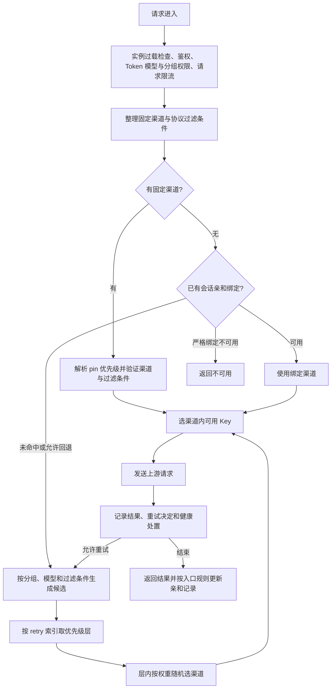

# New API 号池调度策略与 Sub2API 对比

最新复核日期：2026-10-21。当前项目与 Wei-Shaw、ranxi2001、两个 sub4api 来源及 vm2api 的源码对照、确定缺口和下一阶段规划见第 18 节；第 18 节是未实施方案，第 15、17 节保留历史实施证据。
调研及修订日期：2026-10-17。需求归属：共享网关能力，适用于 KDAN、TapModels、Tokensavy。第 1—8 节保留调研基线与分阶段目标，第 9 节为第一阶段历史验收，第 10 节为经用户授权的修订设计，第 11 节记录第二阶段实现与大账号池审计。第 12 节记录用户随后授权的提交归并与共享交付口径。第 13 节是提交后的最新三方复核，包含本轮独立复现的问题与适用边界。

结论：保留 Sub2API 现有账号级并发、配额、协议能力和归属控制，将优化后的调度收敛为代码内唯一生产策略，删除高级/兼容选择开关、手调评分参数及被替代旧路径；吸收 New API 的统一约束表达、请求决策轨迹、会话语义、恢复任务边界及实例过载保护。

已纳入用户要求：减少配置步骤和两套策略并存。第 3、4 节描述最初调研时的事实，已实现修订见第 15、17 节，本轮复核与未实施规划见第 18 节；第 6 节按重新评估结果修订，区分算法参数、经营偏好和运行保护，不把“删除全部设置”视为已确定需求。OpenAI 兼容入口的统一调度器无需手动启用，必要的业务控制仍保留；原生入口及尚未落实的可靠性路线不能据此视作全部完成。

## 1. 调研基线与证据边界

| 对象 | 固定版本 | 范围 |
| --- | --- | --- |
| New API | `09109ec315a5086366f94bcce00f177ec831dbe1`，2026-10-16 | 已核对 GitHub main；研究完整调度实现，包含此前已存在而未吸收的方案 |
| Sub2API | `56f1a9d0b63e0ce6654158d224602e2d9be46bd8` | main 源码，加本轮开始时已存在的 57 个后端/前端受跟踪改动文件的快照；这些供应商控制台等改动属于其他工作 |
| 运行配置 | 未读取线上设置、数据库或生产日志 | 下文“默认值”是代码默认，不等于线上实际配置；“支持”不等于“已启用” |

为避免并行工作影响结论，双方源码已固定到[调研快照目录](/Users/luhonglin/Git/sub2api-analysis-20261017-new-api-scheduling)，版本和本地覆盖文件摘要见 [sources.json](/Users/luhonglin/Git/sub2api-analysis-20261017-new-api-scheduling/sources.json)。本轮没有调用真实上游，也没有运行双方完整测试套件。

结束复核时，其他工作已将本地主分支更新为 `e6b3b332dc1fba704db6e07157c4b4674bed2437`。已检查两版文件差异，并逐文件比对本报告引用及补充的 20 个核心源文件，它们与调研快照内容一致；调度结论不受这次并行更新影响。上表保留原始研究基点，便于复核证据。

New API 最新提交正是[容器过载口径、连续超限及采样新鲜度修复](https://github.com/QuantumNous/new-api/commit/09109ec315a5086366f94bcce00f177ec831dbe1)。调度策略和记录能力还来自较早的 [request policies](https://github.com/QuantumNous/new-api/commit/73a471f3a) 与 [HTTP/Responses WS 共享路由](https://github.com/QuantumNous/new-api/commit/ae249f4ec)，均纳入本轮比较。

## 2. 先明确两套系统的调度对象

| 概念 | New API | Sub2API | 对照注意点 |
| --- | --- | --- | --- |
| 池内主要对象 | Channel：上游类型、地址、模型集合、分组、优先级、权重、状态 | Account：OAuth/API Key 等账号、平台、凭据、代理、并发、配额、状态及分组 | Channel 不一定等于一个真实账号，可能本身就是一个中转网关 |
| 第二层凭据池 | 一个 Channel 内可保存多个 Key | 通常每个 Account 独立管理凭据；母子账号等关系有专门语义 | 不应把多个 OAuth 账号压进一个 Key 字符串列表 |
| 下游访问凭据 | Token 控制分组、模型权限等 | 用户 API Key、订阅、分组及费用控制 | 下游 Token 限流不能当成上游账号并发调度 |
| 优先级 | 数值越大越先选 | 常规选择数值越小越优先；高级调度把它作为评分因素 | 不能直接复制数值或假定高级调度仍是严格主备 |
| 权重 | 同一优先级内的随机选号权重 | 有负载因子、评分权重和成本偏好 | `RateMultiplier` 是计费倍率，不能冒充流量份额 |

## 3. New API 完整调度链路



这是普通中转的概括图。任务续接有原任务渠道归属，Responses WS 有能力过滤与自身生命周期；不能把所有入口当成一个无条件换渠道循环。图中重试还受 pin、会话模式、错误类型和预算限制。

### 3.1 分组、模型与候选渠道

候选集合以启用的 `group + model` 能力记录为基础。内存模式先找精确模型；无满足过滤条件的候选时，再用规范化模型名查找。渠道自己的模型映射随后用于构造上游请求。授权模型、调度模型和上游模型不能混为一谈。

普通 Token 使用固定分组。`auto` 分组按有序列表搜索，每个分组还必须符合用户可用组权限及分组配置。Token 可以保存自己的 Auto 组列表，当前权限会再次过滤；显式空列表不会偷偷回到全局列表。默认全局 Auto 列表为 `default`，默认不启用自动选组，Token 自定义组数量上限默认 5。

没有可用渠道时可以检查后续 Auto 分组；开启跨组重试后，还会按当前组重试进度准备下一组。切组会重置重试索引，所以 `RetryTimes` 不能简单解释为整次请求严格的全局上游请求总量。实际出站次数还受首轮预选、错误是否允许重试等影响，应按真实发送事件统计。

依据：[分组权限与 Auto 列表](https://github.com/QuantumNous/new-api/blob/09109ec315a5086366f94bcce00f177ec831dbe1/service/group.go#L98)、[Auto 组选路](https://github.com/QuantumNous/new-api/blob/09109ec315a5086366f94bcce00f177ec831dbe1/service/channel_select.go#L114)。

### 3.2 固定渠道和统一过滤条件

`ChannelConstraints` 将两种事物分开表达：

- Pin 指定渠道及来源。Token pin 的 rank 为 0，原任务 pin 为 10，较小者胜出；相同渠道合并更严格的重试约束，不同渠道的覆盖关系有日志。
- Filter 描述请求路径、任务插件身份、Responses WS 能力；普通选号、亲和命中和固定渠道都调用共同的过滤谓词。

首次选号顺序是固定渠道、会话亲和、普通候选。Token 固定渠道可禁止重试；原任务归属由对应任务路径维持。HTTP 与 Responses WS 共用核心选路逻辑，减少协议分支遗漏条件。

可借鉴的是“约束有类型、来源、优先级和共同验证入口”。不能移植它的授权优先顺序：Sub2API 已有响应和任务所有权，管理端的路由偏好不得覆盖这些归属。New API 的固定渠道分支也不等同于普通 `group/model` 候选筛选，不能拿 pin 当作跳过本地授权检查的理由。

依据：[约束结构](https://github.com/QuantumNous/new-api/blob/09109ec315a5086366f94bcce00f177ec831dbe1/dto/channel_constraints.go)、[公共选择入口](https://github.com/QuantumNous/new-api/blob/09109ec315a5086366f94bcce00f177ec831dbe1/service/channel_select.go#L283)、[过滤谓词](https://github.com/QuantumNous/new-api/blob/09109ec315a5086366f94bcce00f177ec831dbe1/model/channel_constraint.go)。

### 3.3 优先级：按重试索引降档，不是逐个遍历

把候选渠道的不同优先级按数值降序排列。首次取第 0 层，下一次重试取第 1 层；索引超过层数后停留在最后一层。

例如 A、B 的 priority=10，C 的 priority=5：首次在 A/B 中抽选；首次失败后的下一次选号通常进入 C 所在层，并不先把 A、B 全试一遍。若只有一个优先级，则每次仍在该层随机选。

普通渠道选号没有使用“本请求已经失败的渠道集合”来排除候选；`used_channel` 是记录，不是去重机制。因此最后一层可以反复抽到同一个坏渠道，单候选也会重复出现。我们现有失败账号排除集更适合保留。

### 3.4 权重：两条路径并不等价

| 条件 | 内存路径 | 数据库路径 |
| --- | --- | --- |
| 同层有正权重 | 通常按 `w / Σw` 抽选 | 先使用 `w + 10` 作为抽选量 |
| 同层全是 0 | 每个按有效权重 100，均匀抽选 | 每个加 10；边界比较还会造成轻微偏差 |
| 0 与正权重混合 | 0 权重不被抽中 | 0 权重仍有机会 |
| 低平均权重 | 全部乘 100，比例不变 | 没有这段逻辑 |
| 只有一个候选 | 直接返回，即使权重 0 | 通过 DB 抽选返回 |
| 模型回退 | 有规范化模型名回退 | 此查询函数只按传入模型精确查能力表 |

数据库路径还有一个边界差别：随机数是 `[0,total)`，减去权重后使用 `<= 0`，内存路径使用 `< 0`。按数据库的 `weight DESC` 顺序，B 权重 100、A 权重 0 时，静态枚举 120 个随机整数得到 B 111 次、A 9 次；内存路径 A 为 0 次。这是源码分支的计算核对，不是线上流量实测。

默认只有显式 `MEMORY_CACHE_ENABLED=true` 才直接启用内存模式，但配置 Redis 后 main 会强制启用内存渠道缓存。不能只看环境变量判断实际路径。

权重不包含实时在途请求数、等待队列、首 Token 时延、错误 EWMA 或账号剩余额度。它表达抽样倾向，不能保证短时间内精确的流量份额，也不能防止高权重渠道被压满。

依据：[内存选号](https://github.com/QuantumNous/new-api/blob/09109ec315a5086366f94bcce00f177ec831dbe1/model/channel_cache.go#L117)、[数据库选号](https://github.com/QuantumNous/new-api/blob/09109ec315a5086366f94bcce00f177ec831dbe1/model/ability.go#L107)、[随机数边界](https://github.com/QuantumNous/new-api/blob/09109ec315a5086366f94bcce00f177ec831dbe1/common/utils.go#L234)、[Redis 与缓存启用关系](https://github.com/QuantumNous/new-api/blob/09109ec315a5086366f94bcce00f177ec831dbe1/main.go#L83)。

### 3.5 渠道内多 Key 池

Key 可按换行或 JSON 数组解析。状态表缺失的 Key 默认启用；禁用 Key 不进入候选。没有可用 Key 时返回明确错误，不回退到第一个已禁用 Key。

支持均匀随机和轮询。轮询跳过禁用项，保存下一次游标；未知模式回退到第一个可用 Key。选号和状态更新使用进程内的渠道锁；这不等于跨实例全局轮询或 Key 级并发租约。

单 Key 故障可以只禁用当前 Key，并记录原因和时间；全部 Key 禁用后，渠道转为自动禁用。恢复 Key 时同步处理渠道可用状态。它比“一条 Key 失败就停整个多 Key 渠道”细，但仍没有我们逐账号管理的 OAuth 刷新、代理身份、独立配额和恢复状态。

此外，亲和绑定的是 Channel ID，后续请求仍可能从该渠道选出另一把 Key。若这些 Key 对应不同的上游账号，渠道亲和不能保证真实账号亲和，也不能单独保证上游提示缓存或响应续接命中。

依据：[Key 选择与状态更新](https://github.com/QuantumNous/new-api/blob/09109ec315a5086366f94bcce00f177ec831dbe1/model/channel.go#L206)。

### 3.6 会话亲和：匹配规则、模式和回写

规则可以匹配模型、请求路径、User-Agent、提取值正则，并从上下文、Header 或 JSON 路径取亲和键。规则按顺序匹配；TTL 可单独设置。缓存键可包含规则名、分组、模型，但不是所有维度都强制存在。

| 模式 | 行为 |
| --- | --- |
| `off` | 不使用该会话亲和策略 |
| `prefer` | 优先绑定渠道，允许按重试策略回退 |
| `strict` | 已命中绑定时阻止普通故障换渠道；缓存绑定已不可用时可直接返回 503 |
| `inherit` | 使用全局设置；全局未指定时为 prefer |
| 旧规则模式为空 | 按旧 `SkipRetryOnFailure` 推导；true 对应 strict |

默认开启亲和、TTL 3600 秒、内存容量 100000、`SwitchOnSuccess=true`、`KeepOnChannelDisabled=false`。预置 Codex 规则读取 `/v1/responses` 的 `prompt_cache_key`，Claude 规则读取 `/v1/messages` 的 `metadata.user_id`；两条旧规则默认 `SkipRetryOnFailure=true`，所以实际是 strict，而不是全局缺省 prefer。首次没有绑定仍可普通选号，strict 不表示所有首请求都被固定。

缓存使用 Redis 或内存 TTL/LRU 后端；缓存读错误按未命中处理。关闭、清理绑定的行为可配置，并提供按规则清理和亲和命中/缓存 Token 统计。

两个吸收时必须修正的边界：

- 默认缓存键没有强制用户/API Key 命名空间。相同组内相同客户端值可能共享渠道亲和；这不能直接推断为内容泄漏，但不能作为我们的租户隔离方案。
- 普通 HTTP distributor 在 `HTTP status < 400` 时回写亲和。虽然请求策略记录能识别流式是否正常完成，这个回写点没有使用那个语义成功标志；SSE HTTP 200 内的失败也可能刷新绑定。不能照搬成“确认成功后绑定”。

依据：[默认规则](https://github.com/QuantumNous/new-api/blob/09109ec315a5086366f94bcce00f177ec831dbe1/setting/operation_setting/channel_affinity_setting.go)、[匹配及缓存](https://github.com/QuantumNous/new-api/blob/09109ec315a5086366f94bcce00f177ec831dbe1/service/channel_affinity.go#L549)、[回写调用点](https://github.com/QuantumNous/new-api/blob/09109ec315a5086366f94bcce00f177ec831dbe1/middleware/distributor.go#L125)、[回写函数](https://github.com/QuantumNous/new-api/blob/09109ec315a5086366f94bcce00f177ec831dbe1/service/channel_affinity.go#L726)。

### 3.7 重试与换渠道

`DecideRelayRetry` 统一返回 action、reason、source。顺序大致为：已命中严格亲和则停止；固定渠道禁止重试则停止；渠道错误可重试；显式不可重试错误停止；预算不足停止；然后按状态码规则判定。

默认 `RetryTimes=0`，普通请求默认不追加失败重试。配置重试后，默认可重试集合为 `100–199、300–399、401–407、409–499、500–503、505–523、525–599`。普通状态码路径排除 400、408、504、524、2xx；504、524 以及 BadResponseBody 还设有硬排除。渠道错误在预算和状态判断之前返回 retry，最后仍由外层循环控制执行次数，日志上的 retry 决定不一定代表实际又发了一次请求。

重试前重置可重复读取的请求体；本地读取失败、超限等不可重试错误不应去试下一渠道。Auto 组切换可重置索引。中央 HTTP 循环没有统一的抖动退避步骤，不能把所有协议内部可能存在的重试误当成已有统一退避预算。

New API 将“错误策略”和“实际循环执行”分开、并记录理由，值得借鉴。但它的默认状态码集合过宽，不能替换我们按请求、账号、供应商、凭据及流式提交状态分类的逻辑。

依据：[重试决策](https://github.com/QuantumNous/new-api/blob/09109ec315a5086366f94bcce00f177ec831dbe1/service/relay_error.go#L20)、[状态码集合](https://github.com/QuantumNous/new-api/blob/09109ec315a5086366f94bcce00f177ec831dbe1/setting/operation_setting/status_code_ranges.go)、[实际循环](https://github.com/QuantumNous/new-api/blob/09109ec315a5086366f94bcce00f177ec831dbe1/controller/relay.go#L160)。

### 3.8 禁用、探测和恢复

自动禁用需要全局开关和渠道 `AutoBan` 配合，默认全局关闭。判定包含渠道错误、配置的状态码及关键词；默认禁用状态码是 401。自动启用也有独立开关，默认关闭，成功测试只自动恢复自动禁用渠道，不恢复人工禁用渠道。

| 自动测试模式 | 选择对象 | 能否因测试失败新增禁用 |
| --- | --- | --- |
| `scheduled_all` | 除人工禁用外的渠道 | 可以，仍受自动禁用开关等条件限制 |
| `auto_ban_only` | 上述集合中开启 AutoBan 的渠道 | 可以 |
| `passive_recovery` | 自动禁用渠道 | 不新增禁用，成功后按恢复规则处理 |

`passive_recovery` 仍会主动发测试请求；名称不表示完全无流量的被动观察。自动测试默认关闭，周期默认 10 分钟，并发默认 1、上限 32。测试任务可取消、汇总进度，并使用系统任务的同类型锁协调执行。

测试还可以按响应总耗时禁用渠道，阈值默认 5 秒；必须打开相关自动禁用功能才产生该副作用。这个阈值不适合直接作用于长思考或长生成请求，不能拿它替代 TTFT、流中断和请求类型区分。

渠道整体禁用时会关闭关联活动 WebSocket；多 Key 渠道只禁用单个 Key 且渠道仍可用时不等同于关闭整个渠道。我们需要按自己的会话所有权和流生命周期决定是否中断现有请求，不能照搬批量断连。

依据：[禁用与启用条件](https://github.com/QuantumNous/new-api/blob/09109ec315a5086366f94bcce00f177ec831dbe1/service/channel.go)、[探测模式及默认值](https://github.com/QuantumNous/new-api/blob/09109ec315a5086366f94bcce00f177ec831dbe1/setting/operation_setting/monitor_setting.go)、[探测执行和恢复](https://github.com/QuantumNous/new-api/blob/09109ec315a5086366f94bcce00f177ec831dbe1/controller/channel-test.go#L1090)。

### 3.9 缓存、多实例和入站保护

渠道内存缓存建立 group→model→channel 索引，定期从数据库重建，默认同步周期 60 秒；状态改变会更新本机缓存。轮询游标在本机刷新时保留。不要把本机锁、缓存刷新或 Redis 亲和存储解释成分布式账号并发控制。

`ModelRequestRateLimit` 主要按用户计数；配置了组独立限流时按用户+组计数，包含总请求/成功请求额度。它不是按上游渠道并发、Key 剩余额度或上游模型窗口计算的选号器。

最新过载哨兵优先用容器 cgroup CPU/内存口径，不可用时回退宿主机；默认开启，CPU/内存/磁盘阈值均为 90。每 5 秒采样，连续 3 次超阈值才拒绝新请求；采样缺失或超过 30 秒不据此拒绝，任一后续采样回落会清除该项连续计数。配置关闭或提高阈值可以立即放行。源码阈值比较使用整数截断后的 `usage > threshold`，实际吸收时应明确百分比边界。

中间件对多类中转路由返回相应协议的 503。这是网关实例保护，不应记录成账号失败，也不应在同一实例内通过换号继续消耗资源。

依据：[缓存同步](https://github.com/QuantumNous/new-api/blob/09109ec315a5086366f94bcce00f177ec831dbe1/model/channel_cache.go)、[入站限流](https://github.com/QuantumNous/new-api/blob/09109ec315a5086366f94bcce00f177ec831dbe1/middleware/model-rate-limit.go#L173)、[过载算法](https://github.com/QuantumNous/new-api/blob/09109ec315a5086366f94bcce00f177ec831dbe1/common/system_monitor.go)、[过载中间件](https://github.com/QuantumNous/new-api/blob/09109ec315a5086366f94bcce00f177ec831dbe1/middleware/performance.go)。

### 3.10 决策记录和管理界面

每次请求累计选路事件，包含 attempt、channel、group、命中规则、状态码、错误来源、耗时、action/reason/source 和健康处置。事件数上限 512；成功和失败日志可以带管理员可见详情，界面呈现决策时间线。

设置界面把路由、失败重试、渠道健康放在“请求策略”中，并能展示继承来源；亲和界面有缓存条目/规则清理和使用量统计。核心价值是管理员可以回答“为什么选这个渠道、为什么没重试、为什么停用”，无需另建一套调度算法。

依据：[请求策略记录](https://github.com/QuantumNous/new-api/blob/09109ec315a5086366f94bcce00f177ec831dbe1/service/request_policy.go)、[决策时间线界面](https://github.com/QuantumNous/new-api/blob/09109ec315a5086366f94bcce00f177ec831dbe1/web/src/features/system-settings/request-policies/decision-record.tsx)。

## 4. Sub2API 当前实际实现

### 4.1 常规账号调度：Anthropic、Gemini 等路径

主路径是 [SelectAccountWithLoadAwareness](/Users/luhonglin/Git/sub2api/backend/internal/service/gateway_scheduling.go:100)。它按请求分组、平台、模型和已有会话进入调度，并综合账号状态、模型资格、利润/定价约束、配额、窗口费用、RPM、会话数量及请求排除集合。

大体顺序：先模型定向路由，路由内可用亲和；没有定向路由时检查普通亲和；再从普通池选空闲账号；最后生成有界等待计划。定向路由属于偏好路径，失败时存在回到普通候选的路径，不能视作不可突破的所有权绑定。

普通空闲池按有效优先级较小者优先，随后可选最早重置，再按负载率、最近使用时间选择。相同排序条件会打散，混合账号还有 OAuth 偏好。实际竞争槽位失败会继续尝试候选；负载快照不是占位成功的证明。

Redis 槽位控制用户/账号并发，等待计划区分粘性等待和普通等待。`LoadFactor` 调节负载比例的分母，真正占位仍受 `Concurrency` 限制。它与 New API 固定随机权重不同。

### 4.2 OpenAI 兼容调度：必须区分高级开关

[OpenAIAccountScheduleRequest](/Users/luhonglin/Git/sub2api/backend/internal/service/openai_account_scheduler.go:70) 已有结构化上下文：分组、平台、会话、previous response、母账号亲和、传输能力、端点/图片能力、compact、排除集合及隐私要求等。Responses、Chat 及相应 WS 路径共享相关选择入口，部分媒体路径附带独立能力要求；CountTokens、模型列表和任务取回等不能等同于普通推理选号。

**高级评分调度代码存在，但运行时设置 `openai_advanced_scheduler_enabled` 的缺省值为 false。** 关闭时走兼容选择路径，仍保留 previous response、归属、能力与分组检查，不等于关闭这些保护。需读取生效设置才能判断线上是否使用高级算法。

开启后主要层次为 previous response、母账号亲和、会话亲和和负载评分。允许移动的 previous response 和普通会话在启用加权亲和时可参与评分；不能移动的归属继续优先保护。

评分包含优先级、实时负载、队列、错误 EWMA、TTFT，以及可选配额重置、剩余配额、成本因素。默认基础权重为 `1 / 1 / 0.7 / 0.8 / 0.5`；重置、配额余量、上游成本的默认权重为 0。只说“支持按剩余额度和成本选账号”会漏掉默认并未启用这些因素。

默认取 Top-K=7，按 `score - minScore + 1` 在候选内生成不放回的加权顺序。有会话锚点时随机种子由会话等信息派生，无锚点才引入时间熵。加权亲和也不只是额外分数：亲和账号进入 Top-K 后可被移到尝试顺序首位。成本、compact 等条件另有补充候选规则，不能概括成“所有账号按总分取最大值”。

依据：[高级选择及各层](/Users/luhonglin/Git/sub2api/backend/internal/service/openai_account_scheduler.go:382)、[抽样顺序](/Users/luhonglin/Git/sub2api/backend/internal/service/openai_account_scheduler.go:775)、[评分](/Users/luhonglin/Git/sub2api/backend/internal/service/openai_account_scheduler.go:859)、[开关读取](/Users/luhonglin/Git/sub2api/backend/internal/service/openai_account_scheduler.go:1924)。

### 4.3 已有容错和保护，不应重复建设

| 能力 | 当前证据与边界 |
| --- | --- |
| 失败隔离 | `UpstreamFailoverError` 区分 request/account/provider、凭据阶段、是否可换号、是否允许同账号恢复；已有结构化失败语义 |
| 换号预算 | `FailoverState` 有失败账号排除、换号次数、同账号重试计数、取消检测、利润否决上限；某些明确的 503 恢复会在有界条件下重新开放部分候选 |
| 同账号恢复 | 通常默认 3 次，池账号设置可调至 0–10；OAuth 429 等有明确截止时间的例外，不可机械套用一个次数 |
| 流式重试安全 | 错误对象和 handler 已区分语义输出、未发出请求、安全注释写出等；已有流中断/取消/恢复测试 |
| 模型级配额 | Anthropic Fable 独立窗口与 entitlement 错误、OpenAI 规范化配额及母子账号维度、Gemini 等平台各有专门处理 |
| API Key 健康熔断 | OpenAI pool API Key 已有跨实例窗口计数；默认关闭；默认 2 分钟 10 次失败后冷却 5 分钟；不会把普通请求/供应商故障都记成账号失败 |
| 代理流中断隔离 | 已有按 proxy ID 的进程内熔断，默认 1 分钟内 2 个事件、相近断流合并、隔离 10 分钟、容量有界；全池不可用时有只放松代理隔离的回退 |
| 恢复任务 | BPS 403 已有到期筛选、数据库原子认领、受限真实探测和 nonce 校验，不能另做平行探测器把它覆盖 |
| 分布式状态 | Redis 槽位、调度快照、outbox、周期重建、DB 回退和发送前资格复核已存在 |
| 所有权与安全 | Responses/WS 归属、组权限、BPS 授权、供应商供给资格、代理和模型能力等必须在各种命中路径保留 |
| 观测 | 已有 `gateway.retry_decision`、OpenAI 选择层级/候选数/Top-K/耗时、粘性命中和换号指标；账号列表已有可选评分列，默认隐藏以避免额外计算；不足是跨协议完整轨迹与诊断整合 |

依据：[失败对象](/Users/luhonglin/Git/sub2api/backend/internal/service/gateway_service.go:687)、[重试循环状态](/Users/luhonglin/Git/sub2api/backend/internal/handler/failover_loop.go:123)、[配额与错误处理](/Users/luhonglin/Git/sub2api/backend/internal/service/ratelimit_service.go:402)、[API Key 熔断](/Users/luhonglin/Git/sub2api/backend/internal/service/openai_apikey_health_breaker.go:53)、[代理熔断](/Users/luhonglin/Git/sub2api/backend/internal/service/openai_proxy_stream_circuit.go)、[BPS 恢复](/Users/luhonglin/Git/sub2api/backend/internal/service/openai_excel_bps_recovery.go:188)、[调度快照](/Users/luhonglin/Git/sub2api/backend/internal/service/scheduler_snapshot_service.go)。

### 4.4 当前默认配置中容易误判的地方

| 配置/能力 | 代码默认 | 含义 |
| --- | --- | --- |
| OpenAI 高级调度、加权亲和、订阅优先 | 均 false | 有功能不代表已开 |
| 通用最早重置优先 | false | `prefer_soonest_reset` 要启用才改变层内顺序 |
| OpenAI reset/headroom/cost 权重 | 均 0 | 开高级开关也不会自动使用这三个因素 |
| Anthropic 粘性 TTL / 长期历史 TTL | 3600 秒 / 0 | 长期历史默认关闭；其他协议有自己的约定 |
| 粘性队列 / 超时 | 3 / 120 秒 | 是正常配置加载后的默认；nil-config 辅助回退值不能当作部署默认 |
| 普通回退队列 / 超时 | 100 / 30 秒 | 应结合客户端期限与长请求比例评估 |
| 负载批量缓存 | 启用，200 毫秒 | 只降低读压力，不能代替最终原子占位 |
| 调度 DB 回退 | 启用，专用超时 0、专用 QPS 上限 0 | 未设额外回退限制，不表示整个系统没有连接池或请求期限 |
| 换号次数 | 通常 10；Gemini 配置 3 | 不是整次请求上游尝试总数 |
| OpenAI API Key 健康熔断 | false | 只覆盖对应 pool API Key，不能推导为全平台通用熔断 |

依据：[默认配置](/Users/luhonglin/Git/sub2api/backend/internal/config/config.go:2475)、[排队和快照配置](/Users/luhonglin/Git/sub2api/backend/internal/config/config.go:2595)、[健康熔断默认值](/Users/luhonglin/Git/sub2api/backend/internal/service/settings_view.go:622)。

另有一个文档漂移：工作区的旧 `docs/quota-reset-aware-scheduling.md` 草案提及 `reset_priority_mode=lexicographic`、`scheduling_budget.go` 等，但当前受跟踪实现没有对应文件/配置。不能据此声称已实现“7d 优先的字典序预算调度”；本报告以当前代码为准。

## 5. 能力对照与吸收判断

| 维度 | New API | 当前 Sub2API | 判断 |
| --- | --- | --- | --- |
| 基础选号 | 优先级分层+随机权重 | 分层负载/LRU；可选高级评分 | 复用本地能力，收敛为代码内唯一策略并清理旧路径 |
| 多 Key | 渠道内随机/轮询 | 逐账号身份、并发、代理和配额 | 不移植第二层 Key 池 |
| 实时负载 | 普通渠道选号未纳入 | Redis 槽位、等待、批量负载 | 本地已有，保留 |
| 配额耗尽 | 一般错误状态、额度控制 | 原生供应商窗口与模型维度 | 本地更贴合实际号池 |
| 硬约束表达 | pin/filter 及共同谓词 | OpenAI 已结构化，其他路径分布较散 | 吸收表达方式，统一必要检查 |
| 亲和策略 | off/prefer/strict、规则与来源 | 多层亲和、逃逸、历史和响应归属 | 按协议和所有权自动决定，不增加一组模式选择开关 |
| 亲和实际收益 | 命中和缓存 Token 统计 | 有命中/换号、用量日志，关联不完整 | 关联缓存收益、延迟与恢复成功率 |
| 错误分类 | 状态范围+显式错误标记 | 请求/账号/供应商/凭据及平台细分 | 保留细分，不扩大默认重试 |
| 重试观测 | 有界请求决策时间线 | 已有部分日志和指标 | 优先补齐统一轨迹 |
| 自动恢复 | 人工/自动禁用分开，模式明确 | 多个原生恢复机制、BPS 认领探测 | 统一展示和恢复资格，渐进补半开控制 |
| 多实例缓存 | 本地渠道缓存、Redis 亲和 | Redis 快照、outbox、实时复核 | 保留；完善退化演练和回退上限 |
| 实例过载拒绝 | 容器口径、连续超限、新鲜度 | 已有容器监控，未找到同等请求前哨兵 | 值得单独吸收 |
| 动态健康评分 | 普通选号没有 TTFT/error EWMA | OpenAI 高级路径已有，其他路径不等效 | 后续复用本地能力；不是直接移植项 |
| 自动跨组 | 有序 Auto 列表及跨组重试 | 组权限、订阅、费用与恢复语义不同 | 不默认引入；需独立业务需求 |

## 6. 建议优化清单

下列是完整实施方案。2026-10-17 开始第一阶段，实际完成范围与验证见第 9 节；第二至第四阶段仍为待实施项。P1 表示优先实现，P2 表示依赖指标或场景后再实施。调度算法参数由代码维护，管理端主要展示结果与原因；账号容量、分组权限、价格和配额等业务事实继续使用现有数据来源。

### S0 / P1：取消算法选择和手调参数，保留业务控制

经用户要求重新评估，建议保留“唯一调度器、无需手动启用”的目标，撤回“14 项全部删除”的处理方式。13 项属于算法选择或数值调参，建议在替代逻辑验收后退役；订阅优先表达经营偏好，建议保留为统一调度器的业务输入。分类及迁移要求见第 10 节，本轮尚未删除这些设置。仅把 `enabled` 默认改成 true、隐藏表单但保留双路径，也不能完成收敛。

配置与路径清理清单：

| 现有设置/实现 | 目标处理 |
| --- | --- |
| `openai_advanced_scheduler_enabled` | 删除选择开关；正常服务始终构造并使用统一调度器 |
| `openai_advanced_scheduler_sticky_weighted_enabled` | 删除开关；根据是否存在可移动会话、不可移动响应归属和账号健康自动处理 |
| `openai_advanced_scheduler_subscription_priority_enabled` | 建议保留订阅经营偏好，移出实验性算法区，先复用现有字段；统一候选与占位循环消费该输入，删除重复订阅池选号分支，不能仅凭存在订阅账号推断应开启 |
| `openai_advanced_scheduler_lb_top_k` | 删除管理员手调入口；候选规模与探测上限由代码按池大小、可用性和请求预算控制 |
| `openai_advanced_scheduler_weight_*` 的 10 个字段 | 删除可写权重；硬归属、优先级与软健康/成本信号分开表达，只为可比较的软因子保留代码内有界系数，不能原样硬编码十项加权和就宣称优化完成 |
| `gateway.openai_ws.lb_top_k`、`scheduler_score_weights.*` | 同步清理底层配置，不把同一组选项从界面移到 YAML 继续维护 |
| `gateway.openai_scheduler.sticky_escape_*` | 单独迁移；先完善样本数、新鲜度、模型/请求类别和防抖，再退役旧阈值。不能把当前 15000ms 固化为所有模型的统一规则，硬归属请求约束保留 |
| `openai_low_upstream_rate_priority_enabled` | 保留低成本经营偏好的有效意图，移除 legacy 专属门控和重复排序，由唯一调度器处理；不能因删开关强制开启原本未启用的成本优化 |
| `openai_oauth_scheduling_rate_multiplier` | 属于成本估计输入；现有成本来源可等价承载时再迁移，否则保留单一来源并注明估计口径。不得把未知成本当作 0，不得修改计费倍率来模拟调度偏好 |
| 设置读取缓存、逐键 DB 回退、effective 权重回显、更新 DTO/审计及多语言文案 | 按最终退役字段清理；保留经营偏好的单一读写与审计。算法区改为只读策略说明和决策摘要，不新增模式选择器 |
| `getOpenAIAccountScheduler` 返回 nil 后的 legacy 分支 | 将仍有价值的能力检查/亲和/恢复收进统一路径，再删除重复选择和 legacy 专属 helper/test |

已确认高级调度设置共 14 项：3 个开关、1 个 Top-K、10 个权重。重新分类后，建议退役其中 13 个算法控件，保留 1 个订阅经营偏好；保留业务输入不代表保留两套引擎。低倍率偏好、OAuth 成本估计及 YAML 项另行分类。最终退役字段同步清理 service、配置校验、设置 API/类型、契约测试、前端和样例配置，仍有效的业务字段不能连带删除。

清理入口证据：[算法开关及权重解析](/Users/luhonglin/Git/sub2api/backend/internal/service/openai_account_scheduler.go:2000)、[调度器构造开关](/Users/luhonglin/Git/sub2api/backend/internal/service/openai_account_scheduler.go:2085)、[配置键定义](/Users/luhonglin/Git/sub2api/backend/internal/service/domain_constants.go:660)、[管理端现有表单](/Users/luhonglin/Git/sub2api/frontend/src/views/admin/SettingsView.vue:5042)。

账号 `Concurrency`、有效优先级、分组/模型授权、上游价格和额度属于输入事实或业务约束，不能删成全局常量。DB/Redis 连接池和基础设施保护边界也不属于算法选择器。特别是现有低成本、套餐优先所表达的经营目标要写进迁移对照，统一策略应承接目标，而不是把旧值忽略后声称行为不变。

统一策略建议固定为以下执行顺序，HTTP、WS、缓存命中和 DB 回退执行同一语义：

1. 冻结请求的组、模型、能力、计费上下文及剩余期限，先检查硬资格、配额与归属。
2. 不可移动的响应/任务归属固定到对应账号；有安全重建契约的请求才允许换号。
3. 普通会话优先健康且有容量的绑定；满载或持续劣化时，在请求期限内自动回到合格候选，不由用户选择亲和算法。
4. 对需要重新选号的候选按明确的有效优先级分层，再在层内综合负载、等待、有效健康信号、额度紧迫性与成本；本地数值小者优先。该顺序是目标语义，和目前高级路径“优先级只是可调分数”的差别必须在验收中明确。
5. 候选内沿用不放回的尝试方式和原子占位；动态扩大候选只到明确探测/时间上限，避免 Top-K 恰好全忙就误报全池不可用。
6. 配额/健康/成本信号必须有平台身份、时间和可信度；缺失值使用中性行为。不要因缺少配额数据退回另一套调度器，也不要把 5h、7d、Fable 和子账号额度合成一个错误窗口。
7. 发送前复核，失败按类型与预算恢复，正常终态提交成功亲和和健康结果。

这不是新增第三个调度框架。以现有结构化请求、资格函数和评分器为基础收敛；平台差异由必要的协议/配额能力表达，不再成为用户可切换的两套算法。常规 Anthropic/Gemini 路径在共用条件与排序规则时保留其原生额度和会话语义，不能直接跳到 OpenAI 专用传输代码。

实施前读取旧设置只为迁移及行为回放，不增加用户配置步骤。必须按旧总开关及执行路径计算有效行为，不能把保存但未生效的子开关直接激活，也不能把任意权重静默转换成另一种经营目标。验证重点为选号 p95/p99、首 Token p95、排队超时、首次成功率、恢复成功率、每成功请求上游尝试次数、缓存 Token 比例及成本。固定系数不等于已证明最优；低样本/过期健康信号的中性处理应在默认生效前补齐。

验收：全新安装无需算法开关即可工作；旧高级开关开/关、旧权重残留、缓存启停不能切回旧算法；退役算法字段不再读写，保留的经营偏好有单一来源；管理端没有失效控件；内存与 DB 同候选同输入产生相同资格和排序规则；既有安全、费用和恢复要求通过。回退通过正常代码版本回退完成，不常驻 legacy 开关。退役记录的物理清理可随正常迁移处理，本轮不执行数据库迁移。

### S1 / P1：统一调度决策轨迹与原因展示

来源：直接吸收 New API `PolicyEvent` 与决策时间线思路。

复用现有 `OpenAIAccountScheduleDecision`、`gateway.retry_decision`、请求诊断和 Ops 错误详情；补齐通用调度、重选和恢复路径的同一种事件语义。记录候选数量、排除原因聚合、命中层、评分因素摘要、策略版本和业务约束来源、占位/等待结果、真实发送次数及停止原因。

账号列表已有评分展示，应继续复用；把实时选择和列表评分的共同因子计算收敛到同一处。列表缺少某次请求的模型、候选集合和亲和上下文时，只能展示估算，不能伪装成该请求的最终排名。实际请求诊断应展示当时使用的结果，避免为显示日志再执行一次选号。

不要逐请求存全池账号和凭据，不新增第二套日志表作为前提。正常请求采样，失败或管理端诊断可详细记录；事件数和字节数都有限额，敏感字段只用不可逆摘要，权限沿用管理员诊断边界。

验收：对一次“亲和账号满载→备用账号 429→第二账号成功”，能看到每步决定及耗时；本地 400、客户端取消、实例过载不会显示为账号故障；实际未发送的选号尝试不算上游调用。

### S2 / P1：收敛候选资格检查，保持平台业务与协议语义

来源：直接吸收 pin/filter 的表达及公共验证方式；本地 OpenAI 已有可复用基础。

扩展现有选择请求和资格检查函数，让首次、亲和、重试、HTTP、WS、DB 回退使用一致的硬条件：用户与组权限、平台、模型/端点能力、不可移动归属、配额/冷却、供应商供给、代理、BPS 授权及排除集合。软排序执行 S0 的统一规则，平台特有的配额和传输条件仍在现有原生实现中判断。

边界顺序应是“硬资格和所有权先约束候选，再应用路由/亲和/评分偏好”。如果硬归属与路由配置冲突，应明确报冲突，不能按照 New API 的 token rank 去覆盖所有权。最终发送前仍检查会变化的资格，不能仅依赖早期缓存命中。

验收：同一个已撤销、移组、供应商停供或不支持端点的账号，在所有命中路径都不能被派发；删除旧调度路径后既有安全资格完整保留；平台专属的配额规则不被泛化丢失。

### S3 / P1：补实例过载保护，先观察再拒绝

来源：直接吸收 New API 最新连续性、新鲜度及容器资源口径。

我们已有 [cgroup 监控](/Users/luhonglin/Git/sub2api/backend/internal/service/ops_metrics_collector.go:597)，但当前 Ops 采集最低间隔 60 秒、依赖监控开关并由 leader 执行，不能直接给每个实例做实时入站判定。因此需要每实例轻量采样与有界内存状态；复用资源读取逻辑，避免请求热路径查询数据库或执行系统采样。

先在验证环境记录 would-reject 并负载演练，再让已验证规则默认生效：连续超限才拒绝、数据过期不持续封锁、恢复有明确条件。只保护新推理/新 WS 会话，不中断已开始的流；健康检查和管理恢复入口保留。磁盘采样需针对实际承载请求临时文件/日志的卷，不能不加区分照搬。基础设施紧急保护边界与调度算法选择分开，不新增一页评分/阈值调参表单。

验收：单次尖峰不拒绝；持续压力下按协议返回 503，并可提供合理 Retry-After；过期样本不会锁死；实例拒绝不扣账号健康分、不触发换号、不重复计费。原有账号/用户槽位控制仍独立生效。

### S4 / P1：自动判定亲和语义，统一命名空间和回写时机

来源：吸收 New API 的显式模式、继承来源及收益统计，修正其回写边界。

按协议状态自动判定：没有会话锚点就普通选号；普通会话采用健康和容量感知的软亲和；不可移动的 Responses、任务、显式缓存和 BPS 恢复保持硬归属。借鉴 New API 对语义和来源的表达，但不复制 off/prefer/strict 下拉框，也不保留高级加权/传统粘性两套用户选项。

我们已有选择时绑定、利润终检后绑定和请求后绑定，不能简单改成“所有绑定等成功后才写”，否则并发首请求可能分流。应区分防并发漂移的临时预约、长期成功亲和和不可移动归属；必要时用原子比较更新，让晚到失败不能覆盖新成功绑定。SSE 是否成功应由协议终态决定，不能只看 HTTP 200。

命名空间也要按入口核验：OpenAI 已有 API Key 混入会话 ID；通用网关的 metadata session、可缓存内容和 fallback 摘要取键方式不同，不能宣称所有分支都已强制按 API Key 隔离。新增规则必须明确使用 tenant/user/API Key、group、protocol 等哪些维度；历史提示缓存共享行为要单独比较后再迁移。

验收：同值客户端会话不会越过规定的身份边界；软亲和账号变慢时可按既有规则逃逸；硬归属不换号；流式失败不提交新的成功绑定；并发首请求不会互相覆盖；缓存收益能与换号率一起观察。

### S5 / P2：统一恢复资格，按故障范围补有限半开

来源：吸收 New API 对人工禁用、自动故障和恢复任务的区分；半开租约是本地扩展建议，不是 New API 现成通用能力。

先整合现有恢复状态展示：谁设置了暂停、影响账号还是模型/代理、到期点、能否自动恢复、最近探测结果。复用 API Key breaker、供应商原生刷新/配额探测、代理熔断及 BPS 数据库认领机制，不创建平行运营探测系统。

仅对适合的临时故障增加到期后有限试流或探测认领，限制多实例同一时间涌回；失败增加退避与抖动，成功逐步恢复。明确预算和测试模型，不能因一个廉价模型成功就清除其他模型的限流。人工暂停、凭据撤销、供给停用和权益缺失不得被自动恢复。

验收：多实例只取得约定数量的恢复资格；失败不形成探测风暴；成功仅清除对应原因的状态；Fable 专属限制不影响普通 Claude；不额外调用正常账号做全量频繁探测。

### S6 / P2：核对跨层总尝试预算与缓存退化路径

来源：New API 切组重置索引提示了通用风险；我们已有限额，此项是补跨层证据和独立总界限，不能描述为修复已确认的无限重试。

先通过 S1 统计 handler 换号、同账号重试、传输内部恢复及 BPS/WS 恢复的真实出站次数与总耗时。若现有各层预算组合超出产品 SLA，扩展现有重试状态传递统一剩余期限/出站预算；明确 OAuth 429 时间窗口和原生 Responses 恢复的例外契约，不机械取消它们。

同时演练 Redis 故障、快照过期和 outbox 积压。候选缓存、评分缓存可降级，不代表并发占位或权限查询也能按同样方式放行。现有排队计数有 fail-open 路径，而账号/用户实际占位错误向上传递，应分别统计和验收。优先配置已有 DB 回退超时/QPS，不另造回退子系统。

验收：请求取消、预算耗尽或语义输出后都按原协议结束；候选切换不重置全局计数；缓存故障不造成重复发送或 DB 请求洪峰；不可确认的授权和硬归属不被绕过。

### S7 / P2：完善已有评分信号，再考虑跨平台复用

来源：本地对比得出的改进方向。New API 普通渠道调度没有可直接移植的高级反馈算法。

OpenAI EWMA 当前为进程内 `sync.Map`，按样本更新，没有在该统计结构看到时间衰减或容量淘汰；长期无样本的旧健康值及多实例观察差异值得量化。最后样本时间、最小样本数、过期中性值和有界清理应作为 S0 默认策略的基础完善，避免某个历史差样本持续影响选择。本项后续重点是跨实例和跨平台反馈的收益；是否把聚合信号放到 Redis，要用实际多实例偏差证明收益，不能增加每请求同步写放大。

若 Anthropic/Gemini 的尾延迟、单账号波动确实明显，再补全同一策略所需的轻量反馈数据；保持各自配额和协议语义，不增加“新评分算法开关”。不能把“更复杂的评分”本身当成优化成功。

验收：新账号及低样本账号没有永久劣势；旧故障样本会过期；记忆体容量有界；分组/模型的成功率、TTFT 和缓存成本优于基线或至少不回退。

## 7. 暂不建议做的事情

| 方案 | 原因 |
| --- | --- |
| 整套引入 Channel→多 Key 调度 | 破坏本地逐账号身份、代理、配额与恢复的清晰边界 |
| 用随机权重替换并发/负载/配额算法 | 丢失已有能力，且上游两条权重路径行为不一致 |
| 自动跨分组兜底 | 可能改变授权、订阅、价格及恢复归属；仅有可用性目标不足以授权这种变化 |
| 复制默认 HTTP 状态码重试范围 | 参数错误、供应商整体故障和已经输出的流不能靠盲目换号解决 |
| 所有慢响应一律禁用 | 思考模型和长生成会被误伤；总耗时与 TTFT、流健康不同 |
| 开启全渠道频繁探测 | 增加真实费用和限流风险，已有原生恢复能力应先复用 |
| 所有路径增加新的静态流量权重 | 只有明确供应商份额、灰度比例或合同要求才需要；现有负载因子/成本偏好应先核验 |
| 为每种协议再建一套调度策略系统 | 规则会再次分叉；应扩展现有结构并清理被替代判断 |
| 将 thinking 参数 400 归为账号健康失败 | 此前的 disabled/adaptive 不兼容属于请求规范化/模型能力问题；换号通常复制同一错误，还污染健康指标 |

若未来确需静态份额，应单独定义与计费倍率、并发容量的关系，并测试 0 权重、单候选、全部 0、缓存/DB 一致性和故障时份额释放。当前不建议为“上游有此字段”就新增字段。

## 8. 建议落地顺序与验收方式

| 阶段 | 内容 | 进入下一步的依据 |
| --- | --- | --- |
| 第一阶段 | S0 退役设置与行为迁移清单 + S1 轨迹 + S2 硬资格收敛 | 已列明现有不同开关组合的行为差异；协议、费用、归属要求可验证 |
| 第二阶段 | 按第 10 节分类迁移，完成 S0 唯一策略、基本健康信号及 S4 自动亲和 | 建议退役 13 个算法控件，保留订阅偏好与运行保护；删除重复引擎；优先级/订阅排序单独验收后切换，不以删字段数量作为成功标准 |
| 第三阶段 | S3 过载保护默认生效；完整故障注入和性能验证 | 容器过载、流式失败、Redis/DB 故障均有明确结果，无新增策略选择步骤 |
| 第四阶段 | 依据指标选择 S5/S6/S7 的进一步优化 | 复用唯一策略补恢复和反馈；不重新引入两套可切换算法 |

实现时优先扩展已有 service、错误状态、日志详情、设置页和现有测试。每阶段独立形成可回退变更，混合安全规则和排名算法的改动要拆开审查。共享代码按现行交付规则先 main，再普通 merge 到两个品牌；本次调研不执行这些操作。

验证不能只比较“选中哪个账号”。应覆盖：同层多账号与单账号；失效亲和与明确归属；组/模型/供应商资格变化；账号满载、模型专属耗尽、全池故障；客户端取消和流式终态；多实例恢复争抢；Redis/DB/快照故障；旧配置残留不会改变统一策略；全新安装零调参可用。旧高级策略与兼容策略在优先级、成本、套餐和亲和上的差异要用行为回放记录，不声称删除开关后所有历史分配结果都不变。

已有可复用的测试入口包括 `scheduler_layered_filter_test.go`、`openai_account_scheduler*_test.go`、`failover_loop_test.go`、`scheduler_snapshot*_test.go`、`openai_gateway_ws_failover_resume_test.go` 与 BPS 恢复相关测试。调研阶段仅检查相关源码和测试位置；实施阶段的验证单独记录在第 9 节。

调研阶段实际产物：调研报告 1 份及仓库外源码快照。业务代码增删 0、测试代码增删 0；新增运行接口、配置项、执行路径均为 0。未提交、未推送，未改动现有其他任务工作。


## 9. 第一阶段实施记录（2026-10-17）

实现基点为本地 `main@5a806aded`，共享网关改动，后续归属 main/TapModels/tokensavy；本轮只保留未暂存代码，不提交、不推送。报告已加入 `.gitignore` 的精确放行名单，后续可随代码交付。前文的源码快照与行号是研究当时的证据；本节记录当前代码的再次核对和实际变更。

### 9.1 S0 退役清单和迁移边界

- 高级设置共 14 项：`enabled` 在 `openai_account_scheduler.go` 独立定义；其余 13 项在 `domain_constants.go`。完整后缀为 `sticky_weighted_enabled`、`subscription_priority_enabled`、`lb_top_k`，以及 `weight_priority/load/queue/error_rate/ttft/reset/quota_headroom/upstream_cost/previous_response/session_sticky`。均带 `openai_advanced_scheduler_` 前缀。
- 退役字段同步覆盖 service 的解析、默认值、缓存、更新和 settings view，admin handler 的 DTO/update/audit，以及 `backend/internal/server/api_contract_test.go` 契约快照。第一阶段保留现有字段；第二阶段按第 10 节分类迁移，经营偏好保留单一读写来源。
- 前端范围为 `SettingsView.vue`、admin settings API 类型和对应 spec。翻译入口是 `admin.settings.openaiExperimentalScheduler.*`，不能只搜后端键名。届时清理 zh/en/ja 源文案，再运行 `tools/zh-tw/gen-locale.mjs` 更新 zh-TW。
- YAML 中 `gateway.openai_ws.lb_top_k`、`scheduler_score_weights.*` 在统一策略验收后退役；`gateway.openai_scheduler.sticky_escape_*` 先验证健康信号和模型差异，不能直接硬编码后删除。排队上限、回源超时/QPS、并发和连接池保护保留；低倍率偏好和 OAuth 成本估计按第 6、10 节分类迁移。
- 再核对当前代码，`grok_media.go` 直接设置的是**请求约束** `DisableStickyEscape: true`：媒体任务查询必须留在已认证的任务所有者上。这不是可删除的管理员算法选项。第二阶段必须保留该归属语义和错误传播，不因删 YAML 开关而允许媒体任务换号。
- `getOpenAIAccountScheduler` 的调用既包含选择入口，也包含统计上报；删除 nil/legacy 分支时必须逐调用点核对，不能按文本匹配直接移除健康反馈。

旧配置组合的行为迁移对照（代码语义，未查询生产设置）：

| 总开关 | 粘性加权 | 订阅优先 | 当前执行方式 | 第二阶段承接目标 |
| --- | --- | --- | --- | --- |
| 关 | 任意 | 任意 | legacy 优先级/低倍率路径，另外两项不启用高级策略 | 单一实现承接成本和亲和目标 |
| 开 | 关 | 关 | previous/session 先命中，再跨优先级评分 | 固定归属、健康会话，再严格优先级层内评分 |
| 开 | 开 | 关 | 可移动亲和参与加权；不可移动归属仍固定 | 自动判断亲和可移动性，不保留用户切换 |
| 开 | 关 | 开 | 订阅池优先尝试，再到普通池 | 保留有效订阅偏好，用统一候选与占位循环承接，排序范围变化单独验收 |
| 开 | 开 | 开 | 加权亲和与订阅池分支组合 | 亲和自动判断，订阅偏好作为业务输入，不保留重复选号分支 |

### 9.2 已实现的轨迹和资格收敛

- 复用现有 HTTP/WS 请求上下文和 Ops JSON 事件列，新增有界调度诊断收集器。现有 Gin-only 上游错误入口无法供 `context.Context` 调度器/重试循环直接使用，因此增加请求级 helper；没有另建日志表、数据库迁移或调度框架。
- 记录实际执行引擎（legacy/scored/gateway priority）、命中层、候选和排除原因聚合、占位结果、等待计划、重试/停止原因及耗时。默认关闭的高级调度仍会正确标为 legacy；没有为了展示诊断重新选号。
- 单次请求最多保留 32 个事件、16 KiB，超出淘汰最早事件并记录丢弃数；事件只含数字 ID、计数和内部原因码，不含 session hash、请求体、凭据。失败/恢复保留日志，普通成功日志按 1/100 采样。Ops 仍服从已有监控开关和过滤规则。
- Ops 详情将 `scheduling_trace` 单独显示为“调度决策”；本地选择和重试决定不参与最后上游归因、故障账号判定或实际发送次数计数。保留真实 HTTP 错误、鉴权阶段和 `retry_stopped` 语义。WS 每回合重置收集器，错误快照不会被后续回合改写。
- 通用负载感知调度的路由候选、路由粘性、普通粘性和普通候选共用一处资格判断，保留利润、平台/混合调度、模型、渠道限制、模型配额、账号配额、窗口费用与 RPM 的差异，粘性宽限仍使用原来的 sticky 参数。
- OpenAI legacy/advanced 和 fresh/DB 复核共用基础平台、状态、模型冷却与显式模型归属判定；高级调度的排除集合、BPS 冷却/限流也进入共用请求资格检查，让亲和与最终复核使用相同条件。组范围仍由已有池查询/DB 复核确认，未用缺失的快照 AccountGroups 元数据误拒绝账号。

本阶段没有改变生产评分系数、优先级分层、亲和迁移和账号业务配置。通用无负载批处理的 legacy 分支仍存在，第二阶段随统一策略清理；平台专属供给、代理、配额和 Responses/媒体所有权继续调用原有约束。完整评分因子明细和跨传输的成功发送总次数还需随第二阶段/S6 的统一决策和出站预算补全，本轮不把“占位成功”当作“已发送”。

### 9.3 优先级迁移回放

固定测试输入：Top-K=1，优先级/负载/队列权重均为 1，其余因子为 0，使用固定会话种子。使用真实现有评分器与仅在测试内按优先级分层的参照输入；没有使用生产请求数据，没有声称得到了生产性能收益。

| 场景 | 当前评分首次候选 | 严格分层参照 | 结论 |
| --- | --- | --- | --- |
| 账号 1 优先级 1、负载 90%、排队 1；账号 2 优先级 10、负载 0%、排队 0 | 2 | 1 | 确认真实行为变化：高优先级仍有容量时不再被跨层低负载覆盖 |
| 相同输入，但账号 1 负载 100% | 2 | 2 | 满载层需允许下一层接管 |
| 两账号同优先级，负载 90%/0% | 2 | 2 | 同层继续考虑负载 |
| 单账号且有容量 | 1 | 1 | 单账号行为保持 |

验收测试：`TestOpenAIAccountScheduler_PriorityMigrationReplay`。严格分层仅存在于测试参照中，生产切换留在第二阶段。

### 9.4 验证与二次复核

二次复核覆盖全部业务与测试 diff，并修正、验证了以下边界：

1. 调度诊断必须被最后上游归因和鉴权归因跳过；本地模型配置拒绝保留诊断，但不带出历史供应商错误。
2. WS 连接中上一回合失败不能把新回合标成失败；错误日志快照独立于后续采集器重置。
3. 本地诊断信封不挤占原有最近 16 次上游正文保留名额，事件条数与序列化字节两种上限分别有测试。
4. 模型冷却在 legacy/scored、普通/粘性四种组合下均跳过对应模型，并允许同一账号处理其他模型；实际策略版本按运行结果标注。
5. 代理熔断与请求模型临时封锁测试的三个账号夹具补齐启用状态，不削弱原有断流、客户端取消和代理隔离断言。

最终验证通过：三个包 unit 测试（service 273.643s、handler 54.101s、server 1.796s）、定向 race、build、受影响包 vet、gofmt 和 diff 检查；golangci-lint v2.15.0 最终复核为 0 issues。前端 3 个定向测试文件共 39 项通过，vue-tsc、修改文件 ESLint 和 zh-TW 同步检查通过。Go 使用本机 1.27.2；lint 安装在临时目录，未修改项目依赖。测试使用本地夹具，不调用真实供应商、不访问生产设置或执行数据库迁移；没有生产流量回放、性能压测及在线启用证据。结果属于第一阶段基础实现，不代表四阶段计划全部完成。

## 10. 算法设置重新评估（2026-10-17）

本节保留重新评估算法设置时确定的设计。用户随后授权按新方案实施，并补充供应商接入后每组数百至上千账号的要求；实施与验收以第 11 节为准。

### 10.1 推荐取舍：一个调度器，零算法调参，必要业务控制

不建议一刀切删除所有设置，也不建议保留全部字段只折叠为高级选项。前者会丢失成本与资源使用意图，后者仍保留配置组合与双路径负担。建议退役 13 项算法控件，保留订阅优先这个业务输入。保留输入只影响同一选择过程中的候选次序，不构造另一套引擎。

| 类别 | 推荐设计 | 删除或保留的依据 |
| --- | --- | --- |
| 高级总开关、粘性加权开关、Top-K、10 项权重，共 13 项 | 在替代逻辑验收后移除读写与表单，清理旧分支 | 管理员不必理解归一化、系数组合与选择循环；算法应由代码和测试负责 |
| 订阅优先，共 1 项 | 复用已有字段，调整到业务偏好区域，不新增同义开关；新安装默认中性，存量迁移有效值 | “先消耗订阅资源”是经营选择；存在订阅账号或快到重置时间不能证明运营方希望优先消耗它 |
| 低成本偏好、OAuth 成本估计（不在上述 14 项内） | 偏好由统一调度器消费；估计值只有等价成本来源时才合并，保留单一数据源 | 删低成本开关并固定开启同样是行为变化；倍率估计不等于真实边际成本，更不能改计费数据来表达偏好 |
| 账号/组优先级、并发、供给、额度和模型权限 | 保留现有入口 | 表达业务边界及容量，不能被代码常量替代 |
| 排队长度/期限、回源超时/QPS、连接池等 | 保留现有运维配置和校验，不复制到算法表单 | 部署规模与基础设施容量不同，需要可调的运行保护 |
| 策略版本、实际命中路径、排除原因、信号新鲜度 | 只读展示，复用现有日志和管理页 | 可以解释决策，无需暴露评分系数；账号列表估算不冒充某次请求的真实评分 |

不新增“均衡/省钱/速度”模式列表、不新增通用 JSON 权重覆盖、不把删掉的表单搬到 YAML。紧急回退通过正常代码版本回退；账号人工停用、限流和既有基础设施保护仍可使用。

### 10.2 算法实现与经营偏好分别处理

1. 先收敛资格与所有权，再统一候选、排序、原子占位、等待及发送前复核。HTTP/WS、缓存/DB 执行相同规则；协议恢复能力决定是否能换号。
2. 亲和按协议自动处理：硬归属固定，普通会话有界复用；不再用两个大权重模拟不可移动约束。健康逃逸须有样本量、新鲜度、防抖及模型/请求类别依据。现有 15 秒 TTFT 阈值不作为所有思考模型的固定通用阈值。
3. 优先级分层作为独立行为变更。建议普通重新选号尊重有效优先级，在满足容量和请求等待预算的候选内比较；高优先级层无可用容量时允许下一层接管，不能无限等待。现有健康软亲和、硬归属的先行语义仍需单独保留和验收。
4. 同等业务层级内，健康和服务容量优先，再由启用的订阅/成本偏好及可靠的额度信号影响排序。订阅偏好不绕过资格与归属，也不允许因为便宜而无限排队。当前实现先拆订阅池再选择，可能覆盖账号优先级；改为上述顺序不是纯重构，必须单独回放验证。
5. Top-K 改为代码内候选批次和有界扩展，复用现有探测预算；一次候选占位不是一次上游发送。健康分数只比较可比较的样本，缺少或过期数据保持中性，不全局处罚冷启动账号。

该方案沿用当前 service、选择请求与候选结构，不需要新增调度框架或可选策略接口。软因子可能仍需代码系数，但不能把优先级、授权、归属、成本和健康全部混入一个可调总分。第一阶段四个固定夹具只证明优先级变化，不足以证明新顺序提升线上性能。

### 10.3 迁移与验收顺序

1. 记录旧版本的有效行为与目标差异。总开关关闭时即使子开关存着 true，也不能在取消门控后自动开启；旧低成本偏好及自定义权重也须按实际路径解读。尚未读取生产设置，不声称已完成线上迁移。
2. 在统一选择入口完成健康信号、亲和与候选预算，复用第一阶段诊断。分别验证订阅/普通账号混池、不同优先级、高负载、高延迟、低样本、失效配额及缓存故障；特别记录成本、尾延迟、排队超时、换号率和成功率的取舍。
3. 达到行为与性能验收要求后，一次退役对应算法字段的前端、API、DTO、审计、配置、契约测试和 legacy 分支。保留订阅偏好原字段作为单一来源，不另加字段别名或永久双读路径。对已退役字段的写入明确报迁移错误，不能接收后静默忽略；数据物理删除另行迁移。
4. 使用离线回放和测试环境负载验证，不双发真实上游请求；部署观察通过版本和实例批次安排，不在产品中长期保留新旧算法切换开关。本轮不提交、推送或部署。

该分类已作为第二阶段实现依据：有效经营偏好迁移、排序契约、设置退役和大池边界一起交付，见第 11 节。


## 11. 第二阶段实施与大账号池审计（2026-10-17）

### 11.1 实施结论和范围

基点仍为 main@5a806aded，第一、第二阶段改动合并保留在工作区。OpenAI 兼容平台统一执行 openai_unified_v2，不再以高级开关决定使用哪个选号引擎；通用 Anthropic/Gemini 调度保留各自原生优先级、配额和协议语义，优化相同的大池探测边界。“唯一策略”是消除同一入口可切换的新旧引擎，并非把所有平台改成完全相同的评分公式。

退役 13 项算法控件及对应 YAML、DTO、设置 API、审计、表单、翻译和契约快照。保留订阅优先、低成本偏好、OAuth 成本估计三个现有业务输入，以及账号优先级、并发、负载因子、供给权限、队列和超时保护。账号列表移除旧粘性加分/无穷分，改为静态估算说明；实际选择以请求调度轨迹为准。没有新增用户可编辑算法参数或通用 JSON 覆盖入口。

### 11.2 大池实际选择契约

1. **资格先于排名。** 保留分组/模型/能力、供应商供给、隐私、渠道、利润、母子账号健康、BPS 和各平台配额/冷却规则。排名及亲和均不能绕过这些条件。
2. **归属和软亲和分开。** previous-response 复用仍由现有协议恢复契约约束；普通会话在健康且有容量时复用。忙碌或具备足够模型错误样本时可临时换号，并保留原软绑定。媒体任务 DisableStickyEscape 是请求归属约束，继续保留。槽位获取错误直接传播，不把 Redis 故障误当成满载。
3. **可用容量先于等待。** 用实际 CurrentConcurrency / Concurrency 判断满载，不将负载因子或排队构成的 LoadRate 当作物理槽位上限。已知满载候选单独维护等待集合，不挤掉池尾可用账号。
4. **健康和优先级边界明确。** 已确认模型健康恶化的账号排在健康可用账号之后；健康状态相同后按账号 Priority 严格分层，再处理同层订阅偏好及容量加权随机次序。高优先级层满载时允许下一层接管；全池健康不佳时仍保留既有可用性兜底，不新增永久禁用。沿用账号优先级语义，没有擅自改为 account-group 关联优先级。
5. **全池参与，有界占位。** 从整个合格集合构建有界堆，分别保存最多 64 个可用及 64 个等待候选。按有效负载容量、剩余并发比例和固定软评分加权抽样，不先按 ID/分数截取前 64 个再随机。Compact 的支持、未知及旧快照复核保持独立层次，并共用占位预算。
6. **每轮有明确上限。** OpenAI 一次负载均衡选择与 fresh-load 重试共享最多 64 次占位探测和 64 次受预算约束的最终 DB 复核；通用负载感知入口的路由/亲和/普通占位共用 64 次探测。取消后停止探测。OpenAI 前置 previous/session/guardian 复用、已有代理隔离恢复第二轮及外层协议重试各有自身边界，因此这不是整次 HTTP/WS 请求最多 64 次 DB 调用或上游发送的承诺。
7. **通用调度避免反复全池扫描。** 将逐次过滤最小优先级、负载、LRU 并移除元素的过程改为一次稳定排序，测试对照原过滤链顺序。无负载批处理降级仍服务于运行配置/缓存故障，不是可切换的 OpenAI 高级/兼容双引擎。

### 11.3 健康信号和内存界限

- 健康键为账号 ID + 规范化上游模型，不将某模型失败扩散到该账号全部模型。
- 错误率和 TTFT 至少 8 个样本才参与；超过 10 分钟未更新保持中性。TTFT 有独立时间戳，持续错误不会保留陈旧延迟；仅成功且有效的首 token 时间更新 TTFT。
- 复用 EWMA。错误率超过代码阈值时允许软亲和逃逸；不再用所有模型统一 15 秒 TTFT 作为逃逸条件。低样本和新账号保持中性。
- 最多 32,768 条账号-模型记录，过期清扫有节制；并发更新和清扫有同步保护。统计名称改为 entry count，避免将模型条目数称为账号数。
- 健康状态仍在实例内；未新增全局 Redis 健康协调器、真实探测请求或请求类型分类器。不同 thinking/输出模式的延迟差异仍需真实指标评估。

### 11.4 供应商机制与容量审计

已核对 account_repo_vendor.go：快照账号实时供给资格由 FilterVendorSupply 按 ID 一次 SQL 批量补齐；发送前 ValidateVendorSupply 再核对供应商、分组、账号、代理所有权和代理版本。数据库失败不允许新增供应商出站。没有为降低延迟跳过实时资格复核，也没有复制供应商管理规则。

Redis 负载采集每 256 账号执行一批 pipeline，避免数千账号组成单次巨大管道；每账号仍为 5 条既有命令，总量随 N 线性增长。任一批失败返回错误，不冒充完整快照。已有负载缓存继续使用，测试覆盖 256/257/1000 边界、尾账号、中途失败及取消。

全请求成本并非 O(1)：完整资格和负载元数据依然需要 O(N) 工作，模型别名/母账号/供应商资格等原有检查仍可能涉及缓存或数据库。新选择次序构建为 O(N log 64)，成本归一化仍可能排序；通用路径为一次 O(N log N) 排序。端到端吞吐还受数据库、Redis、代理和上游限制。64 次是代码级保护预算，不保证逐一探测全池；大量过期快照或占位竞争下会进入有界等待/返回不可用。需结合探测耗尽率和 P99 评估该预算，不能把有界工作量解释成任何状态下一定找到剩余可用账号。

分配按合格账号有效容量和业务层级，不承诺供应商等份流量。供应商合同份额或统一配额如有新产品要求，应基于明确语义扩展现有供给约束，不能将账号数量、计费倍率或重试次数偷换成份额。

### 11.5 存量迁移与管理端契约

新增 275_unified_scheduler_preferences.sql，只保存旧设置快照到 migration_275_scheduler_preferences_backup。服务启动接收流量前，在事务中锁定该行，将旧 DB 覆盖和部署 YAML/env 成本权重组合成有效经营偏好，写入完成标记。SQL 无法读取部署配置，因此使用现有启动边界单次补全，不是新运行期配置别名或永久双读。

- 旧总开关关闭或不存在：保留旧低成本偏好；把存储但未生效的订阅优先置为 false，避免意外启用。
- 旧总开关开启：保留订阅意图；按有效成本权重是否大于零迁移成本偏好。DB 显式 0 覆盖 YAML；无效/负数/非有限 DB 值按原规则回退 YAML。
- OAuth 成本估计不变，仍校验有限且非负；新安装业务偏好保持中性。
- 完成标记防止重启覆盖管理员新设置，行锁防止多副本重复改写。旧算法键仅用于审计/回滚，不被请求排序读取，未物理删除。
- 旧算法字段包括 null 的写入均明确 400，前端/API 同步升级；订阅保留原键。只读评分响应移除 sticky_score、sticky_score_infinity、sticky_weighted_enabled，消费旧字段的管理客户端需要更新。

上线采用一致部署配置，版本切换期间避免并发编辑这些设置。回滚不只是回退二进制：应从备份恢复被迁移的经营偏好及必要旧键，并协调完成标记，防止再次启动覆盖。**本轮未连接生产数据库或执行迁移。** 事务、幂等和回滚以 sqlmock 验证，尚未在真实 PostgreSQL 升级环境演练。

### 11.6 二次复核记录

逐文件复核业务 diff、字段删除、前后端契约和测试，修正以下边界：

- 满载集合遮蔽池尾；名义容量代替剩余容量；截断导致尾部账号无机会。
- 软亲和获取槽位故障被吞掉；逃逸后又选中健康恶化高优先级账号；取消后仍探测。
- 错误样本延长陈旧 TTFT 影响；清扫与报告竞争；模型条目数仍标为账号数。
- 客户端取消、截止时间、本地输入/恢复失败以及明确请求级/供应商凭据故障误计入账号样本；原 BPS 实际上游推理失败的反馈契约保留，未将所有 provider 或 RequestScopedTransient 标签一律排除。
- 总开关关闭却激活业务子开关；DB 零权重被 YAML 覆盖；误删保留的 OAuth 成本校验。
- 管理页展示旧粘性无限分；估算暗示实际次序；无限探测分支与软优先级评分字段残留。

依赖旧确定性 LRU/固定命中的测试改为验证容量份额、冷启动参与、优先级和探测上限。BPS 脱敏夹具改为返回实际选中账号的 token，仍断言两个测试 token 均不泄露；生产脱敏逻辑未放宽。

### 11.7 验证与交付清单

本地测试使用 Go 1.27.2、Node 22.20 和临时安装的 golangci-lint 2.15.0，未改依赖或 lockfile。最终验证通过：

| 检查 | 结果 |
| --- | --- |
| 全后端 go test -tags=unit ./... -count=1 | 通过；service 281.827s，handler 55.408s，repository 12.856s |
| 最后归因修正后的 service 全包复测 | 通过，316.123s |
| 归因、真实 BPS 503、千账号及凭据 failover 定向复测，count=3 | service / handler 均通过 |
| 最终定向 race：大池、健康、诊断、Redis 分批、迁移与归因 | service 3.476s、repository 1.930s，均通过 |
| go build ./...；受影响包 go vet -tags=unit | 通过 |
| golangci-lint run --new-from-rev=HEAD | 0 issues；这是本次 diff 检查，不代表全仓历史问题清零 |
| Vue 定向测试 | 4 文件共 67 项通过 |
| vue-tsc --noEmit；修改组件/API/类型的 ESLint | 通过 |
| Vite production build | 通过，23.82s |
| zh-TW 生成、改动 Go 文件 gofmt、git diff --check | 通过 |

全后端测试在最后归因边界修正前完成；随后对最终 service 全包、关联 handler 定向场景、race、build/vet/lint 重新验证。前端测试输出含 router-link/jsdom 测试环境警告，构建提示 Browserslist 数据较旧和部分 chunk 大于 500 kB；这些不是本次测试失败，未为消除提示改依赖或扩展打包优化范围。

实际选择次序微基准（Apple M5，darwin/arm64，每规模 3 次）：

| 合格账号数 | 中位耗时 | 实测范围 | 每次分配 |
| --- | --- | --- | --- |
| 100 | 15.558 μs | 13.828—16.534 μs | 21,472 B / 73 allocs |
| 1,000 | 50.242 μs | 43.096—86.429 μs | 21,472 B / 73 allocs |
| 5,000 | 239.288 μs | 202.309—252.662 μs | 21,472 B / 73 allocs |

命令：go test -tags=unit ./internal/service -run '^$' -bench '^BenchmarkOpenAIUnifiedLargePool$' -benchmem -count=3。测试调用实际 buildOpenAISelectionOrder，包含遍历、加权抽样及有界候选排序；候选输入已准备好，不含完整评分构建、资格加载、Redis/SQL、占位或上游 IO。并行验证带来耗时波动，因此同时列范围，不将它描述为生产 P99、全链路延迟或相对旧版本的吞吐提升。三个规模分配稳定仅指该选择次序函数，不代表整次请求内存恒定。

验收风险覆盖：千账号全池参与、容量比例、剩余容量、满载池尾、优先级/订阅边界、冷启动、模型健康隔离与过期、条目上限、占位预算、取消、Redis 分批失败、有效偏好迁移/幂等/回滚、旧写入拒绝、供应商及协议归属回归。没有真实供应商调用、生产流量回放或生产配置启用证据。

本轮落实第 10 节及大池审计，承接 S0/S1/S2、自动亲和和基本健康信号。原四阶段路线中进一步的实例过载默认化、跨传输统一出站预算、多实例恢复协调和高级反馈扩展未擅自启用，仍需独立验收；不把删除算法设置写成全部可靠性路线完成。


交付规模（第一、第二阶段合计，以当前 main 的未提交 diff 计，包含 Go 格式对齐）：业务/运行代码 42 文件，新增 1,486 行、删除 3,099 行；测试 33 文件，新增 944 行、删除 844 行。另有部署示例、精确 gitignore 放行及本报告。新增 HTTP/API 端点 0，新增用户配置项 0；退役 13 个算法设置及 14 个 YAML 算法键，保留 3 个现有业务输入。新增启动迁移步骤 1，复用现有请求日志的诊断辅助路径 1，没有新增可选择的调度引擎。

代码验收摘要：75 个改动的 backend/frontend 文件按路径排序，以「路径 + NUL + 文件字节 + NUL」拼接计算 SHA-256，结果为 a5c5d3d847a94b0be060482252b59115be555cfd4e581997c16aec26d75884e4。该摘要不包含报告本身、gitignore 和 deploy 示例，可供再次验收确认对象。以上为实施验收完成时的记录；随后提交归并见第 12 节，发版、生产部署和生产迁移不属于本次交付。


## 12. 归入既有提交与共享交付（2026-10-17）

用户在实施和二次复核完成后要求“提交到之前相关提交里，然后推送”。本轮将已验收代码按原功能归属折入既有 schema、auth、accounts、recovery、BPS、ops、i18n、delivery、core 和 requirements 提交，不另保留过渡算法或重复修补提交。官方基线不变，最终源码摘要仍以第 11.7 节为准。

原 requirements 归档中的来源提交、TSV/blob 和行数表继续作为重建前历史快照；它们不代表本次追加修订后的文件摘要。04-accounts、13-ops 和 19-integration 已补充当前调度契约、诊断和设置迁移要求，新增实现与验证证据统一见第 11 节。完整分类序列仍是构建和验收单位，不承诺各中间提交能独立运行。

由于用户要求归入已发布的相关提交，本次限定重写该分类序列，并将两条品牌覆盖重放到新的 main 之上；保留品牌名称、域名、配置、资产和发布渠道，避免旧共享历史重复出现。该操作是本次明确授权的历史归并，不改变日后普通 merge 的默认交付规则。归并前保存原三分支及工作区的可恢复 bundle，推送使用三分支精确旧 SHA 的 force-with-lease 和 atomic；远端变化时应停止覆盖并重新核对。实际交付 SHA 以最终远端核验回执为准。

交付范围仅为 holeenlu/sub2api 的 main、TapModels、tokensavy；不运行生产迁移、发版或部署。第 11 节的完整本地验证可在源码和依赖摘要一致时复用；品牌覆盖需另核对交叉文件、类型、契约和构建。

## 13. 最新三方调度复核（2026-10-17）

### 13.1 审计对象与结论

本轮按用户“复核审计最新调度策略和原作者、New API 调度策略区别和优势”的要求，检查已提交源码、上游实际代码与关键调用链，并用仓库外的测试 overlay 复现边界。仅追加审计记录，没有修改业务代码、仓库内测试、配置或 Git 历史。

| 对象 | 本轮固定版本 | 核验方式及相对上次变化 |
| --- | --- | --- |
| 本项目 | `main@d0e302566be68c15aae01b108a5ad09f84baa823` | 开始时工作区干净；审核最终提交内容，而非归并前工作区 |
| Wei-Shaw 原作者 | `b0a02a3304a0a78cdd003ddda1dd23ba02c03084` | `git ls-remote` 确认 main；相对本地官方基线 `060d016…` 只改了 VERSION，调度代码未变 |
| New API | `3e2ce2c8856e32ca7054d673f8cd059ae466e80c` | `git ls-remote` 确认 main；相对上次 `09109ec…` 的 4 个提交涉及模型卡片时间、主题、模型供应商识别、图片 detail 转换，没有改动号池选择、亲和、重试或过载核心 |

固定源码及记录保存在[本轮证据目录](/Users/luhonglin/Git/sub2api-analysis-20261017-scheduling-audit)，版本见 [sources.json](/Users/luhonglin/Git/sub2api-analysis-20261017-scheduling-audit/sources.json)。本轮没有读取生产配置、访问生产数据库或调用真实供应商，因此下文的“默认”均指所审源码默认值，不代表线上已部署或启用。

审计收尾期间共享工作区出现另一项供应商功能的改动。已确认问题所在的核心调度/媒体文件仍与固定提交一致，并把全部定向验证移至 `d0e302566…` 的独立源码快照重跑；以下结论针对该已提交版本，不覆盖另一项未提交的供应商变更。其他任务改动保留未动，核对记录见 [closing-workspace-check.json](/Users/luhonglin/Git/sub2api-analysis-20261017-scheduling-audit/closing-workspace-check.json)。

结论：本项目的 OpenAI 兼容调度更适合容量不同、账号较多的共享池，优势有源码和定向测试支持；原作者的并发、配额、协议恢复仍是它的基础。New API 在声明式路由、完整决策解释和实例过载保护方面仍有值得吸收的方案。当前实现并未把所有原生入口统一为同一评分策略，也没有供应商份额调度。复核另发现两项需修正的问题：媒体失败归因遗漏，以及原生入口兜底会话检查仍可线性访问全池。

### 13.2 三方实际策略对照

| 维度 | 本项目最新实现 | Wei-Shaw 最新实现 | New API 最新实现 |
| --- | --- | --- | --- |
| 调度对象 | 实际账号；加入供应商供给与代理归属资格 | 实际账号，含 OAuth/API Key 等协议差异 | 先选 channel，再在 channel 内选 key；channel 亲和不能直接等同账号亲和 |
| 默认执行路径 | OpenAI 兼容入口固定使用 `openai_unified_v2`；无需高级开关 | 高级评分默认关闭；默认仍走 legacy 负载/优先级路径；高级实现存在不代表线上启用 | 根据内存缓存开关走内存或 DB 选号；启用 Redis 时强制开启内存缓存 |
| 原生入口 | Anthropic/Gemini 通用入口仍是 `gateway_priority_v1`；复用资格过滤、一次排序与占位上限 | 原有优先级、负载、LRU、模型路由和亲和路径 | 共用 channel 路由入口，按协议执行 adaptor；不具备本项目同等账号资格语义 |
| 业务优先级 | 负载均衡阶段先区分已确认健康降级，再按 Priority 小者优先，同层处理订阅偏好与加权选择；硬归属/健康亲和在此前 | 默认路径按优先级；可选高级路径把优先级放进分数，分数可压过优先级，订阅池还可先于其他优先级 | Priority 大者优先；retry 序号选择优先级层，超出时停留最后一层 |
| 层内分流 | 全部合格候选参与容量、剩余槽位和有界软分数加权抽样；不按 ID 先截取少数账号 | 默认偏向低负载/LRU；高级路径默认 Top-K=7，再加权选择，特定成本路径另有扩展兜底 | 静态 channel weight 随机；内存与 DB 算法不同，详见 13.3 |
| 并发与排队 | 继承 Redis 原子占位及排队；统一入口按真实占槽数判断满载，LoadFactor 影响分流权重 | 已有 Redis 原子占位、队列、短 TTL 负载缓存与 singleflight，不能记作本轮新能力 | 所审核 channel/key 选择函数不包含同等分布式账号槽位、剩余容量评分；其他限流功能不等价于选号时的并发租约 |
| 软亲和 | 健康、有槽位则保留；满载或确认退化时允许可移动会话逃逸；previous_response、任务归属仍遵守原协议恢复契约 | 默认路径常先等待亲和账号；高级路径另有可配置逃逸/加权开关 | 可按模型、路径、请求字段、规则配置；默认 Codex/Claude 规则失败不重试，不能描述成默认自由换号 |
| 健康反馈 | 账号×规范化模型 EWMA；至少 8 个样本、10 分钟过期、最多 32,768 条；TTFT 只记录成功有效样本 | 高级调度已有 EWMA，但为账号维度，缺少上述样本门槛/过期/容量边界；默认 legacy 不消费这一评分 | 错误规则、channel/key 禁用及恢复；channel 选号权重本身未使用实时 TTFT/EWMA |
| 故障切换 | 保留失败账号排除、显式同账号重试、已输出与不确定执行的恢复边界；尚非全传输单一出站预算 | 已有大量上述恢复基础；不能把所有重试与断线恢复归为本次新增 | 统一决定是否重试，支持 pin/strict-session/status 规则；默认 RetryTimes=0，已尝试 channel 记录不是统一排除集合 |
| 多 key | 每个账号独立容量、资格、健康和归属 | 同左的原生基础 | channel 内随机或轮询可用 key、跳过禁用 key；轮询锁是进程内锁，不能作为跨实例公平份额保证 |
| 资格检查 | 共用平台、模型、能力、利润、隐私等过滤；供应商批量过滤和选中后的版本/归属复核；保留新鲜检查与释放槽位 | 已有多数平台/模型/配额门槛；无本地供应商业务语义 | HTTP/Responses WS 共享 pin/filter/affinity 入口，规则来源和覆盖关系更集中 |
| 大池代价 | 全池参与，但只保留有限候选并限制占位/最终复核；Redis 按 256 账号分批；仍有 O(N) 全池资格与负载工作 | 有缓存/pipeline 基础；高级 Top-K 可能偏向同分头部，默认/通用路径存在反复扫描开销 | 内存 group/model 索引直接得到候选，静态随机计算较简单；DB 路径有查询开销和不同分配语义 |
| 可观测性 | 本地决定与真实上游事件分开，32 事件/16 KiB；成功抽样、失败/恢复保留 | 原有选号指标与日志 | decision/action/reason/source/attempt/channel/health 链更丰富，最多 512 事件；更适合解释规则来源和重试理由 |
| 实例过载 | 已有容器指标与局部并发保护，尚未落地同等默认请求入口资源哨兵 | 不能仅凭有监控指标推断已具备入口拒绝闭环 | CPU/内存按容器口径，连续 3 次采样超限后拒绝新请求，忽略超过 30 秒的采样；默认监控开启，阈值 90% |
| 管理方式 | 删除算法开关、Top-K 与手调权重；保留订阅/低成本/OAuth 成本估计业务输入及并发、排队等运行保护 | 算法和业务选项混合，灵活但可能维护两条执行路径 | 规则可塑性更高；配置理解成本和路径语义差异也更大 |

本地关键证据：[统一入口](/Users/luhonglin/Git/sub2api/backend/internal/service/openai_account_scheduler.go:1676)、[候选比较与分层](/Users/luhonglin/Git/sub2api/backend/internal/service/openai_account_scheduler.go:724)、[全池选择](/Users/luhonglin/Git/sub2api/backend/internal/service/openai_account_scheduler.go:973)、[原生入口](/Users/luhonglin/Git/sub2api/backend/internal/service/gateway_scheduling.go:100)、[供应商资格](/Users/luhonglin/Git/sub2api/backend/internal/repository/account_repo_vendor.go:298)、[原子并发缓存及批量读取](/Users/luhonglin/Git/sub2api/backend/internal/repository/concurrency_cache.go:949)。

原作者固定源码：[高级默认与构造门控](https://github.com/Wei-Shaw/sub2api/blob/b0a02a3304a0a78cdd003ddda1dd23ba02c03084/backend/internal/service/openai_account_scheduler.go#L1918)、[默认选号路径](https://github.com/Wei-Shaw/sub2api/blob/b0a02a3304a0a78cdd003ddda1dd23ba02c03084/backend/internal/service/openai_gateway_scheduling.go#L1195)。New API 固定源码：[共享选择](https://github.com/QuantumNous/new-api/blob/3e2ce2c8856e32ca7054d673f8cd059ae466e80c/service/channel_select.go#L283)、[key 选择](https://github.com/QuantumNous/new-api/blob/3e2ce2c8856e32ca7054d673f8cd059ae466e80c/model/channel.go#L206)、[亲和默认](https://github.com/QuantumNous/new-api/blob/3e2ce2c8856e32ca7054d673f8cd059ae466e80c/setting/operation_setting/channel_affinity_setting.go#L117)、[重试判定](https://github.com/QuantumNous/new-api/blob/3e2ce2c8856e32ca7054d673f8cd059ae466e80c/service/relay_error.go#L20)、[资源哨兵](https://github.com/QuantumNous/new-api/blob/3e2ce2c8856e32ca7054d673f8cd059ae466e80c/common/system_monitor.go#L50)。

### 13.3 不可直接照搬 New API 的权重语义

内存路径在所选优先级层内使用原始 weight；全零时改为等权，平均权重较小时乘 100 不改变比例。存在正权重候选时，零权重候选通常没有份额；但仅剩一个候选时会直接返回，不再检查权重。

数据库路径给每项 weight 加 10，再做随机选择，因此零权重仍可能被选中。它还使用 `rand.Intn(total)` 与减权后 `<= 0` 的组合，第一项多占一个离散随机值。以同层 A=0、B=100 为例，DB 按 weight 倒序，B 排第一：有效总权重 120，B 实际占 111 个值，A 占 9 个值，即 92.5%/7.5%；内存路径是 100%/0%。这不是相同算法的缓存优化。

本地的加权抽样也不是 New API 权重的同名替换：层内权重约为 `max(1, EffectiveLoadFactor) × 剩余槽位比例下限 × max(0.1, 1+软分数)`，再按指数随机键选择；Priority、已确认健康退化和订阅偏好属于分层规则。它适合把更多新会话分给有剩余容量的账号，但不能保证供应商收入比例、请求数均分或固定流量份额。已有会话优先复用归属，分布测试应以不同会话为主要样本，不能假设每次请求都是独立随机抽样。

依据：[内存选择](https://github.com/QuantumNous/new-api/blob/3e2ce2c8856e32ca7054d673f8cd059ae466e80c/model/channel_cache.go#L117)、[DB 选择](https://github.com/QuantumNous/new-api/blob/3e2ce2c8856e32ca7054d673f8cd059ae466e80c/model/ability.go#L107)、[本地权重计算](/Users/luhonglin/Git/sub2api/backend/internal/service/openai_account_scheduler.go:989)。

### 13.4 本轮确认的问题

**A / P2：媒体失败归因没有完整接入健康反馈。** [grok_media.go:468](/Users/luhonglin/Git/sub2api/backend/internal/handler/grok_media.go:468) 在普通错误分支调用 `ReportOpenAIAccountScheduleResult` 时没有传入 `err`，因而绕过其客户端取消/请求级错误排除。[同文件:414](/Users/luhonglin/Git/sub2api/backend/internal/handler/grok_media.go:414) 的 failover 分支也遗漏具体错误。另在 [seedance.go:134](/Users/luhonglin/Git/sub2api/backend/internal/service/seedance.go:134)，上游参数错误只返回无 scope 的普通错误，单补传参也无法完整解决该类 400 的归因。

本轮用实际 handler 和模拟上游分别复现 Grok 取消、Seedance 取消、Seedance `InvalidParameter` 400；三者均新增账号健康条目。样本累积达到门槛后，会影响相关账号/模型排序；这是健康评分默认生效后必须补齐的边界。修正应把原始原因送入统一分类，明确客户端取消与请求参数错误不降权、真实账号/推理失败仍入样；同时保留 Seedance 异步创建不得盲重试的原有契约。不要把所有 4xx 一概排除，鉴权、配额等仍需按 scope 处理。

**B / P2：原生入口的排队兜底没有统一限制会话检查访问量。** [gateway_scheduling.go:808](/Users/luhonglin/Git/sub2api/backend/internal/service/gateway_scheduling.go:808) 遍历全部候选并调用 `checkAndRegisterSession`；该函数对启用 max_sessions 的 Anthropic OAuth/SetupToken 账号逐次访问会话缓存。64 次上限仅约束抢槽，没有约束这一循环。复现 1,000 个物理满载且会话已满的账号、一个新会话：抢槽 0 次，会话注册检查 1,000 次。生产缓存实现对应逐次 Redis 调用，尾延迟随池规模与 RTT 增长；这属于仍未收敛的既有路径，不是本次引入的新回归。

修正应先批量获取会话容量、在最终选择时原子确认，或为会话检查共享有界外部访问预算，并在预算耗尽/取消时给出明确结果。不可简单跳过会话限制或失败开放全部账号。验收必须统计整次选择的外部访问，而不只统计 `AcquireAccountSlot` 次数。

**C / P3：满载亲和逃逸日志仍按空模型读取健康值。** [openai_account_scheduler.go:627](/Users/luhonglin/Git/sub2api/backend/internal/service/openai_account_scheduler.go:627) 调用 `stats.snapshot(accountID)`，而新样本按账号×模型保存。因此该日志的 error_rate/TTFT 可能为零，与同账号当前模型样本不符。这里的逃逸已经由槽位满载决定，不影响该次是否逃逸，但会误导排障；应复用此次请求已规范化的模型键。

### 13.5 功能边界与算法取舍

1. **全平台统一仍未完成。** 原生通用入口把 `LoadRate < 100` 用作直接抢槽候选条件；LoadRate 的分母是 EffectiveLoadFactor，分子还包括等待数。本轮构造 Concurrency=10、LoadFactor=2、当前占槽=2：原生入口不尝试抢槽而返回 WaitPlan，统一 OpenAI 路径会立即抢到槽。此为既有语义差异，并不证明客户端必然等待，因为等待执行器也可能立即抢槽；它说明“所有入口都已按真实剩余容量分流”不成立。统一前需验证模型路由、会话限制、Gemini OAuth 偏好、隐私与协议能力，不能直接改用同一函数。
2. **64 不是完整请求的总上游尝试数。** 统一负载均衡阶段把抢槽与最终资格复核分别限制在 64 次，并与负载刷新/排队兜底共享；previous_response、亲和、代理隔离重新选择及外层 failover 不等于这一预算。原作者也已有 64 常量，但旧高级路径只在部分扩展兜底中启用预算限制，本地改成负载均衡阶段始终限制。陈旧快照或高争抢使前 64 个候选都失败时，后面仍可能有可用账号；这是尾延迟与穷举成功率的取舍，需要预算耗尽率指标。
3. **候选堆有界，不代表整个请求 O(1) 内存或计算。** 普通选择最多保留 ready 64、waiting 64；Compact 可按 supported/unknown/stale 三类分别保留，最多 384 个，仍共享最终探测预算。选择堆约 O(N log 64)，全池资格、loadMap、评分候选仍为 O(N)，开启成本偏好时还会排序成本样本。第 11.7 节微基准仅覆盖次序构建，不能当作全链路吞吐证明。
4. **Redis 分批限制峰值，未消除线性工作。** 每次真正加载 1,000 账号仍有约 5,000 条负载命令，分约 4 批发送，外加 TIME；短 TTL 缓存（代码默认 200ms）与 singleflight 可复用结果，并非每个请求都承担这些命令。跨实例各自缓存失效或大量不同候选集合时，需压测 Redis CPU/RTT、缓存命中率与强制刷新率。
5. **健康分仍为实例内反馈。** 模型维度、样本门槛和过期解决了明显污染/陈旧问题，但未实现跨实例共享、半开恢复协调，也未按输入长度、thinking 档位、流式/非流式类别校准延迟。TTFT 应继续作为有界辅助信号，不能据此承诺所有模型“最快优先”。管理页 BaseScore 没有同等请求模型和完整运行样本，也不能当作真实最终获选概率。
6. **供应商资格控制不等于供应商配额分流。** 当前保护供给资格、关联版本和代理归属；未实现供应商份额、供应商总并发/预算或同供应商故障域优先避让。严格优先级会让低优先级长期无流量，同层大账号多的供应商也可能获得更多请求；需要业务份额时应增加明确的供应商约束，不通过十个评分权重间接模拟。
7. **诊断容量有成本取舍。** 本地 32 条事件保留末尾；多次抢槽时最初的过滤统计可能被挤出，虽有 dropped_events，仍不等于完整决策历史。可以保留固定摘要（候选/排除/耗尽/总访问数）和首末关键事件，再限额保存中间尝试；不必直接增大至 New API 的 512 条。

### 13.6 优势判断与后续顺序

保留现设计方向：唯一生产策略加必要业务输入，避免恢复高级开关与管理员手调权重。相对原作者默认路径，本地减少拥塞软亲和占用、扩大大池参与范围，并增加默认健康反馈；相对其可选高级路径，消除了同分 Top-K 头部偏置、明确了业务层级、约束了样本寿命和外部探测。相对 New API 静态 channel 分配，本地账号级容量、配额及供应商资格更贴合异质账号池。上述结论是行为能力比较，不是已经验证的生产性能排名。

New API 仍有三项更完整的设计值得吸收：规则来源与最终决定集中表达；恢复任务明确区分恢复/禁用范围；基于容器指标、连续超限与新鲜度的入口过载哨兵。亲和通用规则可以借鉴表达方式，但默认 strict 的配置和 HTTP <400 写回亲和的口径不能直接替代本地响应归属及 SSE 语义成功契约。New API 自动禁用/启用和定时测试默认关闭，也不能当作默认已生效的健康闭环。

建议按以下顺序推进，不增加可选调度引擎：

| 顺序 | 工作 | 验收重点 |
| --- | --- | --- |
| 1 | 修复 A、B，顺带修正 C | 实际媒体 handler 的取消/参数错不降权；真实账号故障保留；千账号会话满载时外部访问有界；日志模型一致 |
| 2 | 收敛原生入口与 OpenAI 兼容入口的容量和资格语义 | 先统一硬门槛、真实槽位与会话预算；保留协议/模型路由/归属差异；禁止用开关重新维护两套可选算法 |
| 3 | 补全诊断摘要与实例过载保护 | 复用现有指标和请求日志；连续超限、新鲜度、恢复阈值及流式在途保护经过故障注入；不把采样缺失当过载 |
| 4 | 验证真实大池与多实例行为 | 100/1,000/5,000 账号，健康/满载/陈旧快照/Redis 慢/供应商故障；看 P95/P99、QPS、Redis/SQL 访问、抢槽失败和预算耗尽率 |
| 5 | 按明确经营需求增加供应商级约束 | 份额、总预算/并发、同源故障相关性先定义语义；复用现有选择循环消费约束，不增加手调分数矩阵 |

### 13.7 本轮验证与证据限制

在 [固定提交快照 backend](/Users/luhonglin/Git/sub2api-analysis-20261017-scheduling-audit/local/backend) 执行以下定向验证，两个包的 12 个顶层测试均通过；测试 overlay 位于仓库外，实际生产函数未替换：

```text
/Users/luhonglin/sdk/go1.27/bin/go test -tags=unit \
  -overlay /Users/luhonglin/Git/sub2api-analysis-20261017-scheduling-audit/snapshot-overlay.json \
  ./internal/service ./internal/handler \
  -run 'TestAudit20261017|TestUnifiedScheduler|TestOpenAIAccountScheduleFailureAttribution|TestOpenAIAccountScheduler_PriorityMigrationReplay' \
  -count=1 -v
```

| 验证 | 本轮结果 |
| --- | --- |
| 既有统一调度回归 | 千账号分布、容量比例、满载头部、优先级/订阅、健康隔离/过期/容量界限、取消与探测预算、剩余容量、TTFT 独立过期均通过 |
| 既有归因与优先级回放 | 直接服务层错误归因及优先级迁移用例通过；这不覆盖媒体 handler 漏传错误，因此不足以否定 A |
| 新增审计复现：真实媒体 handler | Grok 取消、Seedance 取消、Seedance 请求参数 400 均错误产生健康条目；模拟上游，未真实联网 |
| 新增审计复现：原生满池 | 1,000 次会话注册检查、0 次抢槽，确认 B |
| 新增审计复现：负载因子与真实槽位 | 原生返回 WaitPlan；同样槽位数据的统一调度立即占位，确认入口差异 |

复现测试断言的是当前不理想行为，测试通过表示已复现，不表示缺陷已修复。固定提交验证输出见 [audit-snapshot-tests.log](/Users/luhonglin/Git/sub2api-analysis-20261017-scheduling-audit/audit-snapshot-tests.log)，最初工作区验证见 [audit-tests.log](/Users/luhonglin/Git/sub2api-analysis-20261017-scheduling-audit/audit-tests.log)，两者结论一致。测试源见 [audit_service_test.go](/Users/luhonglin/Git/sub2api-analysis-20261017-scheduling-audit/audit_service_test.go)、[audit_handler_test.go](/Users/luhonglin/Git/sub2api-analysis-20261017-scheduling-audit/audit_handler_test.go)。

本轮未重跑完整后端/前端、race 或线上回放，未运行双方上游的完整测试，未新增生产性能结论；第 11 节验收及微基准仍是此前记录，不冒充本轮结果。本轮仓库写入仅为本报告；本轮业务代码增删 0、仓库测试增删 0、新增接口/配置/生产执行路径均为 0，共享工作区其他改动不计入本轮交付。上述发现留待独立修复，本轮不提交、不推送。


## 14. 最终优化方案（合并两轮复核，2026-10-17）

### 14.1 结论与原则

保留第 11 节的总体设计：OpenAI 兼容入口只有一套生产调度，不恢复算法开关、Top-K 或手调权重；资格和归属先于排名；健康按账号和模型统计。两轮复核合计列出 9 项待处理问题，先完成排序、归因、访问预算与清理三批，再推进原生入口收敛、过载保护和大池验证。F9 的备份缺失属于迁移状态异常，不能直接定性为新安装缺陷；其恢复条件见 14.5。本节是实施规格，不表示所列代码已经修复。

方案遵循三条原则：

1. **不新增用户配置。** 所有新常量由代码和测试负责，业务偏好只保留订阅优先、低倍率优先和 OAuth 成本估计三项。
2. **业务偏好的语义必须明确。** 开启某项偏好后，排序结果要与开关名称一致，不能只是被其他分值稀释的微弱倾向。
3. **一次选择只有一份外部访问预算。** 抢槽、会话注册和最终数据库复核都计入同一预算，并写入决策轨迹。

### 14.2 合并问题清单

| 编号 | 问题 | 来源 | 级别 | 处理批次 |
| --- | --- | --- | --- | --- |
| F1 | 低倍率优先被固定软分数稀释，价差 20 倍时便宜账号先选概率约 54% | 本轮复核 | P1 | 第一批 |
| F2 | 不限并发且未设负载因子的账号容量按 1 计算，同层份额约 9% | 本轮复核 | P2 | 第一批 |
| F3 | 顶层账号达到 64 个时下一层整层进不了候选，快照过期时误排队或误报不可用 | 本轮复核 | P2 | 第一批 |
| F4 | 媒体入口失败未传错误对象，取消和参数 400 仍计入账号健康样本 | 13.4 A | P2 | 第二批 |
| F5 | 原生入口兜底循环逐个注册会话，不受 64 次预算约束 | 13.4 B | P2 | 第二批 |
| F6 | 健康样本写入时模型映射做了两次，链式映射下读写键不一致 | 本轮复核 | P3 | 第一批 |
| F7 | 满载逃逸日志按空模型读取健康值 | 13.4 C | P3 | 第二批 |
| F8 | 旧倍率压过优先级的排序函数、只写不读的 PreviousResponseCanMove 字段、无人读取的业务偏好种子键 | 两轮复核 | P3 | 第三批 |
| F9 | 迁移备份行缺失的恢复条件未定义；未复刻旧版整组权重无效时回退 YAML 的规则 | 本轮复核及方案复核 | P3 | 第三批 |

以下各项不是缺陷，而是需要用指标验证的取舍：会话满载时立即换号与提示缓存命中率的权衡；原生入口仍用负载率判断能否直接抢槽；64 次预算不等于整次请求的上游尝试总数；健康统计只在实例内；供应商资格控制不等于供应商份额。

### 14.3 第一批：排序与容量修正（F1、F2、F3、F6）

**统一后的 OpenAI 排序契约。** 负载均衡阶段按以下顺序比较，前一项相同才比较下一项：

1. 先处理硬资格与不可移动归属；硬归属的等待/恢复仍遵循协议契约，不参与自由跨层换号。
2. 对可移动的负载均衡候选，先区分可尝试抢槽与已知满载集合；尝试前者后才考虑等待计划。低价或高优先级不能让已知满载候选挡住空闲候选。未知负载是未知，允许有界探测，不当作已确认空闲。
3. 在可尝试集合内，已确认模型健康退化的账号排后。
4. Priority 数值小者优先。
5. 订阅优先开启时，订阅账号优先。
6. 低倍率优先开启时，在前述条件相同的层内按成本档排序。成本档以该层最低有效调度倍率为起点，倍率不超过档起点 1.10 倍的账号归入同档，依次划分。倍率已知的账号先于未知；零倍率单独成档，负值和非有限值不得参与分档。关闭偏好时不分档。
7. 档内按剩余容量乘以软分数做加权随机。软分数去掉成本项，避免与第 6 步重复计算。

成本按 10% 分档，用于使价格接近的账号分摊负载。这是代码内的初始策略，不是已经验证的最优阈值，也不自带防抖：最低倍率从 1.00 变成 1.01 时，1.105 会从下一档进入首档。一次选择固定倍率/档位快照，不在重试中按剩余候选反复重划；验收要覆盖最低账号退出、边界波动、零值和未知成本。若回放显示跨请求频繁跳档，再引入明确的滞回规则，不能仅凭 10% 档宽宣称不会抖动。

**与旧版的差异需写入发布说明。** 上游和本地旧版在默认路径开启低倍率优先时，倍率会压过优先级。新契约保持优先级在前，这与第 9.3 节的回放结论和现有测试一致。需要"便宜优先于优先级"的运营方，应调整账号优先级来表达，不新增开关。

**F2：不限并发账号的容量。** 设置了正负载因子时按负载因子计算。未设置时，取同一健康、优先级、订阅与成本档中有限账号的最大有效调度容量作为替代值，缺少有限样本时为 1；不使用另一优先级或成本档的大账号抬高本层全部不限并发账号的权重。该替代值是调度份额估计，不表示供应商实测吞吐。负载批量读取的分母与抽样使用同一份请求内容量快照，缓存键也必须包含实际分母；真实占位上限仍来自 Concurrency。不限并发账号永远不进入已知满载集合。增加极端容量样本、跨层增删账号及全不限并发池的回放，验证最大值估计的敏感性。

**F3：按完整业务层预留后续探测预算。** 分层必须包含健康、优先级、启用的订阅偏好与成本档；仅按健康和优先级分组，会让同优先级的 70 个低价陈旧候选再次挡住空闲的较高成本账号。保留后续层候选，并按层优先探测；候选数量上限与外部操作预算分开统计。

原先“48 个最高层候选加 16 个后续候选”的方案不能直接与共享 64 次外部访问预算混用：若一次候选需要抢槽和 DB 复核，48 个候选至少需要 96 次操作。改为在剩余可用外部预算中，最高层最多消费 75%，为后续层保留至少 25%；预筛等已发生操作先扣除，没有后续层或其无需预算时可回补。每个候选开始前预留完成必需资格复核/会话确认的预算，不足则切层或结束；资源释放不受预算耗尽阻挡。64 是初始主动外部操作总上限，包含批量执行次数，具体计数边界见 14.4，不再承诺固定探测 48 个最高层账号。

这是预算内优先选择，不能承诺穷尽最高层：70 个等权候选中只有一个实际空闲、仅保留 48 个时，漏掉该账号的概率为 22/70。验收应要求“已探测的高层可用则优先、连续失败后能在预算内进入后续层”，而非“最高层任意位置有空闲时行为必定不变”。

**F6：模型映射在每次实际尝试中只执行一次。** 选号时用共享模型解析器得到预期健康键；最终账号、compact 映射或出站模型变化时，在该次出站前确定最终键。成功和失败上报直接消费该键，不再把已映射模型送入账号映射函数。保留实际 UpstreamModel 的证据优先级，不用陈旧的选择结果覆盖真实出站模型；重试和 WS 新 turn 不得继承上一次尝试的残留键。验收同时覆盖链式映射、compact、最终账号刷新以及错误发生在出站前/后，而非只验证选择结果新增了一个字段。

### 14.4 第二批：失败归因与访问预算（F4、F5、F7）

**F4：失败上报必须携带错误。** 把上报接口拆成成功和失败两个函数，失败函数的错误参数为必填，由编译器检查当前统计的 32 处调用点，实施时再做全仓检索确认。Go 仍允许传 nil，因此运行期必须拒收无原因的失败样本并记录诊断；SSE 语义失败也应提供明确错误，不能通过 nil 绕过分类。Grok 媒体两个失败分支传入原始错误。Seedance 复用现有失败分类，结合请求阶段、供应商错误码/响应和 context 判断范围，状态码仅为线索：

| 上游状态 | 归因 | 是否计入账号健康 |
| --- | --- | --- |
| 已确认参数不合法、请求体过大、任务不存在等 4xx | 请求级 | 否；任务查询 404 不等于创建端点 404 |
| 已确认鉴权失败的 401/403 | 凭据，走现有凭据处理 | 按现有 scope 契约；不能把所有 403 都当凭据失败，内容策略拒绝另分请求级 |
| 已确认账号/模型限流的 429 | 走现有限流处理 | 避免与限流状态重复降权；请求范围或全局供应商限流按原 scope 分类 |
| 真实推理 5xx；客户端 context 仍有效的上游超时 | 账号或供应商推理失败 | 按现有健康契约计入 |
| 客户端取消、客户端截止时间耗尽、本地预算耗尽 | 请求级 | 否；不能仅凭 DeadlineExceeded 一律排除真实上游超时 |

Seedance 异步创建请求仍不自动重试，因为上游可能已经接受了计费任务。不能把所有 4xx 一律排除。

**F5：会话检查改为批量预筛加原子确认。** 已有 GetActiveSessionCountBatch 只返回数量、会清理过期项，且会忽略部分命令失败后返回缺失项，不能直接充当“只读且可判定当前会话准入”的接口。扩展现有会话缓存层，增加明确的批量准入查询：按 256 个账号一批，返回 active_count、当前 session 是否仍活跃，以及 known/error 状态。已存在的活跃会话即使账号达到 max_sessions，也允许进入原子确认；缺失/失败结果为 unknown，不是数量零或自动放行。查询与注册使用相同的 Redis 时间和逐账号 idleTimeout 口径。

预筛不得注册会话；只对最终候选调用原有原子注册，因并发竞争失败时最多再试 3 次，全部计入共享剩余预算。批量查询失败时可退回有界原子确认，但不得另开 64 次额度。原子注册错误不能沿用 checkAndRegisterSession 当前的无条件放行；无法确认启用的会话上限时，返回明确依赖故障或尝试其他可确认候选，取消时停止。已占槽但资格/会话失败时必须释放；不得清理此前已存在的他人会话。

**共享外部访问预算。** 一次选择复用一个预算对象，覆盖批量预筛、逐候选抢槽、会话注册、新鲜账号读取、供应商资格验证和最终数据库复核。计量单位固定为调度主动发起的每次 SQL 执行、Redis 单次命令/脚本执行或一次 pipeline Exec；不能把含多次访问的高层函数统一记作一次。pipeline 内的命令另计并受每批 256 账号限制，不能宣称所有 Redis 命令数恒定不超过 64；逻辑执行次数也不冒充底层连接重试/集群拆分后的物理网络往返次数。批量执行先扣减预算，按剩余部分为后续层预留额度，所有阶段受同一选择截止时间约束；共享缓存命中不计为本请求新发出的外部访问。候选数、外部操作数和 Redis 命令数在诊断中分别表达。

额度不足时必须仍能释放已占用资源，清理操作单独记录且始终执行；不能为了满足预算跳过供应商终检，也不能抢槽后发现没有预算复核而泄漏槽位。预算耗尽、无可用账号、取消、依赖故障使用不同停止原因。验收统计整个选择生命周期，包括亲和路径和负载刷新，不只统计 AcquireAccountSlot 次数；整个 HTTP/WS 请求的出站重试预算仍是另一项协议契约。

**F7：** 逃逸日志使用本次请求已规范化的模型键。

### 14.5 第三批：清理（F8、F9）

- 第一批合入后，删除旧倍率排序函数、非负载感知入口的低倍率参数及对应测试。第一批的成本分档复用现有调度倍率函数，所以要等第一批合入后再删。
- 删除只写不读的 PreviousResponseCanMove 字段。删除设置解析里为业务偏好缓存键写入的默认种子值，这个键只用作并发合并的标识，不对应真实设置。
- 正常新安装会先执行迁移 275 并创建备份行，所以“备份缺失即全新安装”不成立。缺行时先核验迁移版本、现存旧键和当前业务偏好；只有能够证明无需迁移旧意图的新安装，或能从可靠原始数据重建备份时，才允许在事务锁保护下恢复。无法区分已升级且备份被删除的数据库时，保留明确启动错误，不写空备份/完成标记掩盖异常。已完成迁移的数据库不得重跑覆盖管理员后来修改的偏好。
- 复刻旧版整组权重校验失败后回退 YAML 的规则，不能只检查 upstream_cost 一个字段。当前配置迁移桥接只保留一个成本权重值，实施时需提供一次性完整有效权重输入，或由配置层计算等价迁移结果；不恢复已退役的运行期算法设置。自动修正未完成迁移；已完成迁移若需追补，使用独立修复标记和管理员修改保护，不能清空旧完成标记强行重跑。

### 14.6 第四批：原生入口收敛

先统一硬语义，暂不统一排名算法：

- 能否直接抢槽改用真实剩余槽位判断，即当前占槽数小于并发上限，不再用负载率小于 100 判断。负载率的分子含排队数，分母是负载因子，不代表物理槽位。
- 采用与 OpenAI 入口相同的不限并发容量处理、按层预留名额和共享访问预算。
- Anthropic 和 Gemini 本阶段保留"优先级、可选最早重置、最低负载、最久未用"的确定性排序。这两个平台的流量主要由会话亲和和提示缓存决定，Gemini 还有 OAuth 偏好。是否改用 OpenAI 的加权随机，要等第六批指标证明收益后再决定。如果迁移，就随一个版本整体切换，不提供开关。
- 模型路由、会话上限、隐私和协议能力差异保持不变。

### 14.7 第五批：诊断与实例过载保护

- **决策轨迹固定摘要。** 保留 32 条上限，另加一份不会被挤出的摘要：候选数、排除原因计数、预算用量与是否耗尽、外部访问总数、首末两条关键事件。
- **新增指标。** 包括：预算耗尽率、跨层接管次数、按原因统计的会话逃逸率、逃逸前后的缓存 token 比例、按原因统计的健康样本拒收数。
- **实例过载保护，即 S3。** 复用现有容器指标采集，不新增第二套资源采样器。每 5 秒采样，连续 3 次超限才拒绝新请求，超过 30 秒的样本不作为拒绝依据；实施前固定触发阈值、恢复阈值/样本条件和采样缺失行为，并通过阈值附近的反复波动验证。先在验证环境只记录"本应拒绝"的事件，经过负载演练后再默认生效。HTTP 新请求和 WS 新 turn 分别核验入口；按各自协议拒绝，HTTP 返回 503 和 Retry-After。不中断已开始的流，不计为账号失败，不触发换号。指标标签使用有限枚举，不把账号、供应商、会话或请求 ID 加入高基数标签。

### 14.8 第六批：验证与决策门

- **规模与故障场景。** 分别用 100、1000、5000 个账号测试健康、满载、快照过期、Redis 变慢和供应商故障，观察 P95 与 P99 延迟、QPS、Redis 与 SQL 访问量、抢槽失败率、预算耗尽率。
- **会话逃逸决策门。** 对比上线前后长上下文会话的缓存 token 比例和单请求成本。如果明显下降，再评估为空闲排队的亲和账号增加一个很短的有界等待。这个等待也是代码常量，不做成设置项。
- **供应商级约束。** 只有在明确提出份额、总预算或故障域需求时才增加，并复用现有选择循环。

### 14.9 验收标准

| 项目 | 验收场景 |
| --- | --- |
| F1 | 同层两个空闲账号价差 2 倍：开启低倍率优先时，便宜账号先选概率至少 99%；价差在 10% 以内的账号按容量分摊；关闭时与价格无关；成本不压过优先级和健康退化 |
| F2 | 同层一个不限并发、一个并发 10，两者均空闲时份额大致相等；另一层新增极大容量账号不改变本层份额；全不限并发池可选；不限并发账号不进入满载集合 |
| F3 | 高层 70 个陈旧空闲候选、下一层 500 个实际空闲：槽位拒绝以及抢槽后资格拒绝两种场景均在共享预算内进入后续层；同优先级但订阅/成本档不同也覆盖；已探测到的高层可用账号优先 |
| F4 | Grok/Seedance 客户端取消与参数错误不入样；上游超时与客户端超时分开；真实 5xx 按原契约计入；语义失败不能以 nil 原因上报；保留异步创建不盲重试 |
| F5 | 1000 个满载账号的逐候选外部访问有界，批量命令另统计；活跃旧会话在满额时仍可续用；部分查询失败不当作空池/空闲；原子确认失败不放行；预算最后阶段与取消均不泄漏槽位 |
| F6 | 链式映射、compact、最终账号刷新、WS 多 turn 的实际出站模型与健康键一致，连续真实失败可影响同键健康；不二次映射 |
| F7 至 F9 | 日志健康值与模型一致；清理保留非计费 token-count 入口；新安装、正常升级、已完成后管理员修改、备份被删、并发启动分别验收；只在可证明安全时恢复缺失备份 |
| 回归 | 第 11.7 节全量测试、竞态检测、契约测试和前端测试重新通过；优先级回放结果不变 |

### 14.10 交付安排

每一批独立成提交，可单独回退。安全与资格类改动和排名类改动分开提交、分开审查。共享代码按 docs/CHANGE_DELIVERY.md 先进入 main，再普通 merge 到 TapModels 和 tokensavy。本方案不包含生产迁移、发版或部署，这些需要另行授权。

**排序决策：** F1 沿用既有回放契约，优先级在成本前；同层 10% 成本档为待回放验证的初始设计，不为此恢复算法切换开关。只有用户明确改变经营需求时才重新讨论优先级与成本的先后，不把已经确定的优先级语义重复列为审批阻塞。

**本次方案复核依据：** [会话缓存接口](/Users/luhonglin/Git/sub2api/backend/internal/service/session_limit_cache.go:15)、[批量查询及部分失败处理](/Users/luhonglin/Git/sub2api/backend/internal/repository/session_limit_cache.go:257)、[原子注册的旧失败开放行为](/Users/luhonglin/Git/sub2api/backend/internal/repository/session_limit_cache.go:201)、[实际候选尝试与复核顺序](/Users/luhonglin/Git/sub2api/backend/internal/service/openai_account_scheduler.go:1063)、[供应商及 DB 终检](/Users/luhonglin/Git/sub2api/backend/internal/service/openai_gateway_scheduling.go:1279)、[迁移 275](/Users/luhonglin/Git/sub2api/backend/migrations/275_unified_scheduler_preferences.sql)、[启动迁移次序](/Users/luhonglin/Git/sub2api/backend/internal/repository/ent.go:136)、[迁移配置输入](/Users/luhonglin/Git/sub2api/backend/internal/config/config.go:117)。本次只复核并修订实施规格，未改代码、未重跑业务测试；预算、抽样遗漏和分档边界的反例为静态计算，不冒充性能压测结果。

## 15. 最终优化实施与复核（2026-10-17）

### 15.1 范围、基点与交付方式

已按第 14 节实施 F1–F9、原生入口收敛、固定诊断摘要和实例过载保护，并完成代码二次复核。优先级先于成本；不恢复算法总开关、手调权重或第二套 OpenAI 调度器。

实施最初基于 `d0e302566be68c15aae01b108a5ad09f84baa823`。期间供应商任务独立完成提交，本次已更新到 `a64aa68c39c98abbab74d03f659febc081ce6780` 并重新验证。两项任务没有文件重叠；供应商层级、结算、资格及前端门户成果完整保留。本次仅归并自身改动，不把其他任务的文件纳入调度修订。

用户本轮明确要求“提交到之前相关提交里，然后推送”，覆盖第 14.10 节默认独立分批提交的安排：按原有 20 类提交归属折入相关类别，保留原作者和既有供应商修订；品牌通过三方树合并核验后重建品牌专属提交，父提交为新的 main，避免带回整段旧分类历史。普通传播规则的这次例外仅用于已授权的历史归并。三个远端分支以各自精确旧 SHA 的 lease 原子更新；不发版、不部署、不执行生产迁移。

### 15.2 最终实现与复核修正

| 项目 | 实现与验证重点 |
| --- | --- |
| F1、F2 | 就绪集合先于满载集合，健康、优先级、订阅、10% 成本档依次比较；同档按剩余容量与软分数抽样，删除重复成本分数。不限并发借用同完整业务层最大有限容量，显式负载因子优先。成本、容量和健康使用同一请求快照，负载缓存键包含实际分母。 |
| F3 | 保留全部业务层候选，尝试时限制主动访问；有后续层时为其保留至少 25% 剩余额度，并预留完整资格复核。70 个陈旧高层加 500 个下层的占位失败、DB 资格失败、订阅和成本分层均已验证。原生优先级层也有对应验证。 |
| F4、F6、F7 | 成功和失败反馈分开，失败原因不可省略；拒收 nil、请求错误、客户端取消、实例过载及预算失败。客户端仍有效的上游超时可以入样。模型键消费实际出站结果，不再次映射；compact 和 WS 新 turn 重算，未知终态、客户端断开及内容过滤不制造健康样本。Seedance 保留异步创建不盲重试，参数/内容策略/任务不存在与凭据/限流/服务故障分别归因。 |
| F5 | 只读会话批量查询使用 Redis TIME、相同 idleTimeout 和 256 账号分批；失败项为 unknown。满额旧会话仍可原子确认，新会话最多四次确认，确认错误不放行；只释放本请求创建的注册。主动 SQL 执行、Redis 命令/脚本/pipeline Exec 共用 64 次预算和 3 秒截止时间，清理另计且不被预算阻挡。 |
| 预算补充复核 | 图片 native/basic 回退及代理隔离回退共享预算；底层失败可保留到停止原因，不再全部折成无账号。SQL/Redis 包装器即使关闭 Server-Timing 也执行预算计量。取消、截止时间、预算耗尽、无账号和依赖故障有不同停止原因。 |
| 冷缓存补充复核 | 原有窗口费用预热逐账号 SET 会消耗大池预算；现改为最多 256 账号一批，并为负载读取、RPM 和终检预留额度。批量查询已经获得的费用留在请求上下文，预热失败不丢弃结果。RPM 以 TIME 加一次 MGET 读取，避免数千条 GET pipeline。5000 账号、会话/费用/RPM/负载同时预读仍给最终资格检查保留至少 12 次操作。 |
| F8、F9 | 删除旧倍率排序、无读取的请求字段及业务偏好伪种子；非计费 token-count 路径保留。启动时复刻十项旧权重整组校验和 YAML 回退；仅修正未完成迁移，完成标记保护管理员修改。备份缺失不能证明是新安装，明确启动失败，不伪造空备份。 |
| 原生入口 | 按真实占槽数与 Concurrency 判断可抢槽，不以 LoadRate 代表物理满载；保留原生优先级/重置/负载/LRU、Gemini OAuth 偏好、模型路由和会话限制。 |
| 诊断 | 固定摘要保留池/候选/排除/尝试/外部操作/首末事件和停止原因，事件环最多 32 条，总 JSON 不超过 16 KiB。指标只使用有限原因维度；异步计费提前冻结逃逸分组，避免下一 WS turn 覆盖。 |
| 实例过载 | 现有资源采样由每实例单一采样循环提供，每 5 秒一次。CPU 或内存连续 3 次达到 90% 才拒绝新请求，连续 2 次均低于 85% 恢复；缺失或超过 30 秒样本不拒绝。HTTP 返回 503 与 Retry-After: 5；WS 新 turn 使用 1013，不触发换号或健康扣分，已开始的流继续。 |

局部预算预留是有界搜索，不能保证穷尽高层所有账号后才使用下层。不限并发的替代容量是调度份额估计，并非供应商实测吞吐。原生窗口费用未预取成功且剩余预算不足复核时不把未知费用当作合规候选。

### 15.3 验证结果

- 最新 main 基点执行 `go test -tags=unit ./... -count=1` 全部通过，service 用时 268.260 秒；最后的 HTTP 完成反馈修正另重跑完整 handler 包并通过。后续仅给回放补充抢槽计数，已单独重跑完整 15 场景基准。
- `go build ./...`、修改包 `go vet -tags=unit`、gofmt 和 `git diff --check` 通过。`golangci-lint run --new-from-rev=HEAD --build-tags=unit ./...` 为 **0 新增问题**；这不是全仓零存量告警的声明。
- 定向 `-race` 覆盖共享预算、缓存、调度、会话、实际健康键、原生跨层、迁移单测、HTTP 过载和 WS 后续 turn；全部通过。扩大到 Grok 测试时暴露两个既有测试竞态，已在修改前基点 `d0e302566` 的独立源码副本复现：`TestGrokFreeQuotaGateIsSchedulerOnlyAdminPathUnfiltered` 的异步刷新与测试全局重置，以及 `TestGrokQuotaQueryRemainsAvailableWhileSchedulingIsPaused` 的测试仓储 map。它们未被掩盖为本轮通过，也未扩大本次修订范围修改其实现。
- 临时 PostgreSQL 17 容器验证迁移 275 新装、12 个并发启动、完成后的管理员修改、备份删除；通过，容器已删除。使用临时数据库，没有连接生产数据库。Redis 行为由 miniredis 验证，不能据此宣称验证了真实集群重试或分片网络行为。
- 过载验证包含阈值反复波动、恢复、过期和缺失样本；本地 HTTP 并发演练中 100 个新请求被拒绝，已经开始的 SSE 流仍完成；真实本地 WS 连接验证上一 turn 完成、下一 turn 关闭码 1013、未向上游转发、未变成换号错误。压力输入为受控样本，不是生产 CPU/内存压测。
- main 前端 5 文件 **69 项测试**、类型检查、繁体生成一致性、Vite 构建通过；手动发布工作流 4 项检查通过。TapModels、tokensavy 分别完成配置/管理契约/仓储、定向调度、后端构建、前端同组 69 项测试/类型/构建、繁体及手动工作流检查，各 8 步通过。品牌相同公共代码复用主分支完整单测证据。

完整日志、原始基点 bundle、逐类别归并清单及品牌结果 JSON 保存在本机交付目录：`/Users/luhonglin/Git/sub2api-publication-backups/scheduler-final-20261017-145456/`。早期失败日志一并保留；最终结果以 `scheduler-final-newbase-unit.log`、`scheduler-final-handler-unit.log`、`scheduler-final-newbase-race.log`、`scheduler-final-admission-race.log`、`scheduler-final-handler-race.log`、`scheduler-final-unit-lint.log` 和各品牌 `*-final-validation.json` 为准。

### 15.4 大池回放

执行 `go test -tags=unit ./internal/service -run '^$' -bench '^BenchmarkSchedulerSelectionReplay$' -benchtime=50x -benchmem -count=1`。Go 1.27.2、Apple M5，本地单进程每场景 50 次；生产选择器配合记录外部执行次数的测试仓储。Redis 延迟场景注入一次 5ms 批量读延迟，供应商故障场景在终检拒绝高层账号；均不是实际供应商或生产数据库压测。品牌并行构建期间的受干扰数据单独留档，以下为其结束后的重测。

| 账号数 | 场景 | P95 ms | P99 ms | SQL + Redis 执行 = 合计 | Redis 命令/选择 | 抢槽次数/选择 / 失败比例 | 选择/秒 |
| --- | --- | ---: | ---: | --- | ---: | --- | ---: |
| 100 | 健康 | 0.2011 | 0.2447 | 7.000 + 4.000 = 11.00 | 503.0 | 1.000 / 0 | 13178 |
| 100 | 已知满载 | 0.2523 | 0.4197 | 7.000 + 5.000 = 12.00 | 1003 | 0 / — | 9324 |
| 100 | 快照过期 | 0.1344 | 0.5182 | 7.000 + 38.00 = 45.00 | 537.0 | 35.00 / 0.9714 | 13052 |
| 100 | Redis 延迟注入 | 5.787 | 5.909 | 7.000 + 4.000 = 11.00 | 503.0 | 1.000 / 0 | 175.3 |
| 100 | 供应商终检拒绝 | 0.1570 | 0.4934 | 19.00 + 28.00 = 47.00 | 527.0 | 13.00 / 0 | 11194 |
| 1000 | 健康 | 1.629 | 1.980 | 7.000 + 7.000 = 14.00 | 5003 | 1.000 / 0 | 1182 |
| 1000 | 已知满载 | 1.905 | 2.977 | 7.000 + 11.00 = 18.00 | 10003 | 0 / — | 863.9 |
| 1000 | 快照过期 | 1.262 | 1.332 | 7.000 + 39.00 = 46.00 | 5035 | 33.00 / 0.9697 | 1318 |
| 1000 | Redis 延迟注入 | 6.694 | 6.886 | 7.000 + 7.000 = 14.00 | 5003 | 1.000 / 0 | 160.0 |
| 1000 | 供应商终检拒绝 | 1.240 | 1.276 | 18.00 + 29.00 = 47.00 | 5025 | 12.00 / 0 | 1406 |
| 5000 | 健康 | 4.505 | 4.711 | 7.000 + 23.00 = 30.00 | 25003 | 1.000 / 0 | 256.1 |
| 5000 | 已知满载 | 6.407 | 6.586 | 7.000 + 43.00 = 50.00 | 50003 | 0 / — | 176.6 |
| 5000 | 快照过期 | 4.503 | 4.789 | 7.000 + 42.00 = 49.00 | 25022 | 20.00 / 0.9500 | 256.2 |
| 5000 | Redis 延迟注入 | 10.23 | 10.66 | 7.000 + 23.00 = 30.00 | 25003 | 1.000 / 0 | 104.1 |
| 5000 | 供应商终检拒绝 | 4.381 | 4.778 | 14.00 + 37.00 = 51.00 | 25017 | 8.000 / 0 | 256.1 |

15 个场景预算耗尽比例均为 0，全部主动逻辑执行不超过 64。满载场景直接构建经过资格检查的等待计划，抢槽次数为 0，失败比例记为无样本。pipeline 内命令单独计数，5000 满载场景约 5 万条 Redis 命令；64 不代表命令总数或物理网络往返数。5000 账号健康回放每次约 11.2 MiB 分配，仍需按实际请求并发观察 GC 与实例资源，不能把本表选择/秒视为线上吞吐承诺。

### 15.5 代码规模与边界

相对最新基点，业务 Go 代码 **34 文件、+1403/−443 行**；测试及测试夹具 **24 文件、+996/−323 行**。本轮未修改前端业务源码。58 个 Go 文件按排序后的“路径、NUL、内容、NUL”计算 SHA-256：`138313c817221b33c333604fc585464f3266496cb1b361b3ee7ecd460acd6b65`。

新增 HTTP/API 路由 **0**、用户配置项 **0**、数据库迁移文件 **0**。内部缓存能力新增 **2** 个方法（会话批量准入、可选窗口费用批量预热）；健康反馈由 1 个含可选失败原因的方法拆为 2 个明确方法，净增 **1**，旧入口删除；会话注册返回值改为包含 Allowed/Created 的结构。新增 `selectionbudget` 内部包统一服务与存储计量，原有服务层无法独自观察一次仓储调用里的多次 SQL/Redis 执行。资源采样使用 **1** 条每实例采样循环，替代原持久化循环里的资源采集；增加 HTTP 和 WS **2** 处既有入口的过载拒绝判断，没有增加网关路由或并行调度引擎。

长期提示缓存与单请求成本的上线前后对比仍是部署后的决策门；当前普通/逃逸 token 聚合提供观测基础，不能替代同会话配对分析。未调用真实供应商、未部署，也未宣称三品牌线上已经启用本次代码。已完成的旧偏好迁移不会被本次启动再次覆盖，若需纠正历史已迁移的经营偏好，应单独核对管理员意图。

## 16. 账号重试与会话连续性专项审计及实施方案（2026-10-17）

本节响应“网关或上游的一次错误不应直接终止会话，应支持账号内重试、账号内不同模式重试、号池账号重试”。归属为三品牌共享网关能力。审计基点为本地 `main` 的 `b6598cafc178eea0e35fe4cdadd39630a922861f`，包含工作区尚未提交的 BPS 恢复复核修正；不是线上配置或运行状态审计。本节是新一轮需求和待实施方案，不把前文实施记录或本轮测试通过当成已经完成本节改造。

### 16.1 目标与可验收的语义

**可恢复的单次失败先进入统一恢复决策，在额度内依次选择有效动作；本轮恢复失败不应自动清空会话或关闭仍可使用的客户端 WS。** 同账号、同账号切模式、换账号都应成为明确动作，并记录实际执行目标。入口、协议和供应商可以有不同能力，恢复判断和预算只保留一个归属。

必须区分三件事：一次上游尝试失败、当前请求/轮次失败、会话或连接结束。HTTP 请求最终返回错误不等于网关删除了整个会话；客户端是否继续需要协议及客户端共同配合。网关不能承诺上游全面故障时每轮仍成功，也不能在发送状态不明时保证工具只执行一次。

- 未发送、明确拒绝且未生成、无副作用并满足重放契约的故障：自动恢复，不能仅因底层返回普通 `error` 就结束。
- 已提交语义内容或可能执行工具的故障：优先使用供应商已经支持并能验证归属的续接方式；没有续接能力时，返回本轮失败并保留合法历史，不能拼接一次新的生成假装续传。
- 无效请求、客户 Key/余额/分组权限拒绝、客户端取消、明确安全策略拒绝：不轮询账号绕过限制。请求级错误通常结束本轮；客户身份失效、连接协议损坏等才可能结束连接。
- 预算耗尽：准确说明尝试、阶段、耗尽原因与最后失败。预算是防止故障被放大的硬边界，不以“永不中断”为由无限等待或遍历千账号。

### 16.2 当前真实实现

| 路径 | 已有账号内恢复 | 已有换号/模式恢复 | 当前限制 |
| --- | --- | --- | --- |
| OpenAI HTTP Responses / Chat / Messages | 池模式重试、OAuth 临时 429 窗口、字段拒绝修复；不可迁移上下文的部分 5xx 可申请一次原账号重试 | typed failover 换号；BPS 429 进入先 BPS 后原生的阶段恢复 | HTTP handler 的同账号重试回到普通选号；默认不启用全轮尝试硬上限 |
| HTTP 入口使用上游 WS | 部分 WS 故障最多 5 次重连，另有默认 5000ms 重连预算 | typed failover 可交给外层；当前命中 WS 后明确不自动回退 HTTP | 一部分 WS fallback error 在服务层直接渲染错误，未统一交给恢复决策 |
| 客户端 WS / HTTP bridge | 原生 WS 部分未输出读写错误重连一次；桥接已有“本轮拒绝后继续下一轮”能力 | handler 内层可重试当前账号，外层换号；完整历史恢复和归属检查已存在 | 重试耗尽、不可迁移等若走 handler 关闭分支，仍关闭整个客户端连接 |
| BPS | 附件 429 的有限等待、已允许的工具参数修复等；独立授权刷新流程 | 普通可携带请求的 429/模型权限/部分服务错误可换号；429 才驱动当前 BPS→原生阶段转换 | 连接错误、401、普通 403、部分无输出断流/超时直接返回最终错误 |
| Claude / Bedrock 原生 | 普通 Forward、Anthropic API Key 透传、Bedrock 分别有最多 5 次状态码尝试，并检查 10s 重试经过时间；另有适用路径的签名/请求兼容修复 | 401/403/429/529/5xx 等 typed failover 换号 | 服务层与 handler 各自计数；获取凭据错误可能是普通 error；流写出后不再换号 |
| Gemini 原生及兼容 | 适用状态码最多 5 次重试；部分请求兼容修复 | transport/状态码 typed failover，显式 cachedContent 保持所属账号 | 请求构建含凭据获取，一些失败直接写 502；没有统一全轮额度 |
| Grok 的 OpenAI 兼容入口 | 复用同账号重试规则；模型容量失败有额外一次重试上限 | 凭据失败已区分账号/供应商/请求；存在账号换号与 team+model 冷却 | 仍依赖共享 HTTP handler；不能把普通 429 配额、模型容量和供应商凭据故障混成一种账号错误 |
| Antigravity | 普通请求最多 3 次；短限流智能重试；单账号 503 最多 3 次、累计等待 30s；部分模型容量故障最多 60 次、每次等待 1s | 特定错误返回账号切换信号；已授权 overages 可使用 credits | 网络重试耗尽可能直接写 502；上述额度分层独立；当前 `availableURLs` 实际只装入一个 base URL |

说明：API Key/Bedrock 的 `pool_mode` 是“一个本地账号后面还有上游账号池”的配置，不等于本地多账号调度总开关。其同账号重试默认 3 次、最多 10 次，默认状态码 401/403/429；不能把它当成所有普通账号都已经有相同的重试行为。OAuth 临时 429 另有两分钟窗口，窗口分支不受普通池重试次数约束。上述数字是代码默认值/边界，不是已核验的生产配置。

### 16.3 发现的问题与影响

| 编号 | 结论与触发条件 | 对应修复 |
| --- | --- | --- |
| R1，优先修正 | HTTP 的“同账号重试”只增加计数、等待后 `continue`，再次调用普通 scheduler；没有传入本轮固定账号。粘性因健康、并发、绑定读取失败等变化而失效时，可能选到 B；这次隐式切换没有经过正常换号的 portability 分支，统计也不算一次换号。原生 handler 的同账号重试也重新选号。客户端 WS 内层则确实保留当前账号，不能笼统认定所有入口都错。 | 用明确的 owner retry 动作固定当前目标并重新获取槽位、复核资格；目标不再可用时明确升级到模式恢复/换号决策，不能借普通粘性实现强归属。 |
| R2，优先修正 | OpenAI/Claude 获取 token 返回普通 error；Gemini 的 buildReq 同时承担 token 获取和请求构建，除已有特例外直接写 400/502。缺失/过期凭据、刷新服务暂时异常、客户请求错误可能因此落入同一个终止出口，即使池里有可用账号。Grok 已有较完整的凭据失败分类，值得按语义复用。 | 将凭据、账号配置、供应商授权服务、请求构建失败分开；请求未发送的凭据故障可刷新一次、复核版本或换健康账号；不得把供应商公共授权配置故障逐个处罚账号。 |
| R3，优先修正 | BPS 已采集 `DefinitelyUnsent` 传输证据，但 generation 的连接错误统一调用 `fail(...)` 写最终响应。401、普通 403 及部分 metadata-only 断流/超时也终结本轮。当前 429 改造仅解决一种恢复原因。 | 把发送证据带到 typed failure；未发送故障进入重连/其他合法模式/换号。401 在确认拒绝且未生成时刷新对应 grant 一次；403 按模型权限、账号授权和策略拒绝区分。无输出不等于未执行，超时不能不加判断地全部重放。 |
| R4 | HTTP 入口一旦选定上游 WS，代码明确“仅走 WebSocket Mode；不再自动回退 HTTP”。部分升级/连接类 fallback error 服务层直接渲染，不能保证继续尝试同账号可用 HTTP 路径或另一个账号。 | 仅对同时支持目标协议、模型、工具和上下文的账号建立模式转换；WS upgrade/协议不支持与推理失败分开。保留客户端协议，只改变合格的上游传输。 |
| R5 | Antigravity 普通网络错误在服务层最多尝试 3 次后返回普通 error；Claude/Gemini 两个 adapter 只把 `AntigravityAccountSwitchError` 转成 failover，其余写 502。因此“账号内重试用尽”不一定升级到“号池重试”。 | 网络失败耗尽后交还恢复决策，携带发送状态和最后根因；输出/副作用条件允许才换号。已有单账号等待和模型容量去重也纳入同一预算。 |
| R6，优先修正 | `openai_turn_max_attempts` 默认 0，保留各路径旧上限；大于 0 才启用共享计数上限，且被 `max_account_switches+1` 截断。首输出 deadline 的跨尝试共享也依赖此开关。原生服务、handler、协议修复、OAuth 窗口各有额度；一次选号的 64 次存储执行/3s 限制不是整个请求的重试预算。 | 统一默认生效的全轮预算，分开总生成尝试、账号切换、准备阶段重试、调度依赖访问与时间；所有内层动作从同一预算扣减，不在换协议或换账号时重置。 |
| R7 | Responses 已区分部分 keepalive/未输出尝试；原生 Claude 和 Chat handler 仍使用 writer 字节变化阻止重试。原生 Claude 会直接发出 message_start 等身份事件；上游随后 overloaded 时，即使未产生文本也无法直接撤销已发出的身份。 | 统一“未写、仅 keepalive、协议身份已提交、语义/工具输出已提交”状态。可丢弃的元数据需提前有界暂存；已经发出的 response/message 身份不能假装未提交。禁止单纯删除 writer 守卫。 |
| R8，优先修正 | WS bridge 已支持部分请求级失败后读下一轮；但 handler 的 `closeOpenAIWSFailoverExhausted` 会直接关闭连接，覆盖预算耗尽、不可迁移、无候选等情况。当前“本轮失败”和“连接必须结束”尚未统一。 | 在现有 WS owner 内提供 finish-turn-and-continue 路径，发送一次协议终态、释放本轮资源并等待下一轮。只有客户端身份失效、连接损坏、抢占等连接级原因才关闭。 |
| R9 | OpenAI 选号失败且存在 `lastFailoverErr` 时会回报上一条上游错误；此时实际新错误可能是 Redis/DB/调度预算失败。其他入口也有各自处理。通用 `HandleSelectionExhausted` 只按上一条 503 判断退避、清理排除集，没有接收本次选号错误的类型。 | 区分“候选耗尽”和“依赖失败”；依赖瞬时故障在独立小预算内恢复，不扫账号池。最终记录原始失败链和实际停止原因；仅释放已到期的临时排除，不凭 503 清除不相关排除。 |

以上来自调用链审查。现有定向测试通过说明各自的既有行为仍成立，不等于已用端到端测试复现表中所有缺口。尤其 R1 需补“第二次选号主动改变候选”的 handler 集成用例，不能用 `FailoverContinue` 的单元断言代替实际账号断言。

### 16.4 一个恢复决策归属，复用现有实现

以现有 `FailoverState`、`OpenAITurnBudget`、`UpstreamFailoverError`、WS owner 和调度轨迹为基础收敛，不另起一套 scheduler。现有错误字段只能表达部分上游失败；`NextAccountAction=Stop` 也不能表达“不能换号但可以刷新本账号”。因此需要扩展/整理内部失败与决策类型，而不是继续添加入口特有的布尔分支。

内部契约最少需要下列信息，优先复用已有字段并迁移旧读者，避免同一事实存两份：

1. **失败阶段及归属**：准入、选号、凭据、连接、上传/准备、推理、读流；请求、账号/grant、代理、供应商/上游故障域、本机依赖。HTTP 状态码仅为一项证据。
2. **尝试进度**：有证据未发送、明确拒绝且未生成、已接受或执行未知；以及下游未写、仅无身份 keepalive、协议身份提交、语义/工具输出提交。保持两个维度，不能用“还没看到文字”推导“上游没执行”。
3. **上下文归属与能力**：上一响应/私有文件/容器/cache 的 owner、完整历史和成对工具结果、该模式的实际模型/工具能力。密文保持原样；现有 BPS 429 窄例外不能自动扩成所有失败的许可。
4. **恢复动作**：重试当前目标、刷新本 grant、重建连接、切合法模式、重新选账号、等待资源、结束本轮、结束连接。返回明确动作和目标，执行后记录结果。
5. **本轮状态**：已尝试目标、失败原因及到期时间、阶段、共享预算、已观察用量。一次恢复动作无进展时必须消耗预算或停止，不能空转。

尝试目标应包含调度账号、已有的真实凭据 owner/母账号、grant 类型及版本、模式、端点、模型和有效代理版本。只用 `account.ID` 排除会把 BPS 失败误扩成原生失败；只换影子账号 ID 也可能实际重复使用同一份失败凭据。复用已有 `ParentAccountID`、供应商身份和配置版本，不新增储存明文 token 的键，不仅凭两个账号 token 相同就跨供应商合并授权。

服务/adapter 尽量返回失败证据和已观察用量；恢复决策决定是否还有动作；handler/WS owner 负责最终协议输出。已经提交输出的路径仍负责正确终止当前流，不能以重构为由延迟到无限缓冲。

### 16.5 三层恢复的顺序与例外

普通短暂连接或容量问题：**同账号同模式短重试 → 同账号合法模式恢复 → 其他合格账号**。这是一条有条件的路径，不要求每种错误把所有动作执行一遍。

| 失败 | 首选处理 | 后续处理及停止条件 |
| --- | --- | --- |
| 未发送的短暂 DNS/TCP/TLS/连接池故障 | 当前目标新建连接并短退避一次 | 相同代理确定失效则跳过无效重连，优先不同有效故障域；遵守既有代理授权/出口规则 |
| 账号 token 失效、明确 401 拒绝 | 有 refresh 能力时合并刷新一次，确认新版本后再试 | refresh 永久无效则换合格账号；setup-token/Excel-only 不虚构其他授权；客户端 Key 401 不适用 |
| WS upgrade/端点不支持 | 同账号存在等价 HTTP 能力且上下文允许时切换 | 不支持切换则换支持该能力的账号；模型、工具、隐私要求不能静默降级 |
| 429 短期限流 | 有效 Retry-After 很短且留有预算时小额等待 | 长冷却、配额耗尽优先换账号/故障域；不在每个账号上等待两分钟 |
| BPS 429 | 保留已确定的“当前 BPS → 其他可用 BPS → 原生 Codex”顺序 | 原生阶段只选有真实原生授权且可重放的目标，不回到 BPS；Excel-only 无原生候选资格 |
| 明确模型权限拒绝/模型不存在 | 对当前模式+模型暂时排除，匹配实际可服务的账号 | 不全局禁用账号其他模型，不改成另一个模型假装成功 |
| 500/502/503/529、HTTP 200 内失败事件 | 按实际语义及发送进度判定；可重放时短重试 | 同供应商/代理/模型出现关联故障时尝试不同故障域；不因两次失败直接认定整个平台永久故障 |
| 首输出前 EOF/超时 | 先判断是否存在副作用或可恢复锚点，再决定重连/重放 | 有身份但未发送给客户端可丢弃该尝试；已提交身份需遵守协议；未知执行不能按“未生成”处理 |
| 选号 Redis/DB 瞬时故障 | 在同一授权和并发约束下短重试依赖操作 | 不处罚当前账号，不绕过并发/供应商终检；依赖持续失败准确结束本轮 |
| 当前账号无空槽 | 允许迁移时选其他合格账号；强归属时有界等待 | 等待释放本轮不再需要的账号/代理资源，保留客户请求本身的准入约束 |
| 本机持续过载 | 现有准入保护/有界队列 | 换号不能修复本机过载，不向池发更多请求；可用 WS 返回本轮繁忙后继续，严重资源压力仍可要求重连 |
| 请求字段/历史不合法 | 使用已有明确、幂等、保留语义的修复；否则请求级错误 | 不删完整历史、密文、工具结果、私有引用；不放宽权限或执行未经授权的付费模式 |

**模式切换必须保留经营和产品语义。** BPS/native、WS/HTTP、Gemini OAuth 的不同 API、Antigravity credits 不是任意互换。仅对已有授权和 capability 生成有限转换边；overages 仍须已有经营授权。切模式后重新复核供应商供给、利润、倍率、工具能力和有效出口，以实际路径记录成本；不把供应商帐号移到另一用户/分组规避拒绝。

### 16.6 大号池与共享预算

预算默认生效，不新增高级算法开关/十项权重/模式排列组合表单。保留业务能力与经营配置；旧 `pool_mode`、账号显式重试禁止、overages 等不能在此次整理中一起删掉。旧重试参数向一个执行规则映射，调整“0 保留各路径分散限额”的现有语义需要同步配置说明和迁移测试。

实施首轮可用下列内部保守上限作故障回放起点，正式合入前按 16.9 验收校准。这些是设计建议，不是现有默认值，也不是已证明的生产最优值：

| 预算维度 | 建议初值/规则 | 目的 |
| --- | --- | --- |
| 生成尝试总数 | 一轮最多 8 次，含首次发送；已有更严格的运维上限仍生效 | 重连、字段修复、换模式、换账号都占用，不按层相乘 |
| 同目标重复 | 一次原请求加至多一次相同目标重试；单账号合计最多 3 次生成尝试 | 普通暂态故障有恢复机会，又不耗光号池机会；已有明确禁用重试须尊重 |
| 凭据刷新/准备重试 | 同 grant 版本只刷新一次；全轮准备阶段额外重试最多 2 次，全部占时间和依赖额度 | 正常多个附件上传不误算成多次生成，但每项工作仍受既有数量/字节上限；禁止每个附件各获得一套完整重试预算 |
| 退避 | 带抖动的短退避；累计额外等待建议不超过 10s，有效 Retry-After 超出余额则换目标或结束本轮 | 避免大量并发请求同步重试，以及每个账号各等待一个长窗口 |
| 调度访问 | 保留单次选择的 64 次逻辑执行/3s；另设全轮聚合上限，回放初值 256 次逻辑执行 | 每次换号重置局部预算不能变成整轮无限访问；pipeline 内命令数仍单独观察 |
| 时间 | 一轮共用绝对 deadline，沿用当前模型/推理档位的有效首输出 SLA；未配置时的内置保守 deadline 须经长推理回放定标 | 准入、等待、刷新、连接、响应头和首输出都消耗同一时间；切换不续期。已正常输出后解除首输出约束 |

固定总数前必须解决 **BPS 阶段机会分配**：若一组有数百 BPS 账号，仅设总上限会把原生阶段饿死。建议发现合格原生候选时预留总生成额度中的 2 次，BPS 使用其余阶段额度；“BPS 候选耗尽”应明确为“本轮有界候选集或阶段额度耗尽”，不是强制扫完整个数据库号池。原先约定的阶段顺序不变，但这是新增的阶段预算语义，实施和验收文档必须显式记录。原生没有合格候选时不预留，不能在未知能力时盲保留或强行回退。

调度仍遵守当前硬资格、优先级、成本档和容量分摊。重试使用同一候选视图/局部刷新，按实际失败域过滤，再复用排名；不构建“1000 账号 × 全模式 × 多次重试”的笛卡尔积。具有相同母账号/grant 的影子账号不能计为独立恢复机会。不同供应商/代理只有在确实提供独立路径、且当前业务规则允许时才带来容灾收益。

已有代理流故障隔离、模型冷却、供应商终检、资源过载保护继续复用。新增失败域排除先限制在当前轮并带到期时间；持久隔离须沿用已有健康证据，不能把一个请求参数错误扩散成整池禁用。清理资源走独立有界 cleanup，不因主动预算已耗尽而泄漏槽位、会话注册或上传内存额度。

### 16.7 会话、重放与计费

- 同账号重试必须固定 owner/grant 归属；刷新允许版本更新但不能偷偷改变身份。重新获取槽位和资格失败时，走明确恢复动作，禁止粘性逃逸替代归属校验。
- 已有 `previous_response_id`、私有文件、vector store、container、Gemini cachedContent 等不能无条件跨账号。完整历史是否足够必须由现有重放契约验证；保持 call_id 配对、reasoning/compaction 和工具配置。
- 每次发送基于不可变原始请求及本次合法修复构造独立请求体；保存有限的“已修复变体”摘要避免 A→B→A 修复循环。日志不保存提示词、明文 token 或密文。
- 原生 Claude/Chat 等需要改善首输出前恢复时，应先暂存尚未公开的协议身份/元数据，采用字节和时间双上限；到达上限选择提交或正确结束，不无限缓冲。无身份 keepalive 不代表语义输出；已公开的响应身份不能重用为另一次生成。
- WS 本轮失败只清理本轮。保留之前已成功、归属仍有效的上下文；失败尝试不写入成功历史，不沿用失败 response ID。下一轮重新校验 Key、分组、账号、模型、供应商与出口，预算在真正新轮次重建。
- HTTP 客户端可用同一完整会话历史继续请求；若客户端只持有无效服务端锚点，返回明确的完整历史恢复要求。网关不承诺凭空补全缺失历史。
- 未发送/明确未生成的那次推理尝试不凭空计费；此前已发生的 compaction 或其他服务成本另按事实保留。已经观察到的用量需要区分上游尝试成本与客户有效响应计费，沿现有 usage/账单契约处理。不能“每次尝试算一次完整客户账单”，也不能为了重试抹掉已观察到的真实成本。工具或图片已执行的情况优先保护原结果与归属。

### 16.8 落地批次与代码位置

| 批次 | 范围 | 完成条件 |
| --- | --- | --- |
| A：决策及预算基础 | 扩展/收敛 `FailoverState`、`OpenAITurnBudget`、typed failure；接入三条 OpenAI HTTP 入口及原生 handler；补目标固定与最终原因 | 同账号重试确实访问同账号；不同模式/换号动作可辨；默认有总额；字段修复、重连、准备阶段不另开预算 |
| B：补齐过早终止 | BPS transport/401/403/首输出分类、OpenAI/Claude/Gemini 凭据准备、Antigravity 网络耗尽、选号依赖分类 | 可恢复错误写最终响应前经过恢复决策；策略/请求拒绝不扩散到账号；未知执行不被标记成未发送 |
| C：受控模式恢复 | WS→HTTP 合格路径、已有 BPS→native 阶段、grant 版本刷新、模型/工具/私有上下文 capability 检查 | 不产生 BPS/native 回环；没有模式能力的目标直接跳过；不修改共享账号快照或永久开关来完成本轮恢复 |
| D：本轮与连接分离 | 原生 WS、HTTP bridge、BPS bridge 的统一终态；原生 Claude/Chat 首输出提交边界 | 第一轮失败后第二轮仍可在同一合法连接成功；无双 reader、重复终态、响应身份泄漏或拼接输出 |
| E：大池、归因及验收 | 按真实 owner/故障域去重、阶段预算预留、现有轨迹和有限维度指标 | 100/1000/5000 账号、同代理/同供应商集中故障下访问和重试量有界；健康、成本、计费与用量可解释 |

每批必须替换对应旧决策路径并保留必要的 provider adapter，不能新增平行的“增强重试开关”。内部类型/方法新增用于承载现有 bool/error 无法表达的恢复目标和证据；不新增对外 HTTP 路由。实现后按实际 diff 统计内部接口、配置项、执行路径和业务/测试增删。共享发布沿既有 main→两个品牌的普通合并规则，发布与部署仍是独立事项。

### 16.9 验收矩阵

1. **实际目标与次数**：A 返回一次暂态错误后 A 成功；强制第二次候选排序变化仍只能重试 A；A 同模式失败后 A 合法模式成功；A 不可恢复后 B 成功。断言真实 owner、账号、grant、协议、代理、顺序和预算，不只断言状态枚举。
2. **归属反例**：不可携带上下文、私有文件、previous_response_id、Gemini cache、缺失/重复 call_id、重复 JSON input、opaque task。原账号不可用时不能意外逃逸。既有 BPS 密文窄例外保留且边界不扩张。
3. **发送证据**：DNS/TCP/TLS 未发送、写 header 后失败、写 body 后 EOF、HTTP 429/401、HTTP 200 内失败、仅 created、已输出 text/tool/image。测试应能区分未生成与结果未知，并验证不会重复执行非幂等工具。
4. **预算组合**：字段修复→重连→刷新→切模式→换号连续发生，整个轮次只扣一份预算；大附件正常上传不误耗尽生成次数，额外上传重试有独立小上限；BPS 阶段为合格原生路径保留机会；取消在每个等待和下一次发送前生效。
5. **网关故障**：Redis 一次超时后恢复、DB 暂时失败、供给版本变更、并发满、持续实例过载。不能漏过权限/并发检查、处罚无关账号或用上一条上游 429 掩盖本机停止原因。
6. **会话连续性**：WS 第一轮可恢复失败后自动成功；第一轮不可恢复但属请求级时发送单个终态，第二轮成功；客户身份撤销必须关闭；失败历史不污染第三轮。HTTP 失败后用原完整历史继续，已输出不能被新生成拼接。
7. **用量/并发**：已观察用量、客户取消、后台 drain、compaction、图片和工具执行，验证终态和账单去重；不同尝试槽位、会话注册、lease、内存额度各释放一次。
8. **大池回放**：100/1000/5000 账号，0/10/50/100% 故障比例，单个供应商/共享代理/母账号集中失败，长 Retry-After、长推理、并发刷新和混合 BPS/native。输出成功率、首输出 p95/p99、每成功请求的生成次数/额外成本、调度逻辑执行与 pipeline 命令数、内存、连接数和终止原因。成功率不能以失控放大调用量换取。

### 16.10 本轮已执行的验证与范围

在本地当前工作区运行定向 unit（均 `-count=1`），没有修改业务或测试源码：

- `handler`：同账号重试次数/窗口、failover state、选号耗尽、HTTP/WS 凭据 failover 相关现有测试通过，22.136s。
- `service`：共享预算、首输出 deadline、WS 归属和元数据边界相关现有测试通过，0.080s。
- `repository`：发送前 TLS 重试、真实已写 POST 不重放、dial 发送证据及预算计数相关现有测试通过，0.927s。
- 补充 `service`：BPS 超时/取消/500/429/阶段选择预算、Claude/Gemini transport 分类、Antigravity 智能重试与单账号场景通过，3.111s。

工具链 `/Users/luhonglin/sdk/go1.27/bin/go`。命令中的 package 路径均相对 `backend/`：

```sh
go test -tags=unit ./internal/handler ./internal/service ./internal/repository -run 'Test(SameAccountRetry|EffectiveSameAccountRetryLimit|HandleFailoverError|HandleSelectionExhausted|ResponsesCredentialFailoverLoop|ResponsesWebSocketCredentialFailoverLoop|OpenAITurnBudgetShared|OpenAITurnFirstOutputDeadline|OpenAITurnDeadlineBounds|OpenAIWSAccountRefreshRespects|OpenAICodexTurnMetadata|OpenAIPreRequestRetry|OpenAIPreRequestDial|OpenAIPreRequestTLS)' -count=1
go test -tags=unit ./internal/service -run 'Test(ExcelBPSProgressTimeoutPreservesUsageAndDoesNotReplay|ExcelBPSChildCancellationAndTimeoutRemainProviderFailures|ExcelBPS500RecoverySafetyAndOriginalDiagnostics|ExcelBPS429NativeFallbackAcrossTransports|ExcelBPSPoolRecoverySharesSelectionBudget|HandleUpstreamTransportError_|GeminiForwardNative_TransientTransportError|HandleSmartRetry_ShortDelay_SmartRetrySuccess|HandleSmartRetry_503_ModelCapacityExhausted_ContextCancel|HandleSingleAccountRetryInPlace_Success|AntigravityRetryLoop_PreCheck_NoSingleAccountRetry)' -count=1
```

这轮没有运行全后端 unit、race 或真实供应商调用；未核验生产开关和真实客户端错误后行为。方案中的新上限、模式转换、WS 本轮终止收敛尚未实施，也未进行本节要求的大池组合压测。前一轮遗留未提交修正与其他任务的修改继续保留。本轮仅追加本节文档，不提交、不推送。

### 16.11 关键代码证据索引

行号对应本节审计时工作区，后续修改可能移动。链接指向可继续追踪的源文件。

| 主题 | 位置 |
| --- | --- |
| HTTP 同账号重试回到选号 | [openai_gateway_handler.go](../backend/internal/handler/openai_gateway_handler.go) 687、948–973；[openai_chat_completions.go](../backend/internal/handler/openai_chat_completions.go) 361–385；[gateway_handler.go](../backend/internal/handler/gateway_handler.go) 705、1097–1103 |
| 粘性不是 owner 强绑定 | [openai_account_scheduler.go](../backend/internal/service/openai_account_scheduler.go) 571–654、1951–1975；已有 `DisableStickyEscape` 不等于所有同账号重试调用已使用它 |
| 统一预算默认关闭、窗口特例 | [openai_first_output_timeout.go](../backend/internal/service/openai_first_output_timeout.go) 39–79、141–180；[config.go](../backend/internal/config/config.go) 2428；[failover_loop.go](../backend/internal/handler/failover_loop.go) 88–113；[openai_account_runtime_block_fastpath.go](../backend/internal/service/openai_account_runtime_block_fastpath.go) 15–17、253–308 |
| 普通凭据错误与 Gemini 构建终止 | [openai_gateway_forward.go](../backend/internal/service/openai_gateway_forward.go) 789–792；[gateway_forward.go](../backend/internal/service/gateway_forward.go) 337–341；[gemini_messages_compat_service.go](../backend/internal/service/gemini_messages_compat_service.go) 1194、1284–1298 |
| Claude 透传、Bedrock 及 Grok 的现有重试 | [gateway_anthropic_passthrough.go](../backend/internal/service/gateway_anthropic_passthrough.go) 95–161；[gateway_bedrock.go](../backend/internal/service/gateway_bedrock.go) 192–263；[grok_upstream_failure.go](../backend/internal/service/grok_upstream_failure.go) 409–437 |
| BPS 传输证据及终止路径 | [openai_excel_bps_transport.go](../backend/internal/service/openai_excel_bps_transport.go) 92–110、155–166、183–186；[openai_excel_bps.go](../backend/internal/service/openai_excel_bps.go) 243–260、672–681、729–755、1118–1136 |
| 429 阶段与窄重放许可 | [openai_excel_bps_ratelimit.go](../backend/internal/service/openai_excel_bps_ratelimit.go) 112–177；[openai_account_scheduler.go](../backend/internal/service/openai_account_scheduler.go) 1723–1765 |
| WS 上游模式固定及提前写错 | [openai_gateway_forward.go](../backend/internal/service/openai_gateway_forward.go) 796–812、944–945；[openai_gateway_service.go](../backend/internal/service/openai_gateway_service.go) 805–847、944–979 |
| WS 保持连接能力与关闭出口 | [openai_ws_forwarder_ingress.go](../backend/internal/service/openai_ws_forwarder_ingress.go) 937–962；[openai_gateway_handler.go](../backend/internal/handler/openai_gateway_handler.go) 3495–3515、4328–4383 |
| 原生流提交边界与用量保护 | [gateway_upstream_response.go](../backend/internal/service/gateway_upstream_response.go) 678–705、1051–1073、1092–1114；[gateway_handler.go](../backend/internal/handler/gateway_handler.go) 1090–1095 |
| Antigravity 网络耗尽不升级换号 | [antigravity_gateway_retry.go](../backend/internal/service/antigravity_gateway_retry.go) 502–506、560–570；[antigravity_gateway_claude.go](../backend/internal/service/antigravity_gateway_claude.go) 130–142；[antigravity_gateway_gemini.go](../backend/internal/service/antigravity_gateway_gemini.go) 176–188 |
| 选号根因与 503 排除清理 | [openai_gateway_handler.go](../backend/internal/handler/openai_gateway_handler.go) 701–733；[failover_loop.go](../backend/internal/handler/failover_loop.go) 288–334 |
| 供应商发送前终检 | [scheduler_snapshot_service.go](../backend/internal/service/scheduler_snapshot_service.go) 36–90；[account.go](../backend/internal/service/account.go) `ParentAccountID` / `IsShadow` |


## 17. 三层恢复落地与二次复核（2026-10-17）

本节实施第 16 节方案，属于 KDAN、TapModels、Tokensavy 共享网关能力。改动复用现有调度器、`UpstreamFailoverError`、`FailoverState`、`OpenAITurnBudget` 和 WS socket owner。未恢复算法开关或手调权重；本轮交付为 main 工作区未提交改动，不提交、不推送、不发布。

实施期间 main 已前进至 `060f309fe2873f55bc91df06b0e0e0ee826c9184`（供应商授权相关工作）。隔离工作区与该提交完成逐文件合并，保留新加入的 BPS/native 授权模式终检、OAuth refresh 授权检查和实际 usage authorization mode。未回滚其他任务的提交，之前遗留的 BPS 429 修正也包含在本次最终状态中。

### 17.1 最终恢复规则

1. 可恢复暂态错误先尝试当前真实账号；固定的是调度账号及其母账号/供应商身份，不再只依赖粘性。每次重新抢槽、验证资格。固定目标失效后经过明确的可重放判断才进入换号。
2. 凭据准备、账号配置、供应商终检和网络错误使用类型化失败，保留内部 cause，在最终响应写出前决定恢复。401 强制刷新只针对被拒绝的 grant 版本，复用已有互斥锁、数据库复读和持久化规则；并发已经刷新则复用新版本。停用、归档或身份不一致的账号不能因拿到新 token 而恢复发送。
3. HTTP 入站选用上游 WS 时，升级/建连失败且具备等价 Responses HTTP 能力，可在同账号切回 HTTP。服务端 previous_response_id、agent task/conversation 等限制继续生效，实际发送再次检查供应商和出口。未新增模型替换或代理绕行。
4. BPS 的未发送传输故障、对应 grant 的 401、明确的账号权限故障及满足条件的无输出断流进入恢复；模型/策略拒绝按原语义处理。BPS 阶段仍先访问其他 BPS，再进入原生 Codex；进入原生后不返回 BPS。完整密文历史的宽容重放仍只适用于明确未生成的 BPS 429。
5. 原生 Claude、Gemini、Antigravity 的可恢复错误可升级到号池；内部重连、字段修复和 credits 等现有授权路径也扣共同额度。原生 MCP/托管工具或执行情况未知的服务端工具不能因尚未收到文本而重复发送；限制同时应用于 adapter 内部循环和 handler。
6. WS 恢复耗尽结束当前 response，发送一个协议终态、释放本轮槽位，继续接收下一轮。只保留成功历史，失败 response ID 不进入下一轮。下一轮重验 Key、用户、分组、模型、供应商、计费和出口；身份失效、抢占、连接损坏等仍结束连接。
7. 原生 Claude/Chat 等仅暂存首内容前的零用量身份元数据，最多 32 KiB/1s。文本、工具、结束事件或已观察用量立即提交；元数据到界限也会提交，原 writer 防重复生成检查仍生效。已经发出的响应身份和内容不被替换或拼接。
8. Redis/DB 选号依赖失败有界短重试，不扫描账号池补救本机故障；最终报告本次停止原因。删除原“上一条 503 就清空排除账号”的重新开池路径。

### 17.2 默认预算与明确行为变化

| 项目 | 实现后的规则 |
| --- | --- |
| 生成次数 | 默认全轮最多 8 次，含首次；已有 `openai_turn_max_attempts` 正值只可降低上限。0 从分散限额改为默认 8，配置注释已同步 |
| 同目标/同 owner | 相同模式、端点、模型、代理、grant、修复变体最多 2 次；同真实 owner 跨模式合计最多 3 次。影子账号不能重复获得额度；显式禁重试仍生效 |
| 准备与刷新 | 全轮额外准备重试最多 2 次；同 grant 版本仅一次强制刷新。正常附件上传不扣生成次数，compaction 扣生成次数，额外附件重试扣准备次数 |
| 时间 | 统一绝对首输出 deadline，换号、换模式不续期。未配置标准值为 300s；OpenAI high/xhigh/max 在未配置覆盖值时为 600s，沿用现有显式超时。真实语义输出后解除首输出约束 |
| 退避 | 累计额外等待最多 10s，含正向抖动；取消或 deadline 到达后不继续发送 |
| 调度访问 | 单次选择 64 次逻辑执行/3s；全轮 256 次逻辑执行，包含准备阶段存储访问。cleanup 使用既有独立清理路径 |
| BPS 原生机会 | 当前候选视图内存在合格原生账号时，预留最后 2 次生成机会；其余作为 BPS 阶段额度。阶段耗尽指本轮有界候选/额度耗尽，不扫描数千账号之后才进入原生 |

普通 HTTP 首输出超时若已用完整轮次 deadline，不再获得一份新的换号等待窗口；WS 此时结束本轮但可接收下一轮。Grok 原有 429 风暴保护保留，包括固定重试账号变成不可用后的换号出口。

上述时间和次数是保守初值，不代表已完成真实供应商长推理、生产成本和峰值负载定标。HTTP 客户端可以带完整历史发下一次请求；缺失服务端锚点历史时，网关不能凭空恢复内容。

### 17.3 二次复核修正

- **大池采样相关性**：原有随机数按候选切片位置分配。删除失败账号后，相邻账号会继承相同随机权重，连续故障账号可能反复获选。改为请求种子与账号 ID 共同生成样本，保持剩余账号相对顺序；优先级、成本档、容量权重和故障域规则保留。补充删除/重排候选后的顺序不变断言。
- **故障域与实际 owner**：相同母账号不能重置次数；只有同一供应商/代理下至少两个独立 owner 失败，才在当前优先级/成本档内优先其他故障域，不全局禁用平台。
- **Grok 429 的旁路**：固定目标重新选号失败时，仍调用既有 429 后续账号上限检查，避免这一出口绕过风暴保护。
- **用量和输出身份**：Claude message_start 已含正数 input/output/cache tokens 时立即提交，保留真实观察用量；不能为了恢复丢弃成本。WS 已发 error/response.failed 不重复发终态，response_not_active 控制错误不误算当前 response 已终止。
- **内部重试安全**：Claude、Bedrock、Gemini、Antigravity 的 5xx 内循环同样检查托管工具；Gemini `fileUri` 和 vector store 等私有引用不能跨账号。新增实际 adapter 发送次数测试，不只验证布尔分类器。
- **刷新与授权**：补充 16 个并发拒绝版本刷新只发生一次实际轮换的测试；新版本来自停用账号时不继续发送。保留供应商新提交中的模式授权终检。
- **测试预期**：等层容量调度是概率分摊；把“某一个固定 hash 必须选择低负载账号”的旧断言改为 256 个会话的容量倾向与实际粘性绑定检查。真实 WS 三轮用例验证 A→A→B→B 的关系，不硬编码等层随机首选账号 ID。
- **旧路径清理**：移除已无生产调用的 close-on-failover WS helper，统一到记录本轮错误后继续接收的出口；删除 503 清排除集及对应死字段。

### 17.4 验证记录

工具链：`/Users/luhonglin/sdk/go1.27/bin/go`，Go 1.27.2；golangci-lint v2.14.0。以下命令从 `backend/` 执行，均使用 `-count=1`：

| 检查 | 结果 |
| --- | --- |
| `go build ./...` | 通过（最终代码） |
| `go vet -tags=unit ./internal/handler ./internal/service ./internal/repository ./internal/pkg/selectionbudget` | 通过（最终代码） |
| `go test -tags=unit ./internal/handler` | 通过，93.081s；末次协议关闭边界修改由定向 race 覆盖 |
| `go test -tags=unit ./internal/service` | 通过，255.068s（最终完整复跑） |
| `go test -tags=unit ./internal/repository ./internal/pkg/selectionbudget` | 通过，12.531s / 0.033s |
| 原生 adapter、smart retry、Bedrock/Gemini/Claude 定向回归 | 通过，31.983s |
| 定向 `-race -parallel=1`（handler/service/selectionbudget） | 通过，7.267s / 35.361s / 1.055s；selectionbudget 此筛选没有匹配测试，其实际并发用例由 service 执行 |
| 最后补充刷新并发、托管工具内部循环、容量分布 `-race` | 通过，1.823s |
| `golangci-lint run --new-from-rev=HEAD --build-tags=unit --timeout=5m` | 通过，0 issues（最终代码） |
| `gofmt -l` / `git diff --check` | 通过 |

完整 service 第一轮在账号采样修正后暴露上述固定 hash 旧断言，修改为容量分布验收后已单独通过；本表记录随后完整复跑结果。扩大 race 集合时，未改动的 `openai_compat_model_test.go` 中多个 `t.Parallel` 测试并发调用全局 `gin.SetMode`，产生测试框架竞争；同集合使用 `-parallel=1` 后通过。该参数仅串行顶层并行测试，WS、刷新、计时器和预算测试内部的并发仍受 race 检测；不声称全仓 race 无问题。

定向 race 覆盖前缀包括 `TestTurnRecovery`、`TestRetryOutputStage`、`TestOpenAITurn`、Grok 混合状态 429、WS 凭据恢复、BPS 图片准入、绝对首输出期限、previous_response_id、WS fallback/recovery 和托管工具重放。真实本地 WS 用例覆盖第一轮耗尽、同连接第二轮成功、第三轮引用成功历史，并断言失败输入未混入后续请求。

### 17.5 大号池故障回放

执行生产选号实现、带计数的存储 stub 与假上游，每格 30 个独立会话。时间是本机选号及恢复逻辑耗时，**不是供应商 TTFT**。一次 SQL/Redis pipeline 是一次逻辑执行，pipeline 内命令数单列，不将其冒充网络往返数。

| 账号数 | 故障比例 | 成功 | 生成发送/轮 | 逻辑执行/轮 | 最大逻辑执行 | p95 / p99（ms） |
| --- | --- | --- | --- | --- | --- | --- |
| 100 | 0% | 30/30 | 1.00 | 11.00 | 11 | 0.634 / 0.697 |
| 100 | 10% | 30/30 | 1.07 | 11.73 | 33 | 0.460 / 0.909 |
| 100 | 50% | 30/30 | 2.03 | 22.37 | 55 | 0.756 / 0.921 |
| 100 | 100% | 0/30 | 8.00 | 88.00 | 88 | 1.827 / 2.292 |
| 1000 | 0% | 30/30 | 1.00 | 14.00 | 14 | 2.482 / 4.398 |
| 1000 | 10% | 30/30 | 1.13 | 15.87 | 28 | 2.798 / 3.159 |
| 1000 | 50% | 30/30 | 1.67 | 23.33 | 56 | 6.088 / 7.162 |
| 1000 | 100% | 0/30 | 8.00 | 112.00 | 112 | 19.639 / 26.195 |
| 5000 | 0% | 30/30 | 1.00 | 30.00 | 30 | 12.513 / 13.006 |
| 5000 | 10% | 30/30 | 1.20 | 36.00 | 90 | 20.798 / 28.526 |
| 5000 | 50% | 30/30 | 2.20 | 66.00 | 180 | 31.833 / 112.914 |
| 5000 | 100% | 0/30 | 8.00 | 240.00 | 240 | 100.897 / 108.715 |

同一故障矩阵在修复候选随机权重移位前，50% 故障时分别仅成功 17/30、16/30、17/30；修复后本组样本全部成功。该结果说明本次相关性问题已消除，不保证任意故障分布 100% 恢复。

另运行 `BenchmarkSchedulerSelectionReplay`，`-benchtime=20x -benchmem`，覆盖 healthy/full/stale/redis_delay/vendor_fault：5000 账号单次选择最多 51 次逻辑执行，未超过 64；healthy 30 次（SQL 7、Redis 执行 23）、Redis pipeline 内命令 25003、约 11.9 MB 分配；full 50 次、50003 条命令、约 17.5 MB。5000 账号全故障完整一轮平均 199884 条 pipeline 内命令，虽然只有 240 次逻辑执行，命令量仍明显随池大小增长。不能把有界执行预算理解成常数查询成本。

### 17.6 验证边界与后续生产定标

未调用真实供应商、未执行生产迁移或上线。未运行全后端全部包测试和全仓 race。第 16.9 节的真实长推理 p95/p99、实际额外上游费用、真实 Redis/数据库时延下的并发吞吐与连接峰值，仍需在供应商测试环境/灰度流量测量；本地假上游次数只能描述调用放大，不能替代真实费用。当前回放不作为生产 5000 账号容量承诺。

客户端已收到文本/工具结果、工具是否执行未知、服务端私有引用不能迁移、客户端权限失效等情况仍可能终止本轮；这是保留结果和授权语义所需。对可恢复失败提供自动恢复，对无法安全恢复的 WS 请求保留合法连接，不承诺任意错误必然生成成功回答。

### 17.7 差异与交付摘要

相对 `060f309f`，含本轮前遗留的 BPS 修正：业务 Go **+2053/-547（48 文件）**，测试 Go **+945/-177（27 文件）**。新增 Go 文件 4 个（两个业务文件、两个测试文件）。配置/文档另计。

对外 HTTP/WS API 路由新增 **0**，配置键/表单新增 **0**，Go interface 声明新增 **0**。新增供跨包使用的内部函数/方法 **14**，另有 **10** 个方法实现既有 writer/read/error 接口；辅助状态承载现有 bool/error 无法表达的 owner、grant 版本、变体和跨尝试预算，未增加平行调度器。

新增恢复执行分支按行为计 **7**：拒绝 grant 刷新/版本复用、选号依赖短重试、HTTP 入站 WS→HTTP、BPS 传输/凭据失败恢复、Antigravity 网络耗尽升级换号、元数据暂存后恢复、WS 失败轮次结束后继续。同账号固定与全轮预算属于原重试路径的修正。

75 个变更 Go 文件按路径排序，将每项写成“路径 + 空格 + 文件 SHA-256 + 换行”后计算清单 SHA-256，结果为 `fb836366f2736b2ad18190af72845f32bd1ac37edc9c672a067f2720ce98b923`。写回主工作区前再次校验 main HEAD 和已有文件摘要，写回后核验实现文件与已验证副本一致。最终状态为未暂存、未提交、未推送。

### 17.8 提交归并范围与验证依据

用户随后明确要求“提交到之前相关提交里，然后推送”，本轮据此将第 17 节已验收的 78 个文件折入原有相关主题提交，保留原作者及原 20 类提交结构。第 17.7 节的“未提交、未推送”是验收时的状态；本轮提交归并及三个远端分支的结果以本次交付记录为准。

提交准备期间，另一项供应商界面任务将 main 更新为 `6ef74ce57fd0027d445ad0b4f5c275daa189802c`。其 13 个文件与本轮没有重叠，全部保留。75 个 Go 文件的内容与第 17.7 节校验清单一致，业务实现未因归并改写，沿用第 17.4 节验证证据与第 17.6 节限制；交付另核对最终文件树、品牌配置和全部 Workflow 仅允许手动触发的保护测试。

共享结果先落 main，再以普通合并传播到 TapModels、tokensavy。品牌重叠仅为 `backend/internal/config/config.go` 和 `deploy/config.example.yaml`，保留各自名称、路径、数据库和部署默认值。main 按本次明确的历史归并要求使用精确旧 SHA 的 lease 更新；品牌分支保留原有父提交，按快进方式推送合并提交。操作不触发发版、部署或生产迁移。

归并前完整检查点、原分支 tip、可恢复 bundle、逐文件归属和旧新提交映射保存在本机 `sub2api-publication-backups/turn-recovery-20261017-184623/`；每一步使用预期旧 SHA 与文件摘要防止覆盖并行任务。

## 18. 四方源码复核与下一阶段调度方案（2026-10-21）

### 18.1 范围、固定版本与结论

本节为当时的**源码复核及未实施方案**，不是上线验收；后续代码落地见第 19 节。第 15、17 节保留历史实施记录。需求归属：KDAN、TapModels、Tokensavy 共享网关能力。本轮只更新报告，不改业务源码，不提交、推送、合并来源仓库、部署或执行生产迁移。

推荐保留本地现有资格检查、分布式槽位、业务分层和整轮恢复预算；统一有效容量与亲和决策，补有限恢复探测，降低大池动态读取成本。各平台保留自己的协议约束，不恢复算法选择开关、手调权重或第二套调度引擎。

| 对象 | 分支与固定 SHA | 核对边界 |
| --- | --- | --- |
| 当前项目 | main / c5d1b1a64b0282df936c53ee38c6287eafde570a | 开始时工作树干净；包含统一调度、恢复预算及后续配额保护 |
| Wei-Shaw/sub2api | main / 8f2cbb53d9d1c40e1865b07ac460571f7d4c48de | 本地已经普通合并到这一官方基线 |
| ranxi2001/sub2api | production / 472e0db09201ad3f950a512fe99812bdd3686449 | 官方基础上的优先调度、公平分流、历史信号及 RPM |
| huoji120/sub4api | main / a3eaf63afc672ffedf7844e6cfc5cb6750d52a3e | 本会话最初指定的作者仓库 |
| MACOS-DO/sub4api | main / 254e7ec4932e65ab8830e7d10e66f184140041bd | 本项目持续跟踪的另一来源，独立核实 |
| dofastted/vm2api | main / f14e68b99220936d56049393075a3b301afdff1b | 官方上游，不是本机 holeenlu 定制分支 |

外部快照均从对应远端取得并固定 SHA。本机旧 checkout 只用于 Git 对象复用。两个 sub4api 的 openai_account_scheduler.go、gateway_scheduling.go、concurrency_service.go 三个核心文件逐字节相同；快照服务与限流代码有差异，不能称两仓完全相同。

### 18.2 当前本地能力，避免重复建设

1. OpenAI 兼容入口已经只有一个生产调度器。平台、分组、模型、端点、隐私、利润、额度、账号和供应商授权先过滤，选中后仍做新鲜账号检查与实际占槽。
2. 可自由调度候选先区分就绪与满载，再按模型健康降级、Priority、订阅偏好及 10% 成本档处理。同档按容量与软信号做绑定账号 ID 的无放回指数抽样；保留低层候选，限制外部访问而非固定截取 Top-K=7。
3. 软健康以账号×规范化上游模型为键，至少 8 个样本、10 分钟过期、最多 32,768 个条目。请求错误、客户端取消、预算耗尽、429 等不进入通用健康失败样本。
4. Claude/Gemini 等原生路径仍采用平台业务语义及优先级、负载、LRU、窗口、会话检查。**共享资格/恢复基础，不等于各平台排序和粘性等待已经一致。**
5. Redis 原子槽位控制真实并发；LoadFactor 表达分流份额，不等于并发上限。等待路径已有计数、指数退避、取消和超时，但计数器不保证 FIFO。
6. 默认全轮最多 8 次生成发送，同真实 owner 最多 3 次，同目标最多 2 次；单次选号 64 次逻辑外部执行/3秒，全轮 256 次。额外等待共用 10 秒上限，换号/换模式不重置绝对首输出截止时间与排除集。
7. 可信新鲜额度窗口、凭据身份校验、稀疏快照失效、临界窗口并发降到 1、大冷输入与已确认缓存前缀保护已经落地。默认大冷输入阈值 100,000、证据最大年龄 300 秒；历史和 previous_response_id 本身不是缓存命中证据，BPS 保留已有例外。
8. 已有代理隔离、API Key 健康熔断、模型冷却、实例过载及 Ops 调度摘要，后续扩展应归入这些既有能力。

### 18.3 差异与采用判断

| 维度 | Wei-Shaw | ranxi2001 | sub4api（两版核心） | vm2api | 本地选择 |
| --- | --- | --- | --- | --- | --- |
| 调度结构 | 基础负载/LRU；可选高级评分，默认 Top-K=7 | 基础路径外叠加可选 priority_scheduling_v1，四种模式 | 主要沿用官方基础/高级结构 | Claude seat 调度与 Codex smart 等选择器分开 | 单一规则归属，保留平台适配 |
| Priority/weight | 原生小值优先；高级先比分数，Priority 是分数组成及后续比较 | 优先策略先看健康、容量档、历史档，再看 Priority | 接近官方 | Claude seat Priority 大值优先；Codex weight 先取最高档，不是比例分流 | 保持现有小值优先与业务层边界，不直接复制字段值 |
| 层内公平 | Top-K 可缩窄同分候选；基础偏负载/LRU | 全候选指数抽样，考虑剩余槽位、排队、配额；条件性 10% 探索 | 没有独立的新型全池公平算法 | Claude balanced/fill；Codex 最优分数附近轮询 | 保留本地全层抽样，给合格冷账号有界机会 |
| 亲和 | 通常优先亲和等待；高级可配置逃逸 | 可移动请求在负载差≥20个百分点、替代权重>2倍等条件下借用 | 沿用官方，另有 BPS/诊断目标绑定 | 区分长期 home、临时借用和故障迁移；设备 seat 与请求并发分离 | 借鉴语义，不把设备强绑定推广为所有协议硬约束 |
| 健康和体验 | 高级账号级 EWMA | 历史 P90 TTFT、质量结果、收入/成本，异步缓存；错误率2分钟半衰期 | 无独立完善的模型级健康闭环 | Codex 用 load/quota/failure/latency，失败率有时间衰减 | 保留模型隔离及样本门槛，补模式/请求难度分层 |
| 额度与限速 | 原生窗口、配额和平台限制 | RPM 可移动流量80%余量、连续请求硬上限、发送预留 | 主要继承官方，附加其自身运营约束 | seat 额度预留、临界限并发、大冷输入保护 | 本地已有临界保护；不恢复退役的额外准入开关 |
| 恢复 | 原生冷却、重试、代理隔离 | 增加体验恢复、历史衰减及备用策略 | 原生恢复加 BPS/诊断约束 | unit 熔断、单探测、失败决定；计数门槛后仍允许未尝试 unit | 保留本地硬预算；半开需跨实例租约 |
| 多实例 | Redis槽位/会话、DB快照；部分软统计在进程内 | 类似官方，历史可从库聚合 | 类似官方 | seat/inflight/probe/Codex信号主要为进程内Map，部分有持久化镜像 | 不用 Map 替代 Redis 原子租约 |
| 管理与诊断 | 原生可用状态和配置 | 候选得分、信号年龄、历史不足、恢复原因较丰富 | BPS/票据/诊断约束更多 | 面板与池复用资格判定，队列状态明确 | 复用本地有界调度轨迹，不另造评分管理系统 |

**取舍边界：**

- ranxi 的 BalanceProtocols 可让 BPS/原生同池排序；本地已有“先 BPS 阶段、再原生”的明确授权与恢复契约，不因公平分流静默改成混排。
- ranxi 按 OAuth 账号绑定分组数除权重可缓解共享争用，但静态绑定数不是实际负载。不能让绑定五个空闲分组的账号自动损失五分之四份额。
- 质量探测、经验延迟和历史利润都属于有来源/时效的证据，不应越过业务优先级与硬资格；不能拿全局3秒目标评价长上下文和长推理。
- vm2api 的 unit/worker/VM/代理绑定是其架构前提。本地不恢复打票、Cookie、自动登录 Worker、Mihomo、额外准入等退役能力。
- sub4api 的附加 BPS绑定、诊断指定账号、模型上下文修正是具体功能约束，不是证明其整体调度更先进的依据。

### 18.4 确定缺口与证据强度

| 编号 | 发现 | 影响与证据 | 优先级 |
| --- | --- | --- | --- |
| R1 | 排序使用配置容量，抢槽使用生效容量 | 临界额度把实际并发降到1，排序仍可按32加权并认为占1槽仍就绪；生产排序函数已复现。实际抢槽仍防超限，不是已证实超卖 | P0 |
| R2 | Claude 与 Codex 的软亲和满载处理不同 | Claude普通粘性分支可直接返回原账号 WaitPlan；Codex可移动会话满载会逃逸。空闲容量和缓存收益需要按请求语义权衡 | P1 |
| R3 | 健康/TTFT 未充分区分模式与请求难度 | 键为账号×模型，TTFT按当前候选min/max归一化；不同协议、推理强度、上下文和极端值可能扭曲比较。源码风险，未做生产归因 | P1 |
| R4 | 大池动态读取仍随 N 增长 | 每账号5条Redis命令，256账号分批；5000账号一次新鲜读约25,000条，额外读取更多。缓存/singleflight已有，但64次逻辑执行上限不是64条命令 | P1/P2 |
| R5 | 熔断恢复缺少通用跨实例单探测 | 无可用账号时代理隔离可被整体绕过；API Key已有共享失败计数和持久化冷却，也不等于统一半开租约 | P1 |
| R6 | 等待计数不保证发放公平 | 独立退避抢槽允许新请求在老请求轮询间抢到。现有用户并发/队列上限有保护，但不能据此宣称FIFO | P2，先量化 |
| R7 | 软健康在实例间不共享 | 多实例可能对同账号给不同软分；不影响已有硬并发正确性。共享需异步、有界，不在热路径查询全池历史 | P2，按规模决定 |

R1 离线复现：两账号配置容量32与16，第一个处于可信临界额度，实际容量为1。256个固定会话种子调用当前生产排序：临界账号空闲时首选 **165/256**；它已占1槽、实际上满载时仍排序第一 **162/256**。实际选择随后会跳过或拒绝超限，数字证明的是排序口径不一致，不代表162次真实上游超并发。

另有两个外部行为不能照搬：

1. vm2api 的 AttemptCoordinator(maxTotalAttempts=12) 达到门槛后切为 untriedOnly，仍允许试未访问unit；受deadline及每unit次数限制。离线20个不同unit得到hops=20。**12不是硬总上限**，不能替换本地最多8次。
2. 两个独立 UnitCircuit 共享持久化镜像，冷却结束后都能获得 probe；probeHeld 为进程内状态。离线复现两个probe均为true，说明持久化镜像不等于分布式互斥，不代表其单进程部署必然有错。

### 18.5 推荐的统一决策流程

~~~mermaid
flowchart TD
    A[鉴权与真实请求契约] --> B[共享资格和故障作用域过滤]
    B --> C{存在不可迁移归属?}
    C -->|有| D[原 owner 内重验/等槽/合法恢复]
    C -->|无| E[会话 home 与可借用候选]
    E --> F[有效容量与就绪/满载快照]
    F --> G[健康状态 → Priority → 订阅偏好 → 成本档]
    G --> H[层内容量抽样与有限探索]
    D --> I[原子占槽与资格/版本终检]
    H --> I
    I --> J[共同尝试/时间预算内发送]
    J --> K[失败归因/真实用量/亲和反馈]
    K --> L{仍允许合法恢复?}
    L -->|是| B
    L -->|否| M[释放本轮资源并返回]
~~~

统一规则含义，不制造一个巨型函数。复用 OpenAIAccountScheduleRequest、AccountSelectionResult、AccountWaitPlan、UpstreamFailoverError、OpenAITurnBudget 和现有 Redis 仓储：

- **资格先于评分。** 管理员停用、凭据撤销、group/model/mode授权、硬额度、隐私与利润门槛不能被高分、探索和半开绕过。
- **硬归属先于分流。** 服务端 previous response、任务、私有附件、工具执行状态及缺失可恢复历史复用原判定；没有合法迁移条件就限时等待原owner或返回错误。
- **可移动亲和区分借用与迁移。** home仍合格但暂时忙，可借用本轮并保留长期home；失去资格或确认故障再按现行规则迁移。已经提交的响应身份、文本、工具和真实用量不能被另一段流替换。
- **就绪先于满载，业务层先于软分。** 保留现行小值Priority优先、健康降级例外、订阅与成本偏好、BPS/native阶段。历史利润和质量分不能暗中重排经营优先级。
- **同层所有合格账号有机会。** 保留绑定账号ID的稳定指数抽样；探索限于同业务层且硬资格通过、软证据不足的账号。已知故障、硬归属、配额不合格不能用探索兜底。

### 18.6 容量、健康、成本与缓存

**同一有效容量快照。** 一次选号固定配置并发、生效保护上限、inflight、waiting、remaining及未知标记。有限容量取配置与保护的最小值；配置无限仍保持无限语义，但受已生效的临界额度等硬约束。现有 LoadFactor 单独表示分流偏好，不替代物理容量。

排序、就绪/满载、等待计划和面板解释消费同一口径；终检继续复读账号资格/版本。等待期间凭据、额度或并发变化，按新值重新占位，不因“固定快照”取消安全复核。

**层内权重。** 保留 key=-ln(U(seed,account_id))/weight 的无放回抽样。weight由有效剩余容量、现有分流份额及有界软修正组成；避免LoadRate和剩余槽位重复给予强容量奖励。排队、配额余量、标准化时延、成功率与缓存代价只在同层有限修正。上下界通过回放确定，不新增一套后台权重配置。

**健康证据。** 保留8样本门槛、TTL、总条目上限；先区分BPS/native及传输故障，再按有限上下文/推理档比较时延。细桶不足退回粗桶或中性，不能组合无限维度。队列等待、首语义输出、首可见文本分开统计；reasoning delta不自动等于用户已看到文字。

借鉴ranxi的时间衰减和“惩罚截止属于真实样本而非缓存刷新”原则。衰减只回到中性，不代表凭据/额度恢复；恢复健康需要有效证据或受控探测。质量检测复用现有能力并限定模型/版本/有效期，保留Fable独立阈值，不把简单题通过率当作通用能力结论。

**成本与缓存。** 保留现有经营偏好和10%成本档；计费倍率不是容量权重。未知成本/配额/缓存使用中性状态，不把OAuth标价当已知边际成本。仅使用同凭据、同前缀、实际观察缓存用量的证据估计迁移损失；不因有历史就认定热缓存，不在请求正文注入探测标记。

### 18.7 亲和、排队、故障恢复与大池

**亲和与队列。** 在现有轨迹区分home_hit、borrow_busy、migrate_ineligible、wait_owner、resume_home；复用既有粘性键、历史绑定和成功回写点，不新增平行home表。可移动会话先看同层真实空闲容量；短等待是否有利由排队观测与缓存代价决定。先旁路量化，再定短等待上限，不统一照搬官方120秒或vm2api45秒。等待总时间不超过整轮剩余deadline，硬归属不能因短等待耗尽就换owner。

先记录最老等待年龄和插队比例，确认饥饿后才在原Redis并发仓储实现有TTL/取消/发放token的有界FIFO。已有等待者时，新请求同样经过发放入口。需验证Redis Cluster键共槽/拓扑，不能用跨槽Lua换取表面原子性。多组公平利用真实排队需求与已有用户/API Key/分组限制，不使用静态绑定分组数作为流量份额；空闲容量允许借用。

**分层失败。**

| 失败 | 既有规则基础上的处理 | 禁止混淆 |
| --- | --- | --- |
| 请求格式/策略、客户端取消 | 原语义返回，不记通用账号故障 | 不遍历号池碰运气 |
| 明确429/Retry-After/额度窗口 | 对真实作用域冷却和恢复时间 | 不当作模型能力或TTFT失败 |
| 可刷新grant的401 | 对被拒绝版本至多一次刷新，再验授权 | 停用账号不能因新token自动复活 |
| 账号×模型×模式暂态故障 | 共享预算内同owner恢复、冷却或换号 | 不污染其他模型，不重放未知工具执行 |
| 多独立owner指向同代理/供应商 | 复用故障域证据隔离路径 | 单账号错误不封禁整个供应商 |
| 本机Redis/DB故障 | 有界短重试后依赖错误 | 不伪装为全部账号不健康 |

**单探测恢复。** 在原自动冷却/代理隔离的归属中，增加按故障作用域的Redis原子探测租约，含TTL、epoch和所有者释放；跨实例最多一个恢复请求。成功恢复、失败续冷却、取消/崩溃按租约收尾。管理员停用、撤销凭据不自动半开。

探测使用真实到达且满足资格的请求，正常扣尝试预算/计费，不后台造请求。验证后同次替换“全池隔离就整体绕过”的分支，不永久并存两套恢复。Redis不能确认探测租约时不成批放行；未隔离健康账号仍走正常准入。vm2api的3次/30秒只作回放参考，不覆盖现有配置。

**大池动态读取。**

1. 复用scheduler snapshot/outbox缓存静态资格及层次，账号/供应商版本变化及时失效。
2. 同层稳定抽样后分批读取动态负载/占槽，不固定按ID截头；一批失效再扩展，保留下层预算。未知/过期不能直接等价于无账号。
3. 保留64/3秒/256硬预算，另计实际Redis命令数、扫描/水合账号数和CPU时间；预算耗尽与确实无可用账号区分。
4. 跨实例软健康仅在确有分歧时做异步有界汇总，不在请求热路径聚合全池usage。过期中性退化不能绕过硬冷却和权限。
5. 调度收益拆为排队、连接、上传、上游计算；不把WS/增量传输的收益全归给选号算法。

### 18.8 实施顺序、清理和验收

| 批次 | 内容 | 现有落点 | 完成标准 |
| --- | --- | --- | --- |
| P0 | 统一有效容量，补必要原因和度量 | scheduler_business_layers、scheduler_quota_guard、两个原生调度入口、Ops轨迹 | 排序、满载判断、等待和抢槽一致；旧计算同次删除 |
| P1-A | 可移动亲和的借用/等待/迁移 | sticky helpers、AccountWaitPlan、gateway_helper、WS owner | 全量可恢复历史可借用，硬归属不迁移；可回home；并发turn不覆盖 |
| P1-B | 故障域和单探测恢复 | 原代理隔离、API Key健康、模型冷却、Redis仓储 | 两实例仅一个探测；不放宽管理员停用；移除旧整体绕过 |
| P2-A | 动态负载分批与有界探索 | 原快照、批量负载、抽样、选择预算 | 100/1000/5000池无固定头部偏置；Redis命令量与选号P95/P99相对基线下降 |
| P2-B | 标准化时延、衰减及按需共享软状态 | 原健康反馈、Ops/usage、既有质量结果 | 长上下文不被全局短TTFT阈值误判；冷账号有恢复机会；资源有界 |
| P3，按观测决定 | 等待者顺序和跨组争用 | 原并发仓储、等待路径及已有用户/分组限制 | 插队/饥饿降低，取消/崩溃无泄漏，不无故牺牲吞吐 |

共同验收：

- 资格：停用/归档、授权撤销、group/model/mode、隐私/利润、Fable阈值不被高分绕过。
- 容量：0/1/N、临界窗口、旧会话与新会话、占槽后版本变化、幂等释放；两个真实网关实例共享Redis测试。
- 连续性：缓存命中、满载借用、硬previous response、缺失历史、工具副作用、BPS/native阶段、WS下一轮、租户隔离。
- 恢复：429、401刷新、5xx、未发送/执行不确定、已出字/已有用量；8次全轮、owner3、目标2和64/256访问额度不被模式/影子账号重置。
- 配额：证据新鲜、同凭据、稀疏更新、未知前缀、大冷输入和可信热缓存；不伪称准确预测未发生的供应商输出消耗。
- 效果：完成率、排队P95/P99、首语义/可见输出延迟、实际容量利用、缓存命中、每完成请求成本与重试放大；不只看换号率和平均TTFT。
- 清理：替换时删除旧计算、重复亲和回写、整池绕过和失效测试，不恢复算法开关、不改写已应用迁移。

先用已有运行日志旁路回放，再受控测试流量；旁路有验收退出条件，不长期保留第二引擎。本轮没有真实供应商A/B，不承诺具体速度或费用降幅。

### 18.9 验证与一手源码

已执行：

- 本地定向Go测试覆盖service与selectionbudget：**42个顶层用例通过**，涉及统一调度、分层容量、请求额度、整轮恢复、实例过载；不是全仓验证。
- 临时Go overlay仅新增复核测试，未替换生产实现，直接调用当前排序复现R1，结果165/256和162/256。
- vm2api现有seat-planner、unit-circuit、openai-account-selector三个测试文件：**31项通过**。首次因新副本缺node-fetch无法启动，复用本机已有依赖后通过，未安装或升级依赖。
- vm2api离线预算及双实例半开：**2组断言通过**。是独立对象共享镜像的受控回放，不是生产多节点压测。
- 其他来源为源码与调用链比较，未宣称外部仓库全量测试或真实上游请求。

固定源码、日志及临时复核脚本在 /tmp/sub2api-scheduler-review-20261021-cxtvogxr/。关键一手证据：

- 本地：[排序](https://github.com/holeenlu/sub2api/blob/c5d1b1a64b0282df936c53ee38c6287eafde570a/backend/internal/service/openai_account_scheduler.go#L963)、[容量分层](https://github.com/holeenlu/sub2api/blob/c5d1b1a64b0282df936c53ee38c6287eafde570a/backend/internal/service/scheduler_business_layers.go#L25)、[实际临界容量](https://github.com/holeenlu/sub2api/blob/c5d1b1a64b0282df936c53ee38c6287eafde570a/backend/internal/service/scheduler_quota_guard.go#L442)、[Claude等待](https://github.com/holeenlu/sub2api/blob/c5d1b1a64b0282df936c53ee38c6287eafde570a/backend/internal/service/gateway_scheduling.go#L653)、[原等待循环](https://github.com/holeenlu/sub2api/blob/c5d1b1a64b0282df936c53ee38c6287eafde570a/backend/internal/handler/gateway_helper.go#L380)、[五条Redis命令](https://github.com/holeenlu/sub2api/blob/c5d1b1a64b0282df936c53ee38c6287eafde570a/backend/internal/repository/concurrency_cache.go#L949)。
- Wei-Shaw：[高级排序与Top-K](https://github.com/Wei-Shaw/sub2api/blob/8f2cbb53d9d1c40e1865b07ac460571f7d4c48de/backend/internal/service/openai_account_scheduler.go#L698)、[默认配置](https://github.com/Wei-Shaw/sub2api/blob/8f2cbb53d9d1c40e1865b07ac460571f7d4c48de/backend/internal/config/config.go#L2484)。
- ranxi：[可选优先策略](https://github.com/ranxi2001/sub2api/blob/472e0db09201ad3f950a512fe99812bdd3686449/backend/internal/service/priority_scheduling.go)、[容量公平/探索/借用](https://github.com/ranxi2001/sub2api/blob/472e0db09201ad3f950a512fe99812bdd3686449/backend/internal/service/priority_scheduling_fairness.go)、[异步历史](https://github.com/ranxi2001/sub2api/blob/472e0db09201ad3f950a512fe99812bdd3686449/backend/internal/service/priority_scheduling_history.go)、[RPM发送预留](https://github.com/ranxi2001/sub2api/blob/472e0db09201ad3f950a512fe99812bdd3686449/backend/internal/service/openai_rpm.go)。
- sub4api：[huoji调度器](https://github.com/huoji120/sub4api/blob/a3eaf63afc672ffedf7844e6cfc5cb6750d52a3e/backend/internal/service/openai_account_scheduler.go)、[MACOS-DO对照](https://github.com/MACOS-DO/sub4api/blob/254e7ec4932e65ab8830e7d10e66f184140041bd/backend/internal/service/openai_account_scheduler.go)。
- vm2api：[seat队列](https://github.com/dofastted/vm2api/blob/f14e68b99220936d56049393075a3b301afdff1b/src/lib/pool/seat-planner.mjs)、[实际选号/占位](https://github.com/dofastted/vm2api/blob/f14e68b99220936d56049393075a3b301afdff1b/src/lib/pool/pool-scheduler.mjs)、[半开](https://github.com/dofastted/vm2api/blob/f14e68b99220936d56049393075a3b301afdff1b/src/lib/pool/unit-circuit.mjs)、[尝试预算](https://github.com/dofastted/vm2api/blob/f14e68b99220936d56049393075a3b301afdff1b/src/lib/pool/unit-decision.mjs)、[Codex选择器](https://github.com/dofastted/vm2api/blob/f14e68b99220936d56049393075a3b301afdff1b/src/lib/pool/openai-account-selector.mjs)。

本轮仅报告增补；业务/测试代码新增删除均为0，运行接口、用户配置项、生产执行路径及数据库迁移新增均为0。临时复核测试留在仓库外，仅作证据，不成为长期第二套测试框架。


## 19. 按推荐顺序落地的代码与验收（2026-10-21）

### 19.1 交付范围

本节落实第 18.8 节的 P0 → P1-A/P1-B → P2-A/P2-B；P3 按约定先做观测。共享网关能力，在 main 工作树实施；本节验收完成时尚未提交或推送，后续授权交付方式见 19.7。没有生产部署或生产数据库迁移。第 18 节的固定 SHA 与源码缺口是实施前证据，不因本节改写历史结论。

| 批次 | 已落地行为 | 主要落点 |
| --- | --- | --- |
| P0 | 有效容量贯通加权、负载分母、满载判定、等待和真实占槽；配置并发不改写；等待每次重试刷新资格及容量；原生路径水合后上限变化则释放旧槽并重新占位 | scheduler_business_layers.go、gateway_scheduling.go、openai_account_scheduler.go、gateway_helper.go |
| P1-A | 原账号忙时只借用同健康/优先级/订阅/成本层的合格空闲账号；借用结果携带到最终绑定，避免覆盖 home；没有合格空闲同层候选则等原账号；健康证据确认失败时允许迁移 | scheduler_affinity.go、sticky/profit helpers、两个选号入口 |
| P1-B | 原代理隔离、账号健康冷却及模型暂态故障增加 Redis 单探测恢复；删除整池隔离绕过；HTTP、WS 首轮和持续会话后续轮次发送前核验 | scheduler_recovery.go、scheduler_recovery_cache.go、turn budget、WS adapters |
| P2-A | 全池静态资格仍保留；OpenAI 候选堆化后按需取同层 32 个，原生路径同层稳定抽样；批内动态评分/真实占槽失败再扩展，给后续层保留预算；短 TTL 负载缓存改为按账号复用 | scheduler_load_batches.go、openai_account_scheduler.go、concurrency_service.go |
| P2-B | 账号×真实模型×传输/模式×有限请求难度分档；同业务层中位数比值替代全候选 min/max；错误证据 2 分钟半衰期；真实样本时间决定过期 | scheduler_health_cohort.go、scheduler_business_layers.go、原运行统计 |
| P3 观测 | 记录等待结束时长、最老观察等待年龄、在旧等待者之前获槽的次数；账号和用户分开计数；不改变原发放顺序 | scheduler_wait_observation.go、concurrency_wait_observation.go、原 Ops 轨迹/周期日志 |

硬 previous response/不可恢复历史、管理员状态、授权/额度/利润/隐私检查及 BPS 先行阶段继续经过原资格判断。既有 8 次全轮、3 次 owner、2 次目标、64 次/3 秒选号和 256 次整轮外部执行限制保留；探测本身不增加生成请求，正常进入尝试与用量口径。

### 19.2 恢复与观测数据契约

- 共享恢复键为 `concurrency:recovery:proxy:<id>`、`concurrency:recovery:model:<id>:<模型哈希>` 和 `concurrency:recovery:account:<id>`。同一键保存 epoch、冷却截止、租约持有者和租约截止；所有新增 Lua 均为单键操作。
- 探测租约 60 秒，每 20 秒续期。明确失去所有权或连续无法确认达到 40 秒时取消本轮；passthrough 还关闭对应会话连接。旧 epoch/旧持有者不能释放新租约、清除新隔离。取消释放租约，进程崩溃依赖 TTL 回收。
- 成功恢复；失败按对应故障域续冷却：模型沿用长冷却，代理沿用现有 quarantine TTL，账号沿用已记录的自动冷却时长。不能把请求错误、凭据/供应商错误或取消当作模型/代理失败。
- Redis 无法确认已知隔离路径时不放行该探测；原本健康的账号不因新增观测/恢复组件的读取错误被判定为账号故障。正常发送前的恢复检查计入整轮准备阶段的外部执行预算。
- 等待观察键为 `concurrency:wait_observation:<account|user>:<id>`，最多保留 4096 条观察成员，按实际等待 deadline 清除，键 TTL 最长 1 小时。数据仅为随机请求标识与时间，不保存请求正文。它是观察索引，不是第二套发放队列。
- 负载缓存复用原实例与 TTL，保存每账号真实 inflight/waiting，按当前请求的容量计算负载率；最多 32768 条。重复/交叠的随机批次复用账号观察，不再保留整批成员不同导致的重复缓存。
- 健康统计仍在进程内，8 样本门槛、10 分钟证据 TTL、32768 条上限。难度使用输入正文 64,000/400,000 字节档与低/中/高推理档；有 previous_response_id 的输入单独视为 continuation，不能把短后缀当短上下文。字节档不是 token 估算。只有成功请求的首语义输出进入时延样本；不把长上下文本身视为账号故障。

多实例启用完整单探测约束，需要同一账号池的所有网关节点升级；旧程序不会读取新租约。无新增数据库字段或迁移；新增 Redis 数据按 TTL 自动收敛。

### 19.3 已清理的旧路径

删除代理隔离全池绕过及其日志/上下文标记、相应旧测试；删除原生路由中被统一批读取替代的重复排序/占槽段、无生产调用方的 shuffleWithinSortGroups/sameAccountWithLoadGroup 及专属测试；删除闲置的 stickySessionHit 字段；删除原整批负载缓存及复制辅助函数。更新配置示例中的 fail-open 描述。

沿用既有粘性缓存和 Anthropic 历史键，不建立新 home 表。沿用 LoadBatchEnabled 的“不读批负载”含义，资格、借用和等待语义不再走另一套入口。API Key 计费、用户额度、BPS/native 阶段、品牌配置、供应商凭据和协议内容不在本次改写范围。

### 19.4 回放结果及限制

固定基线 c5d1b1a64b0282df936c53ee38c6287eafde570a，Apple M5，Go 1.27.2，CPU=1。现有 BenchmarkSchedulerSelectionReplay，健康池每档 500 次、3 轮，表中取每轮指标的中位数。两版使用同一回放夹具；Redis 命令数由与仓储一致的每账号 5 命令及批执行计数记录。

| 账号数 | Redis 命令/选号，前 → 后 | 逻辑外部执行/选号 | P95 ms | P99 ms |
| --- | --- | --- | --- | --- |
| 100 | 503 → 163 | 11 → 11 | 0.2555 → 0.3008 | 0.3300 → 0.4729 |
| 1000 | 5003 → 163 | 14 → 11 | 2.0390 → 1.8040 | 2.3420 → 1.8690 |
| 5000 | 25003 → 163 | 30 → 11 | 7.5260 → 5.9310 | 8.0340 → 6.1290 |

5000 账号健康池的命令量下降约 99.35%，P95 下降约 21.2%，P99 下降约 23.7%。100 账号小池的纯 CPU/分配开销增加，P95 约多 0.045ms、P99 约多 0.143ms；不能宣称所有池规模都更快。另有 full、stale、redis_delay、vendor_fault 共 15 档回放，检查外部预算及正常结束；这些压力档的运行时间不与并行执行其他验证时的结果做速度归因。

这是离线选号回放，不是真实 Redis 网络压测、真实供应商 A/B、首字延迟或端到端收费结论。吞吐、缓存命中、排队饥饿和请求完成率仍需部署后的真实流量观察。

### 19.5 验证与部署后观测

- 全仓 `go test -p 2 -tags=unit ./... -count=1 -json`：62 个有测试包通过，13,251 个顶层用例、28,367 个含子用例结果通过，无失败；123 项按既有条件跳过。最后新增的恢复故障归因和原冷却时长用例另经定向 race 验证。此前并行执行压力回放和验证时，BPS 一个计时用例曾超时；单包重跑及本次限制包并行度的全仓复验均通过。

- Redis 集成在隔离的 testcontainers 环境运行：两个独立客户端同时争夺恢复资格只放行一个，校验续租、错误持有者释放、共享真实槽位和等待观察；两个网关服务对象的发送/取消接线另有受控共享缓存测试。没有把后者冒充两个完整 HTTP 网关的生产压测。
- 定向 race 覆盖恢复租约、客户端取消、passthrough 丢租约关闭、等待容量刷新、亲和回写、负载缓存交叠和配额容量；生产构建与 go vet 结果记录在本轮验收目录。
- 增量 golangci-lint 包括未跟踪新增文件。原本机二进制的 x/tools v0.49 不支持当前 Go 导出格式；在 /tmp 以同版 golangci-lint v2.13.1、仓库已经使用的 x/tools v0.50.0 构建验证工具，未修改项目依赖。固定基线全量 lint 有 138 项既有报告，因此不把增量通过表述为全仓 lint 清零。
- 运行证据目录：`/tmp/sub2api-scheduler-implementation-20261021-ssg2h8qt/`，含基线、回放原始日志、JSON 对比、unit/race/Redis/lint/build 日志。

部署后复用 `gateway.scheduler_metrics` 周期日志及 `gateway.scheduling_trace`：`queue_admissions_account_user`、`queue_bypasses_account_user`、`oldest_observed_wait_ms_account_user` 数组顺序为账号/用户；按相同时间窗口的计数增量计算比例，最大等待值是本进程启动以来观察到的最大值。`dynamic_accounts_read` 与原 budget.redis_commands 一起区分扫描量、Redis 命令及往返次数。错误 Ops 保留有界轨迹，普通成功按原采样记录。

**按观测决定的后续项：** Redis FIFO/发放 token、公平跨组配额以及跨实例软健康汇总均未启用。没有生产饥饿/分歧证据，不加第二套队列或热路径历史聚合；观测达到第 18.7 节条件后再实施。部署观察还应确认真实模型/传输分档样本量和小池开销，不用本轮回放代替线上验收。

### 19.6 变更量

- 业务 Go：新增 1352 行、删除 509 行、净增 843 行；覆盖 33 个文件，已计入未跟踪新增文件。
- 测试 Go：新增 607 行、删除 218 行、净增 389 行；覆盖 16 个文件，已计入未跟踪新增文件。
- 新增 HTTP 接口 0、用户配置项 0、数据库迁移 0。新增内部 Redis 能力接口 2 个（探测恢复/等待观察）；新增运行能力入口 2 类（发送前恢复准入、等待观察），其余为原选号/缓存/健康/绑定路径的替换。等待上限刷新通过既有 AccountWaitPlan 增加一个内部回调，不新增外部接口。

### 19.7 历史归并与品牌交付（2026-10-21）

用户在实施验收后要求“提交到之前相关提交里，然后推送”。本轮按实际行为归入既有账号调度、恢复、BPS 回归、Ops、配置和需求文档主题；部分 WS 发送钩子依赖既有供应商发送终检，随该依赖主题归并，供应商业务规则未变。后继本地提交接续父链，保留原作者、来源正文及 Wei-Shaw 原始提交和合并关系。此次没有同步新的上游版本，也不把条件尚未成立的 FIFO 或跨实例软健康汇总计为已实现。

交付目标为 `holeenlu/sub2api` 的 `main`、`TapModels`、`tokensavy`。归并后 main 的完整文件树须与已验收实现加本节交付说明一致；品牌以旧 main 与各品牌的真实共同基点三方合并形成预期树，再将原品牌覆盖接续到新 main。历史替换使用三个旧远端 SHA 的精确 lease，正式版本标签及其他任务工作树保持原指向。

原提交 bundle、51 个文件的完整工作区补丁、逐主题旧新 SHA、完整树核验、远端与本地正式分支收尾结果保存在 `/Users/luhonglin/.codex/backups/sub2api/scheduler-delivery-20261021-w2a9ro6l/`。业务与测试字节和工具链不变时复用 19.5 的验收，并核验品牌差异及全部 Workflow 仅手动触发。提交与推送不包含发版、部署或生产数据库迁移。
