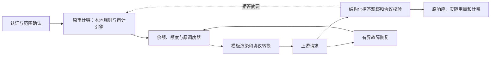

# vm2api 能力移植记录

> 历史实施/审计记录：遥测章节已由用户 2026-10-20 的新要求替代，现行契约见 [账号遥测](ACCOUNT_TELEMETRY.md)。旧采集/样本选择及按上传触发不再是当前行为。

> 以下首次移植和首次交付记录为历史快照。2026-10-20 最新实现、缺副本初始化、共享风控记忆、模板和调度修正，以 [后续完善记录](vm2api-improvements-2026-10-20.md) 和现行 Claude 遥测契约为准。

## 范围与来源

本次将遥测配置、风控、协议转换、提示词模板、调度、故障切换和额度保护纳入现有 Sub2API 实现，归属 KDAN / TapModels / Tokensavy 共享能力。

- 行为研究基准：`dofastted/vm2api@819ee2a7c40b49fe81ebc3823e20373350a20545`（1.3.199）。
- 实施基准：`d8e5f23ca197addc4d941f49d78f377678f333ac`。
- 隔离实施分支：`codex/vm2api-capabilities-20261019`。
- 使用独立 Go / Vue 实现补齐行为，不复制来源受限许可源码、提示词全文或闭源 payload。
- 保留租户隔离、BPS / Excel、Responses 恢复、Fable 独立窗口、原生账务和既有调度器。

## 已接入的能力

| 能力 | 实际行为与入口 |
| --- | --- |
| 遥测配置 | 运维设置 → 高级设置增加 `forward / disabled`。关闭或请求携带 `DNT: 1` / `Sec-GPC: 1` 时，认证后直接 ACK，不读取、解析或存储遥测正文；复用现有两代客户端遥测入口、留存和清理。开启后原文入库，再以会话授权账号的遥测副本替换身份、环境和环境头，并使用该账号凭据、代理发往上游。设置由运行时快照读取。 |
| 风控 | 风险控制页增加蒸馏规则、RE2 正则、精确 / 近似拒答记忆、设备临时限制及审计失败策略。沿用现有开关、pre_block / observe、分组 / 模型范围、白名单和 Jev / OpenAI 审计引擎；count_tokens 也进入现有审计。 |
| 协议转换 | 补齐并行工具索引和独立参数状态、done-only / 终态快照恢复、拒答 / reasoning、重复终态抑制。函数参数必须是完整 JSON 对象；自定义工具保留自由文本。生产转换入口检查错误，保留真实 partial usage，失败不伪造完成、不重放调用。 |
| 提示词模板 | 现有 Claude OAuth system blocks 编辑器增加简洁兼容 / 完整兼容 / 零注入 / 自定义预设、排序、变量、逐块空值控制和缓存 TTL。新增 `{caller_system}` 独占块，原文和缓存标记可保留；显式 `[]` 表示零注入。 |
| 调度 | 原生统一调度器的候选过滤、黏性选号和最终资格复核接入请求额度保护；持有并发槽位后的否决继续走现有释放路径。缓存投影保存最小可信采样证据，不复制 OAuth token。 |
| 故障切换 | HTTP / SSE / WS 使用同一结构化拒答分类；明确内容拒答停止重试和换号，不计账号健康故障、不冷却账号。已提交输出的整轮预算禁止重放，保留原有取消、归属、可移植上下文和有界恢复契约。 |
| 额度保护 | 复用原 5h / 7d 调度与自动暂停阈值，在距停调阈值 5 个百分点以内，拒绝估算输入达到 100,000 tokens 的明确首轮请求；要求同一窗口、同次来源的有效采样，采样小于 5 分钟且未重置。请求级拒绝返回独立 429，不修改账号额度或账务。 |

主链路继续使用原入口：

## 设置与默认行为

复用现有 API：`/api/v1/admin/ops/advanced-settings`、`/api/v1/admin/risk-control/config`、`/api/v1/admin/risk-control/status`、`DELETE /api/v1/admin/risk-control/hashes/all` 和原 `/api/v1/admin/settings`。新增 HTTP 路由 **0**，数据库迁移 **0**，外部依赖 **0**。

新增设置共 **6 个顶层字段、18 个可配置叶字段**，统计包含已有模板块内新增的一个字段：

| 位置 | 字段 | 默认值 / 约束 |
| --- | --- | --- |
| Ops 高级设置 | `client_telemetry_mode` | 默认 `disabled`；开启值为 `forward`。旧 `local` 值不会自动升级为转发。冷启动配置不可读取时暂不采集；刷新失败保留上次有效快照。 |
| 风控 | `failure_policy` | `fail_open`；`fail_closed` 仅在 pre_block 阻止审计引擎故障请求，返回 `503 content_audit_unavailable`，不认定用户违规。 |
| 风控 | `regex_rules` | 默认空；最多 64 条、每条 512 字节，保存时编译 RE2。 |
| 风控 | `distillation.enabled / phrases / patterns / fingerprints / min_max_tokens / min_thinking_tokens / structure_pattern` | 默认关闭；规则列表默认空；两个 token 门槛默认 8192。结构检测需同时满足两个门槛和配置的结构正则。 |
| 风控 | `refusal_guard.enabled / ttl_seconds / max_entries / similarity_threshold` | 默认关闭，3600 秒、1024 条、0.9；最多 4096 条；阈值 1 表示仅精确匹配。 |
| 风控 | `device_guard.enabled / ttl_seconds / max_entries` | 默认关闭，900 秒、1024 条；最多 4096 条。 |
| 原模板块 | `drop_if_empty` | 默认允许空变量块省略；显式 false 时空块校验失败。 |

新增 `{caller_system}` 模板变量 1 个；预设名称由前端转换为现有 blocks JSON，不新增预设配置键。新增风控状态计数字段 2 个。额度保护复用已有阈值配置，没有增加第二套阈值或独立后台任务。

按业务规则类别统计，原链路新增处理分支 **9 类**：遥测退出、蒸馏、正则、拒答记忆、设备限制、审计失败关闭、协议错误终止、零注入模板、临界额度准入。独立网关入口、第二套调度器和 VM 槽位执行框架均为 **0**。

## 行为边界

- 遥测仅处理实际发送到本服务的客户端事件；开启后使用账号独立副本替换身份与环境并向上游发送，保留当前事件 ID、时间和结果。不能控制客户端直接发往供应商的流量，不自动生成成功事件或回放样本库。
- 新拒答 / 设备记忆为**当前进程内**的有界摘要缓存，重启失效，多实例之间不共享。现有清空入口同时清理本实例记忆；共享旧哈希缓存清理失败会明确报错。本地记忆清理不依赖 Redis 可用。
- 拒答学习只接受明确的协议字段，不将普通回复、工具参数中的同名字符串、网络错误或审计服务失败当成内容拒答。白名单不学习；observe 放行。设备来源是未受信任客户端标识，不承担身份认证功能。
- 记忆作用域为认证用户、分组、供应商、公开模型和协议，加上 system / instructions、历史消息、工具定义与工具结果等上下文摘要。上下文相同才比较当前正文，避免“继续”等短句污染另一会话。近似匹配限定 80–12000 字、至少 32 个不同 shingle，图片摘要需一致。
- 额度采样采用原供应商证据：Anthropic 观察绑定凭据摘要，Codex 沿用既有账号身份冲突校验，并独立保存同次窗口利用率 / 重置时间。缺失、过期、跨窗口拼接或无效证据不触发新增保护。
- 历史会话和 `previous_response_id` 不能证明缓存未命中，因此新增大请求保护只作用于明确首轮；输出 token 上限不计为输入。BPS 的额度不与原生 Codex 额度混用，Fable 独立阈值继续保留。
- 模板影响原本需要 OAuth system 注入的入口；原生客户端和 API Key 入口保持既有契约。Fable 保持现有独立身份规则。零注入只改变注入内容，响应和计费仍使用实际 usage。

## 清理和验证

已移除旧设置页内重复维护的提示词文本与编辑逻辑，删除 9 个不再使用的旧翻译键（四语言同步）；并行工具转换共用参数状态，替换原单工具状态。原扩展提示词字段仍被有效模板变量读取，原生协议、缓存清理与账务路径继续使用；没有修改历史迁移或清除生产历史数据。

验证工具链为 Go 1.27.2、Node 24.19.0。测试使用仓库测试夹具和本地 mock；没有连接或部署生产服务。

| 验证 | 结果 |
| --- | --- |
| `go test -tags=unit -json ./...` | 通过：61 个有测试包，13225 个顶层测试通过，99 个按测试条件跳过；无失败。 |
| 风控、拒答反馈、额度、调度缓存、HTTP Handler、WS 重试的定向 `go test -race -tags=unit` | service / handler / repository 均通过。 |
| 协议转换包及生产消费者的定向 unit / race | 通过；覆盖非法参数、晚到 usage、终态和不可重放。 |
| `go vet -tags=unit ./internal/service ./internal/handler/... ./internal/repository ./internal/securityaudit ./internal/pkg/apicompat ./internal/pkg/typesafe` | 通过。 |
| 前端六个相关测试文件 | 105 项通过（设置、模板、风控、遥测设置和四语言完整性）。 |
| `vue-tsc --noEmit -p tsconfig.json`、改动文件 ESLint、`gen-locale.mjs --check` | 通过。 |
| 主站 Vite build、`VITE_VENDOR_PORTAL=true` 构建 | 均通过；有现有大 chunk 提示。 |
| `go build -o /tmp/vm2api-sub2api-server ./cmd/server` | 通过。 |
| 所有改动 Go 文件 gofmt、`git diff --check` | 通过。 |

实际模板组件另以本地 Vite 预览验证过预设切换、缓存控件与 zero 空预览；设置保存回读由模拟管理 API 的组件测试覆盖。

按最终源文件 diff 统计，包含未跟踪的新文件；业务包含后端、前端和语言资源，文档另计：

| 类别 | 文件数 | 新增行 | 删除行 | 净变化 |
| --- | ---: | ---: | ---: | ---: |
| 业务代码 | 84 | 3604 | 1176 | +2428 |
| 测试 | 33 | 2416 | 58 | +2358 |
| 文档 | 3 | 107 | 1 | +106 |

清理属于本次实现：替换旧编辑器和单工具转换状态，不增加废弃实现的并行开关或兼容层。现有扩展提示词、共享哈希缓存及原生协议 / 计费属于仍在调用的有效功能，继续保留。

首次移植完成时仅做本地实现和验证，没有推送、发版、部署或执行生产数据库迁移。

已核对共享品牌归属；首次移植代码同步到主工作区 `main` 时保持未提交。验证在隔离工作区完成，同步后逐文件校验内容一致。后续归并交付见文末。

## 2026-10-20 遥测链路更新

客户端实际上传时，按该会话实际使用账号读取账号遥测，有有效副本才替换身份、环境并发送上游；账号没有保存遥测数据时只去重留存。匿名请求保持 Wei-Shaw 空 200；有效网关 Key 的合法上传在本地去重保存后统一返回空 200，转发失败仅记日志。账号归属按用户 / Key / 分组 / 会话隔离，会话换号时停止该会话转发；多账号批次只跳过没有副本的账号。

当前开关为 `forward / disabled`，默认关闭；旧的仅本地模式、失败后向客户端返回转发错误的分支已经清理。账号副本只用于身份和环境替换，事件事实保留当次上传值，转发不换号或影响推理计费。详细契约见 `CLAUDE_REQUEST_FINGERPRINT.md` 的遥测部分。上文增删统计和全量验收记录属于首次移植快照，本轮增量另行验证与统计。

本轮新增 HTTP 接口 **0**、配置字段 **0**、数据库迁移 **0**。新增内部缓存接口 **1**（读写共 2 个方法），用于认证用户 / Key / 分组隔离的会话账号记录；已有可由客户端选择的 sticky key 不能承担此归属证明。按功能链路计，新增执行路径 **2**：模型请求记录实际账号、客户端上传使用该账号副本转发。未增加定时事件、后台补发、第二套调度或转发状态表。

最终版本验证：后端四个相关包的定向竞态回归共 **55 个顶层测试通过**；前端四个相关文件 **13 项通过**；`go vet`、后端服务器构建、前端类型检查、改动文件 ESLint、繁体同步检查、gofmt 和 `git diff --check` 均通过。覆盖匿名空 200、保存成功但无法转发的空 200、缺副本跳过、跨用户 / Key 隔离、多账号批次、账号认证及代理、上游拒绝和网络失败。测试只使用本地 mock，未向真实供应商发送遥测。

相对首次移植快照的实际增量（含未跟踪新增文件）：

| 类别 | 文件数 | 新增行 | 删除行 | 净变化 |
| --- | ---: | ---: | ---: | ---: |
| 业务代码 | 20 | 446 | 45 | +401 |
| 测试 | 6 | 415 | 25 | +390 |

已清理 `local` 模式及旧提示、`SaveClaudeTelemetry` 入口名称和向客户端暴露转发错误的分支；已有样本去重、账号独立副本和历史迁移继续有效。实现验收时保持本地未提交，随后按下述授权归并交付。

## 2026-10-20 原功能提交归并交付

用户明确要求归入之前相关提交后推送。以 `d8e5f23ca197addc4d941f49d78f377678f333ac` 为共享输入，保留未提交现场、三分支旧 tip 和完整候选树；按实际功能归入以下原有主题，必要的后继本地提交仅重接父链并保留无关内容、原作者和来源署名。

| 原主题提交 | 本轮归入内容 |
| --- | --- |
| `92635cc44` 安全 | 风控规则、拒答记忆、设备限制及审计失败策略 |
| `f578e123c` 账号与调度 | 原调度器额度保护及隔离的会话账号缓存 |
| `3a5a198ad` 恢复 | 明确拒答终止换号、输出后禁止重放及 WS 恢复约束 |
| `ed9c4d24a` BPS | 既有 BPS 转换与拒答处理入口的联动 |
| `24d4779b0` 协议 | 工具参数、并行调用、流终态、拒答及生产转换消费者 |
| `71f603176` Ops | 遥测开关、原文留存接入及独立运行诊断 |
| `a81d2c96d` Claude | 提示词模板、账号遥测替换、空 200 回执与转发 |
| `caf27418b` 客户端 | Claude 使用说明 |
| `f391c3edf` 多语言 | 四语言文案及繁体生成产物 |
| `c57b10824` 装配 | 现有请求入口及设置页的共享接线 |
| `86fe9adad` 需求归档 | 本文的实现、来源与验证记录 |

官方 `060d01604` 基线及 `b0a02a330` 上游合并来源保留原 SHA。归并后 main 的完整文件树必须与候选树一致；TapModels、tokensavy 先以旧 main 为共同基点得到三方合并预期树，再接续原品牌覆盖并核对完整树。发布目标仅为 `holeenlu/sub2api` 的 `main`、`TapModels`、`tokensavy`，使用明确 refspec 和精确旧 SHA 的 lease；不更改版本、正式标签、Release，不发版、部署或迁移生产数据。
